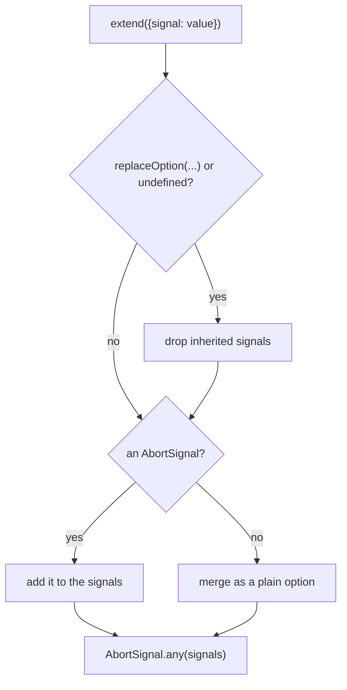

import { UseCaseTerminal } from "/snippets/use-case-terminal.jsx"

<UseCaseTerminal
  services={[
    { cli: "gh", name: "GitHub", logo: "/images/github-logo.svg", invert: true, text: "reads, then comments" },
    { cli: "/repo", name: "Repository", icon: "folder", text: "read-only clone" },
    { cli: "grep", name: "Unix tools", icon: "terminal", text: "grep, sed, awk, jq" },
  ]}
  steps={[
    { cmd: "gh pr view 880 --json title,state …", cli: "gh", out: "MERGED, fixes #879" },
    { cmd: "gh issue view 879 --json body --jq .body | grep null", cli: "gh", out: "null should reset too" },
    { cmd: "gh pr checks 880 … | sort | uniq -c", cli: "gh", out: "6 pass" },
    { cmd: "sed -n 312,317p source/utils/merge.ts", cli: "/repo", out: "null passes neither check" },
    { cmd: "gh pr diff 880 | grep \"^+test(\"", cli: "grep", out: "3 tests, none for null" },
    { cmd: "gh pr comment 880 --body-file /workspace/review.md", cli: "gh", out: "the review is on the pull request" },
  ]}
/>

When a pull request opens, an agent reviews it the way a teammate would. It
reads the pull request and the issue it fixes, looks at the code around the
change, checks the tests and CI, and posts a review comment on the pull request
with a confidence score, a diagram of the change, and notes on the lines that
need one.

A review is reads and writes over scattered context, a pull request, its
issue, CI and the code around the change, and that is the work Mirage is
built for. The agent reaches all of it from one terminal, with fewer tokens
than calling the same services as MCP tools
([VFS-Bench 1.0](https://agentvfs.org/benchmark/vfs-bench-1)). It is also a
task with clear boundaries, one repository to read and one pull request to
comment on, so a managed terminal suits it best. Here it runs as an
[in-process terminal](/home/examples/in-process-terminal) on a Mirage
server, without a VM or sandbox.

## Setup

- **Files:** `/repo`, a clone of the repository in [memory](/home/setup/ram),
  cloned once and shared by every review, and
  `/workspace`, in memory, for the review the agent writes.
- **CLIs:** [`gh`](/python/cli/gh) calls GitHub's API with a token the server
  holds, and [`git`](/python/cli/git) clones the repository with no `git`
  program on the host.
- **Policy:** a [session profile](/home/configuration/session) in
  `workspace.yaml` makes `/repo` read-only for the agent and lets it run only
  the commands a review needs. It can comment on a pull request, never merge
  or change one.

You need the `mirage` CLI and a GitHub token that can read public
repositories, `GITHUB_TOKEN`. [GitHub](/home/setup/github) says how to create
one.

<AccordionGroup>
  <Accordion title="Installation">
    <Tabs>
      <Tab title="pip" icon="/images/python-logo.svg">
        ```bash
        pip install mirage-ai
        ```
      </Tab>
      <Tab title="npm" icon="/images/typescript-logo.svg">
        ```bash
        npm install -g @struktoai/mirage-cli
        ```
      </Tab>
    </Tabs>
  </Accordion>
  <Accordion title="workspace.yaml">
    `workspace.yaml` mounts `/repo` and `/workspace` in memory, installs `gh` and
    `git`, and defines the `reviewer` profile every agent terminal gets:

    ```yaml workspace.yaml
    mounts:
      /repo:
        vfs: ram
        mode: write
      /workspace:
        vfs: ram
        mode: write

    clis:
      gh:
        cli: gh
        machine: in_process
        config:
          token: {from: env, key: GITHUB_TOKEN}
          repo: sindresorhus/ky
      git:
        cli: git
        machine: in_process

    profiles:
      reviewer:
        cwd: /repo
        mounts:
          /repo:
            mode: read
        commands:
          allow: [cd, pwd, echo, ls, cat, head, tail, grep, sed, awk, wc, sort, uniq, find, jq, git, gh pr view, gh pr diff, gh pr checks, gh issue view, gh pr comment]
    ```

    - `mounts` in the profile makes `/repo` read-only for the agent. The clone
      below runs in the default session, which has no profile.
    - `commands.allow` is the whole list of what the agent can run. `rm`, `mv`
      and `curl` are not on it. Of `gh`, it has the four commands that read a
      pull request, its issue and CI, and `gh pr comment` to post the review.
      `gh pr merge`, `gh pr edit` and `gh api` are refused.
  </Accordion>
</AccordionGroup>

Create the workspace, clone ky into `/repo` at the commit pull request 880
merged as, and open a terminal for the agent under the `reviewer` profile:

```bash
export GITHUB_TOKEN=<your token>
mirage workspace create workspace.yaml --id review
export MIRAGE_WORKSPACE=review
mirage shell -c 'git clone -q https://github.com/sindresorhus/ky.git /repo && git -C /repo checkout -q --detach 0bda554d448c1b57c17a5c18114432c02465d467'
mirage workspace session create -s agent -p reviewer
```

The local server reads `GITHUB_TOKEN` when it starts. If it was already
running, run `mirage daemon restart` after the export. To review your own
repository, change the clone's URL and commit, and the `repo` of `gh` in
`workspace.yaml`.

## Example

The agent reviews
[pull request 880](https://github.com/sindresorhus/ky/pull/880) of
[ky](https://github.com/sindresorhus/ky), which fixes how `ky.extend()`
replaces an `AbortSignal`. Each command runs in its terminal, the `agent`
session, which starts in `/repo`.

### 1. Read the pull request with `gh`

`gh` reads the pull request, the issue it fixes and CI, with the token the
server holds:

```bash
mirage shell -s agent -c 'gh pr view 880 --json title,state,closingIssuesReferences --jq ".title, .state, .closingIssuesReferences[0].number"'
mirage shell -s agent -c 'gh issue view 879 --json body --jq .body | grep null'
mirage shell -s agent -c 'gh pr checks 880 --json bucket --jq ".[].bucket" | sort | uniq -c'
```

```text
Fix `signal` replacement when extending instances
MERGED
879
Similarly, passing `{signal: undefined}` or `{signal: null}` in `.extend()` does not remove parent signals from being combined via `AbortSignal.any()`.
Unwrap `replaceState` before the `key === 'signal'` branch and handle `isReplace` / `undefined` / `null` to reset the accumulated `signals` array.
      6 pass
```

### 2. Read the code with Unix tools

`sed` and `grep` read the clone in `/repo` and the diff, like files on disk:

```bash
mirage shell -s agent -c 'sed -n 312,317p source/utils/merge.ts'
mirage shell -s agent -c 'gh pr diff 880 | grep "^+test("'
```

```text
	if (signals.length > 0) {
		if (signals.length === 1) {
			returnValue.signal = signals[0];
		} else if (supportsAbortSignal) {
			returnValue.signal = AbortSignal.any(signals);
		} else {
+test('ky.extend() with replaceOption replaces signal instead of merging', async t => {
+test('ky.extend() with signal set to undefined removes parent signal', async t => {
+test('signal option handling does not affect nested JSON properties', async t => {
```

The fix resets the signals on a `replaceOption` or `undefined`. The issue
names `null` too, but a `null` still keeps the parent's signal, and no test
covers it.

### 3. Write and post the review

The agent writes the review to `/workspace` and posts it with
`gh pr comment`, the one write its profile allows:

````bash
mirage shell -s agent -c 'cat > /workspace/review.md' <<'MD'
## Confidence score: 4/5

Safe to merge. `replaceOption(signal)` and `signal: undefined` now drop the
signals an instance inherits. One gap: `signal: null`, which #879 also
names, still keeps them.



**P2, `source/utils/merge.ts:228`:** clear the signals on `null` too, and
add a test.
MD
mirage shell -s agent -c 'gh pr comment 880 --body-file /workspace/review.md'
````

### 4. What the profile refuses

The profile is checked before each command, and the mount mode on every
write:

```bash
mirage shell -s agent -c 'rm -rf /repo/source'
mirage shell -s agent -c 'echo hi >> /repo/readme.md'
mirage shell -s agent -c 'gh pr merge 880'
mirage shell -s agent -c 'curl https://example.com'
```

```text
rm: Permission denied
policy denied: rm is not allowed
bash: line 1: /repo/readme.md: Read-only file system
gh: Permission denied
policy denied: gh pr merge is not allowed
curl: Permission denied
policy denied: curl is not allowed
```

See [Session Profiles](/home/configuration/session) for the rules a profile
takes, and [Policy](/home/policy/overview) for checks a list cannot express.
