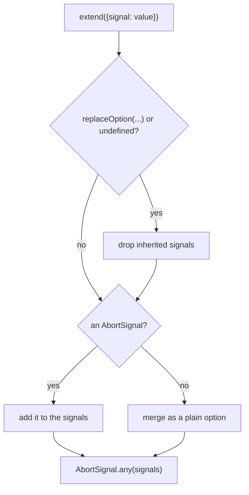

import { UseCaseTerminal } from "/snippets/use-case-terminal.jsx"

<UseCaseTerminal
  services={[
    { cli: "gh", name: "GitHub", text: "reads the pull request, its issue and CI" },
    { cli: "/repo", name: "The repository", text: "cloned into memory at start, read-only" },
    { cli: "jq", name: "The review", text: "a score, a diagram and line comments as JSON", dir: "out" },
  ]}
  steps={[
    { cmd: "gh pr view 880 --json title,state,changedFiles …", cli: "gh", out: "MERGED: 4 files, +79 -7, fixes #879" },
    { cmd: "gh issue view 879 --json title,body …", cli: "gh", out: "undefined and null should both reset" },
    { cmd: "gh pr diff 880 | awk …", cli: "gh", out: "the change to source/utils/merge.ts" },
    { cmd: "sed -n 222,237p source/utils/merge.ts", cli: "/repo", out: "null passes neither check" },
    { cmd: "gh pr checks 880 --json bucket …", cli: "gh", out: "6 pass" },
    { cmd: "jq -n --rawfile body /workspace/review.md … > /workspace/review.json", cli: "jq", out: "1 comment on merge.ts:228" },
  ]}
  extras={[
    { text: "/workspace in memory" },
    { text: "profile: reviewer" },
  ]}
/>

An agent reviews a pull request. It reads what changed and why, reads the
code around the change, checks the tests and CI, and writes a review: a
confidence score, a diagram of the change, and comments on the lines that
need one. A webhook can start it for each new pull request.

A job this small needs no VM or sandbox. It runs in an
[in-process terminal](/home/examples/in-process-terminal) inside one
FastAPI or Express server:

- **Files:** `/repo`, a clone of the repository in [memory](/home/setup/ram),
  made once when the server starts and shared by every review, and
  `/workspace`, in memory, for the review the agent writes.
- **CLIs:** [`gh`](/python/cli/gh) calls GitHub's API with a token the server
  holds, and [`git`](/python/cli/git) clones the repository with no `git`
  program on the host.
- **Policy:** a [session profile](/home/configuration/session) in
  `workspace.yaml` makes `/repo` read-only for the agent and lets it run only
  the commands a review needs. The agent writes the review; the server, not
  the agent, posts it.

The commands below are what the agent runs in its terminal, on
[pull request 880](https://github.com/sindresorhus/ky/pull/880) of
[ky](https://github.com/sindresorhus/ky), a small HTTP client. It fixes how
`ky.extend()` replaces an `AbortSignal` the parent instance set. The whole
repository is 3.5 MB, and the clone takes a few seconds.

## Installation

<Tabs>
  <Tab title="FastAPI" icon="/images/python-logo.svg">
    ```bash
    pip install mirage-ai fastapi uvicorn
    ```
  </Tab>
  <Tab title="Express" icon="/images/typescript-logo.svg">
    ```bash
    npm install @struktoai/mirage-node express
    ```
  </Tab>
</Tabs>

## Workspace

`workspace.yaml` mounts `/repo` and `/workspace` in memory, installs `gh` and
`git`, and defines the `reviewer` profile every agent terminal gets:

```yaml workspace.yaml
mounts:
  /repo:
    vfs: ram
    mode: write
  /workspace:
    vfs: ram
    mode: write

clis:
  gh:
    cli: gh
    machine: in_process
    config:
      token: {from: env, key: GITHUB_TOKEN}
      repo: sindresorhus/ky
  git:
    cli: git
    machine: in_process

profiles:
  reviewer:
    cwd: /repo
    mounts:
      /repo:
        mode: read
    commands:
      allow: [cd, pwd, echo, ls, cat, head, tail, grep, sed, awk, wc, sort, uniq, find, jq, git, gh pr view, gh pr diff, gh pr checks, gh issue view]
```

- `mounts` in the profile makes `/repo` read-only for the agent. The server
  clones into it from its own session, which has no profile.
- `commands.allow` is the whole list of what the agent can run. `rm`, `mv`
  and `curl` are not on it, and of `gh` only the four commands that read a
  pull request, its issue and CI. `gh pr merge`, `gh pr comment` and `gh api`
  are refused, so the agent cannot post or change anything on GitHub.

## Server

This is the server from the
[Overview](/home/examples/in-process-terminal#simple-server) with three
changes: it builds the workspace from `workspace.yaml`, clones the repository
into `/repo` when it starts, and creates each terminal under the `reviewer`
profile. A fourth route posts a finished review. The clone is pinned to the
commit pull request 880 merged as, so `/repo` holds the code as merged.

Before you start the server, set `GITHUB_TOKEN` to a token that can read
public repositories. [GitHub](/home/setup/github) says how to create one. To
post reviews on your own repository, the token also needs write access to its
pull requests.

<Tabs>
  <Tab title="FastAPI" icon="/images/python-logo.svg">
    ```python app.py
    from contextlib import asynccontextmanager

    from fastapi import FastAPI
    from pydantic import BaseModel

    from mirage import Workspace
    from mirage.config import load_config, resolve_secrets

    REPO = "https://github.com/sindresorhus/ky.git"
    REF = "0bda554d448c1b57c17a5c18114432c02465d467"
    ws: Workspace


    @asynccontextmanager
    async def lifespan(app: FastAPI):
        global ws
        config = await resolve_secrets(load_config("workspace.yaml"))
        ws = Workspace(**config.to_workspace_kwargs())
        ws.create_session("server")
        r = await ws.shell(f"git clone -q {REPO} /repo && git -C /repo checkout -q --detach {REF}", session_id="server")
        if r.exit_code != 0:
            raise RuntimeError(await r.stderr_str())
        yield
        await ws.close()


    app = FastAPI(lifespan=lifespan)


    class Run(BaseModel):
        command: str


    @app.post("/sessions/{session_id}")
    async def create(session_id: str) -> None:
        ws.create_session(session_id, profile="reviewer")


    @app.post("/sessions/{session_id}/run")
    async def run(session_id: str, body: Run) -> dict:
        r = await ws.shell(body.command, session_id=session_id)
        return {"stdout": await r.stdout_str(), "stderr": await r.stderr_str(), "exit_code": r.exit_code}


    @app.post("/pulls/{number}/review")
    async def post_review(number: int) -> dict:
        r = await ws.shell(
            f"gh api repos/sindresorhus/ky/pulls/{number}/reviews --input /workspace/review.json --jq .html_url",
            session_id="server",
        )
        return {"stdout": await r.stdout_str(), "stderr": await r.stderr_str(), "exit_code": r.exit_code}
    ```

    ```bash
    uvicorn app:app --port 3000
    ```
  </Tab>
  <Tab title="Express" icon="/images/typescript-logo.svg">
    ```typescript app.mjs
    import express from 'express'
    import { Workspace, configToWorkspaceArgs, loadWorkspaceConfigFile } from '@struktoai/mirage-node'

    const REPO = 'https://github.com/sindresorhus/ky.git'
    const REF = '0bda554d448c1b57c17a5c18114432c02465d467'

    const { mounts, options } = await configToWorkspaceArgs(loadWorkspaceConfigFile('workspace.yaml'))
    const ws = new Workspace(mounts, options)
    ws.createSession('server')
    const cloned = await ws.shell(`git clone -q ${REPO} /repo && git -C /repo checkout -q --detach ${REF}`, {
      sessionId: 'server',
    })
    if (cloned.exitCode !== 0) throw new Error(cloned.stderrText)

    const app = express()
    app.use(express.json())

    app.post('/sessions/:id', (req, res) => {
      ws.createSession(req.params.id, { profile: 'reviewer' })
      res.sendStatus(201)
    })

    app.post('/sessions/:id/run', async (req, res) => {
      const r = await ws.shell(req.body.command, { sessionId: req.params.id })
      res.json({ stdout: r.stdoutText, stderr: r.stderrText, exitCode: r.exitCode })
    })

    app.post('/pulls/:number/review', async (req, res) => {
      const r = await ws.shell(
        `gh api repos/sindresorhus/ky/pulls/${Number(req.params.number)}/reviews --input /workspace/review.json --jq .html_url`,
        { sessionId: 'server' },
      )
      res.json({ stdout: r.stdoutText, stderr: r.stderrText, exitCode: r.exitCode })
    })

    app.listen(3000, '127.0.0.1')
    ```

    ```bash
    node app.mjs
    ```
  </Tab>
</Tabs>

To review your own repository, change `REPO` and `REF`, the `repo` of `gh`
in `workspace.yaml`, and the path in the last route.

## Usage

Create a terminal, and define `run`, which sends commands to it and prints
what they print. It needs [`jq`](https://jqlang.org):

```bash
curl -X POST localhost:3000/sessions/a

run() {
  jq -Rs '{command: .}' |
    curl -s localhost:3000/sessions/a/run -H 'content-type: application/json' -d @- |
    jq -j '.stdout, .stderr'
}
```

The commands between `SH` and `SH` in the blocks below run in the terminal
on the server, not in the shell that calls `run`. The terminal starts in
`/repo`, on the commit the server checked out:

```bash
run <<'SH'
pwd
git log --oneline -1
SH
```

```text
/repo
0bda554 Fix `signal` replacement when extending instances (#880)
```

## 1. Read the pull request

First the agent reads what the pull request is, which files it touches, and
the issue it closes:

```bash
run <<'SH'
gh pr view 880 --json title,state,changedFiles,additions,deletions,closingIssuesReferences \
  --jq '"\(.title)\n\(.state): \(.changedFiles) files, +\(.additions) -\(.deletions), fixes #\(.closingIssuesReferences[0].number)"'
gh pr diff 880 --name-only
SH
```

```text
Fix `signal` replacement when extending instances
MERGED: 4 files, +79 -7, fixes #879
readme.md
source/types/ky.ts
source/utils/merge.ts
test/main.ts
```

The issue says what the fix has to do. The agent prints its title and the
lines that name `null`:

```bash
run <<'SH'
gh issue view 879 --json title,body --jq '.title, (.body | split("\n") | map(select(test("null"))) | .[])'
SH
```

```text
Bug: `replaceOption` and `undefined` do not work with `signal` option in `ky.extend()`
Similarly, passing `{signal: undefined}` or `{signal: null}` in `.extend()` does not remove parent signals from being combined via `AbortSignal.any()`.
Unwrap `replaceState` before the `key === 'signal'` branch and handle `isReplace` / `undefined` / `null` to reset the accumulated `signals` array.
```

The fix has to reset the parent's signals for three values: a
`replaceOption`, `undefined` and `null`. The agent reads the part of the diff
in `source/`. `awk` prints from each matching file's `diff --git` line to
the next one:

```bash
run <<'SH'
gh pr diff 880 | awk '/^diff --git/ {show = /source\/utils/} show'
SH
```

```text
diff --git a/source/utils/merge.ts b/source/utils/merge.ts
index aa046c40..922f0175 100644
--- a/source/utils/merge.ts
+++ b/source/utils/merge.ts
@@ -220,16 +220,21 @@ const deepMergeInternal = <T>(isRoot: boolean, ...sources: Array<Partial<T> | un
 			returnValue = [...returnValue, ...source];
 		} else if (isObject(source)) {
 			for (let [key, value] of Object.entries(source)) {
-				// Special handling for AbortSignal instances
-				if (key === 'signal' && value instanceof globalThis.AbortSignal) {
-					signals.push(value);
-					continue;
-				}
-
 				const replaceState = getReplaceState(value);
 				const {isReplace} = replaceState;
 				value = replaceState.value;

+				const isRootSignal = isRoot && key === 'signal';
+				if (isRootSignal && (isReplace || value === undefined)) {
+					signals.length = 0;
+				}
+
+				// Special handling for AbortSignal instances at the root options level
+				if (isRootSignal && value instanceof globalThis.AbortSignal) {
+					signals.push(value);
+					continue;
+				}
+
 				// Special handling for context - shallow merge only
 				if (key === 'context') {
 					if (value !== undefined && value !== null && (!isObject(value) || Array.isArray(value))) {
@@ -312,7 +317,7 @@ const deepMergeInternal = <T>(isRoot: boolean, ...sources: Array<Partial<T> | un
 		} else {
 			// When AbortSignal.any is not available, use the last signal
 			// This maintains the previous behavior before signal merging was added
-			// This can be remove when the `supportsAbortSignal` check is removed.`
+			// This can be removed when the `supportsAbortSignal` check is removed.
 			returnValue.signal = signals.at(-1);
 		}
 	}
```

The new check resets the signals on a `replaceOption` or `undefined`, but
not on `null`.

## 2. Read the code around it

A diff shows only the lines that changed. To know what a `null` does next,
the agent reads the rest of the function in `/repo`: how the signals it
collected become the request's signal.

```bash
run <<'SH'
sed -n 312,317p source/utils/merge.ts
grep -n "interface Options" source/types/options.ts
SH
```

```text
	if (signals.length > 0) {
		if (signals.length === 1) {
			returnValue.signal = signals[0];
		} else if (supportsAbortSignal) {
			returnValue.signal = AbortSignal.any(signals);
		} else {
405:export interface Options extends KyOptions, Omit<RequestInit, 'headers'> { // eslint-disable-line @typescript-eslint/consistent-type-definitions -- This must stay an interface so that it can be extended outside of Ky for use in `ky.create`.
```

`Options` takes `signal` from `RequestInit`, where it is
`AbortSignal | null`, so `extend({signal: null})` type-checks. A `null`
passes neither of the two new checks, the parent's signal stays in
`signals`, and the code above sets it again as the request's signal. Last,
the agent lists the tests the change adds and reads the result of CI:

```bash
run <<'SH'
gh pr diff 880 | grep -E "^\+test\("
gh pr checks 880 --json bucket --jq 'map(.bucket) | group_by(.) | map("\(length) \(.[0])") | join(", ")'
SH
```

```text
+test('ky.extend() with replaceOption replaces signal instead of merging', async t => {
+test('ky.extend() with signal set to undefined removes parent signal', async t => {
+test('signal option handling does not affect nested JSON properties', async t => {
6 pass
```

Three tests, for a `replaceOption`, `undefined` and a nested `signal`; none
for `null`. CI passed.

## 3. Write the review

The agent writes the review in two files: the summary, with its score, a
diagram and a table of the files, and one comment on the line that needs it:

````bash
run <<'SH'
cat > /workspace/review.md <<'MD'
## Confidence score: 4/5

Safe to merge. `replaceOption(signal)` and `signal: undefined` now drop the
signals an instance inherits, and nested `json: {signal}` is left alone. One
gap: `signal: null`, which issue #879 also names, still keeps them.



| File | Change |
| --- | --- |
| `source/utils/merge.ts` | Clears inherited signals on replace or `undefined`, root level only |
| `source/types/ky.ts`, `readme.md` | Document the two ways to replace or remove a signal |
| `test/main.ts` | Three tests: replace, `undefined`, nested `json` |
MD
cat > /workspace/comment.md <<'MD'
**P2:** `signal: null` keeps the inherited signals. `Options` takes the
`signal` of `RequestInit`, which is `AbortSignal | null`, and #879 names
`null` as well. A `null` passes neither check above, so the parent's signal
is still combined. Clear the signals on `null` too, and add a test.
MD
SH
````

Then it puts both into the body of GitHub's
[create a review](https://docs.github.com/en/rest/pulls/reviews#create-a-review-for-a-pull-request)
request. A line comment names the file and the line on the new side of the
diff, and the commit it was written against:

```bash
run <<'SH'
jq -n --rawfile body /workspace/review.md --rawfile comment /workspace/comment.md \
  --arg sha "$(gh pr view 880 --json headRefOid --jq .headRefOid)" '{
    commit_id: $sha,
    event: "COMMENT",
    body: $body,
    comments: [{path: "source/utils/merge.ts", line: 228, side: "RIGHT", body: $comment}]
  }' > /workspace/review.json
jq '{commit_id, event, comments: (.comments | map("\(.path):\(.line)"))}' /workspace/review.json
SH
```

```json
{
  "commit_id": "e22943f7dacf64beec1efb1958604424f07dd4b4",
  "event": "COMMENT",
  "comments": [
    "source/utils/merge.ts:228"
  ]
}
```

To get there the agent read about 3 KB of output, and nothing left the
server but calls to GitHub's API.

## 4. Post the review

The agent cannot post: its profile refuses `gh api`. The server posts the
file once the review is written, from its own session:

```bash
curl -X POST localhost:3000/pulls/880/review
```

`stdout` holds the review's URL. GitHub shows the summary, with the diagram
rendered, at the top of the pull request, and the comment on line 228 of
`source/utils/merge.ts`. A server that takes a webhook calls this route after
the agent's last command; one that keeps a person in the loop shows
`/workspace/review.json` to them first.

## 5. What the profile refuses

The `reviewer` profile is checked before each command runs, and the mount
mode on every write:

```bash
run <<'SH'
rm -rf /repo/source
echo hi >> /repo/readme.md
git commit --allow-empty -m test
gh pr merge 880
curl https://example.com
SH
```

```text
rm: Permission denied
bash: line 2: /repo/readme.md: Read-only file system
fatal: Unable to create '/repo/.git/index.lock': Read-only file system
gh: Permission denied
curl: Permission denied
```

Every terminal reads the same clone, and none of them can change it, so a
review never sees another review's edits. See
[Session Profiles](/home/configuration/session) for the rules a profile
takes, and [Policy](/home/policy/overview) for checks a list cannot express.
