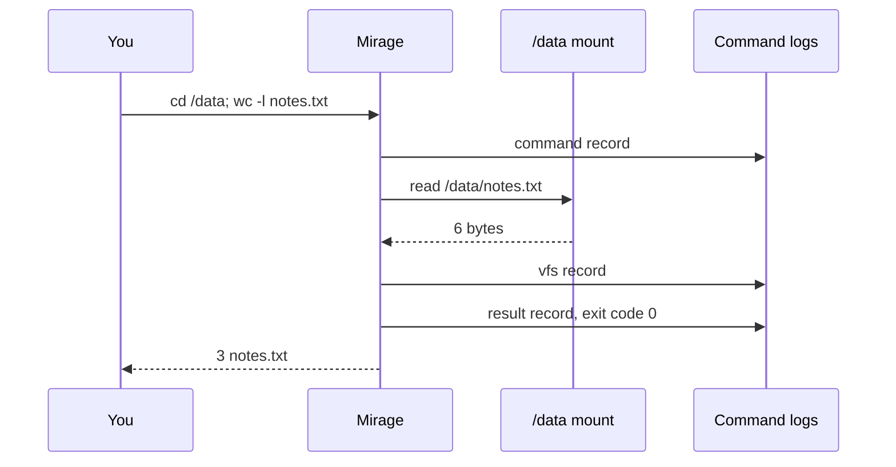
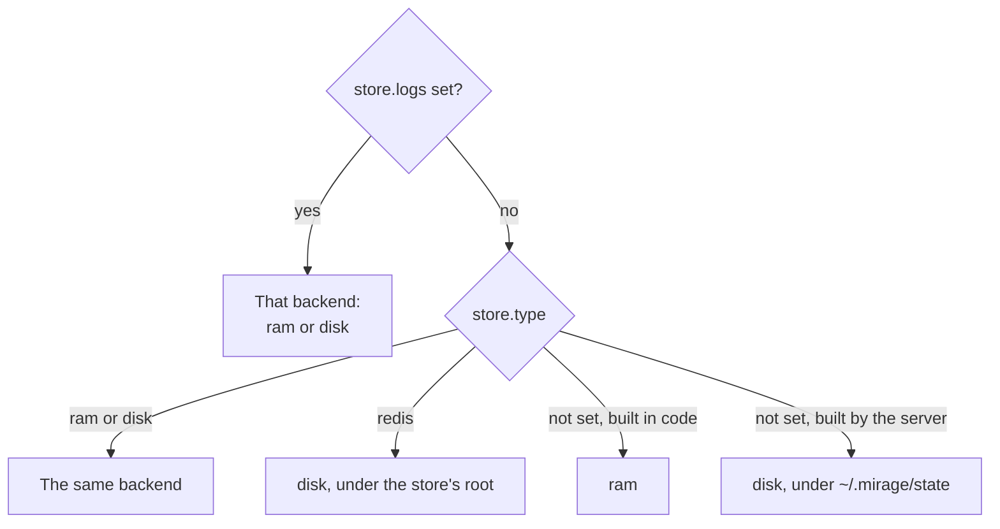

Mirage logs every command a session runs. Each entry holds the command, its
exit code, the first 4096 characters of its stdout and stderr, and every call
the command made to a mount.

<div className="not-prose my-6 flex flex-col gap-3 text-sm md:flex-row md:items-center">
  <div className="rounded-lg border border-zinc-200 px-4 py-3 text-center text-zinc-700 dark:border-zinc-800 dark:text-zinc-300">
    A session runs a line
  </div>
  <div className="text-center text-zinc-400"><span className="md:hidden">↓</span><span className="hidden md:inline">→</span></div>
  <div className="rounded-lg border-2 border-primary px-4 py-3 text-center dark:border-primary-light">
    <div className="font-semibold text-zinc-900 dark:text-zinc-100">Command logs</div>
    <div className="text-xs text-zinc-500">in memory or on disk</div>
  </div>
  <div className="text-center text-zinc-400"><span className="md:hidden">↓</span><span className="hidden md:inline">→</span></div>
  <div className="flex flex-1 flex-col gap-2">
    <div className="text-xs font-medium uppercase tracking-wide text-zinc-500">Read them with</div>
    <code className="rounded-md border border-zinc-200 px-3 py-1.5 dark:border-zinc-800">history</code>
    <code className="rounded-md border border-zinc-200 px-3 py-1.5 dark:border-zinc-800">/.bash_history</code>
    <code className="rounded-md border border-zinc-200 px-3 py-1.5 dark:border-zinc-800">mirage workspace logs</code>
    <code className="rounded-md border border-zinc-200 px-3 py-1.5 dark:border-zinc-800">ws.history()</code>
  </div>
</div>

With an OpenTelemetry SDK set up, Mirage also sends each line out as a
[trace](/home/infrastructure/tracing). [Logs and traces](#logs-and-traces)
compares the two.

## Reading logs

| Where | What it returns |
| --- | --- |
| <code style={{ whiteSpace: 'nowrap' }}>{'history'}</code> | The session's newest 500 commands, as bash's `history` lists them. |
| <code style={{ whiteSpace: 'nowrap' }}>{'/.bash_history'}</code> | The session's newest 10,000 commands, as a file. [Policies](/home/policy/policies) read the logs from this file. |
| <code style={{ whiteSpace: 'nowrap' }}>{'mirage workspace logs'}</code> | Finished commands, newest first, one page at a time. <code style={{ whiteSpace: 'nowrap' }}>--jsonl</code> exports every kept command, oldest first. See the [CLI reference](/home/access/cli). |
| <code style={{ whiteSpace: 'nowrap' }}>{'GET /v1/workspaces/{id}/logs'}</code> | The same pages over HTTP. See [List workspace logs](/api/operations/workspaces/list-workspace-logs). |
| <code style={{ whiteSpace: 'nowrap' }}>{'ws.history()'}</code> | Raw entries from every session, at most the newest 10,000. A command has a `command` entry when it starts and a `result` entry with its exit code, stdout and stderr when it ends. With `vfs=True`, the list also has a `vfs` entry for each mount call. |

`mirage shell --no-record` runs a line without logging it.

## Example

Run three lines in a workspace that mounts a RAM folder at `/data`.

```bash
mirage shell -w demo -c "printf 'a\nb\nc\n' > /data/notes.txt"
mirage shell -w demo -c "cd /data; wc -l notes.txt"
mirage shell -w demo -c "cat /data/missing.txt"
```

While the second line runs, Mirage writes three records for it:



`mirage workspace logs -w demo` lists the lines newest first. This is the entry
for the second line. `mounts` lists the read that `wc` made, and `cwd` is
where the line started.

```json
{
  "id": "line_01a1c8b8-57d8-701f-b424-d3171972060c",
  "command": "cd /data; wc -l notes.txt",
  "cwd": "/",
  "started_at": 1794368886744.0,
  "duration_ms": 11.0,
  "exit_code": 0,
  "stdout": "3 notes.txt\n",
  "stderr": "",
  "user_id": null,
  "api_key_id": null,
  "mounts": [
    {
      "op": "read",
      "path": "/data/notes.txt",
      "source": "ram",
      "bytes": 6,
      "started_at": 1794368886747.0,
      "duration_ms": 0.0
    }
  ]
}
```

The failed `cat` has its own entry with `"exit_code": 1` and the error in
`stderr`.

`mirage workspace logs -w demo --jsonl` and `ws.history(vfs=True)` return the
same line as three records, linked by `parent`:

```json
{"type":"command","session":"01a1c8b8-5529-706b-a504-9e63c747c032","timestamp":1794368886744,"cwd":"/","id":"line_01a1c8b8-57d8-701f-b424-d3171972060c","command":"cd /data; wc -l notes.txt"}
{"type":"vfs","session":"01a1c8b8-5529-706b-a504-9e63c747c032","timestamp":1794368886747,"cwd":"/data","parent":"line_01a1c8b8-57d8-701f-b424-d3171972060c","vfs":"read","path":"/data/notes.txt","source":"ram","bytes":6,"duration_ms":0}
{"type":"result","session":"01a1c8b8-5529-706b-a504-9e63c747c032","timestamp":1794368886755,"cwd":"/data","parent":"line_01a1c8b8-57d8-701f-b424-d3171972060c","duration_ms":11,"exit_code":0,"stdout":"3 notes.txt\n","stderr":""}
```

## Log entries

Mirage splits input into entries the same way bash does.

| Input | Mirage logs |
| --- | --- |
| <code style={{ whiteSpace: 'nowrap' }}>cd /data; wc -l notes.txt</code> | One entry, with the output of both commands. |
| <code style={{ whiteSpace: 'pre' }}>{'echo x\necho y'}</code> | Two entries, `echo x` and `echo y`. |
| <code style={{ whiteSpace: 'pre' }}>{'echo p\nexit 2\necho q'}</code> | Two entries, `echo p` and `exit 2`. `echo q` never runs, so Mirage does not log it. |
| <code style={{ whiteSpace: 'pre' }}>{'for f in a b\ndo\n  echo $f\ndone'}</code> | One entry. In an interactive terminal, Mirage joins the lines as bash does, into `for f in a b; do echo $f; done`. |
| <code style={{ whiteSpace: 'pre' }}>{'cat <<EOF\nhello\nEOF'}</code> | One entry that keeps the heredoc body. |
| <code style={{ whiteSpace: 'pre' }}>{'mirage shell --no-record \\\n  -c "echo hidden"'}</code> | No entry. |

A `set -e` failure stops a line the same way `exit` does. If a
`post_execute` [policy](/home/policy/policies) checks a line, Mirage writes
the entry after the policy answers. Output that the policy drops never
reaches the logs.

## Log storage

A workspace you build in code keeps its logs in memory. A workspace the server
builds keeps them on disk under `~/.mirage/state`. Logs grow with every
command, so `store.logs` moves them without moving the rest of the
workspace state.



| `type` | Storage | Options |
| --- | --- | --- |
| `ram` | The process memory, up to 8 MB. Mirage drops the oldest entries first, and the logs end when the process exits. | None |
| `disk` | Files under `root`. | `root`, default `~/.mirage/state` |

Redis does not hold logs. With `store.type: redis`, Mirage writes the logs to
disk under the store's `root`, unless `store.logs` names another backend.
To collect logs from several machines in one place, export them as
[traces](/home/infrastructure/tracing).

This config keeps the rest of the workspace state on Redis and the logs on
local disk.

<Tabs>
  <Tab title="YAML" icon="file-code">
    ```yaml
    workspace_id: agent
    store:
      type: redis
      url: redis://redis.internal:6379/0
      logs:
        type: disk
        root: /var/lib/mirage
    ```
  </Tab>
  <Tab title="Python" icon="/images/python-logo.svg">
    ```python
    from mirage import Workspace
    from mirage.workspace.store import DiskWorkspaceStateStore, RedisWorkspaceStateStore

    store = RedisWorkspaceStateStore(
        url="redis://redis.internal:6379/0",
        logs=DiskWorkspaceStateStore(root="/var/lib/mirage"),
    )
    ws = Workspace(mounts, workspace_id="agent", store=store, owns_store=True)
    ```
  </Tab>
  <Tab title="TypeScript" icon="/images/typescript-logo.svg">
    ```typescript
    import { DiskWorkspaceStateStore, RedisWorkspaceStateStore, Workspace } from '@struktoai/mirage-node'

    const store = new RedisWorkspaceStateStore({
      url: 'redis://redis.internal:6379/0',
      logs: new DiskWorkspaceStateStore({ root: '/var/lib/mirage' }),
    })
    const ws = new Workspace(mounts, { workspaceId: 'agent', store, ownsStore: true })
    ```
  </Tab>
</Tabs>

## Logs and traces

Mirage keeps command logs itself and serves them back to you, to the agent
and to policies. [Traces](/home/infrastructure/tracing) carry the same
activity out to an OpenTelemetry backend, and Mirage keeps no copy of them.

| | Command logs | Traces |
| --- | --- | --- |
| Where they live | In Mirage, in memory or on disk | In your OpenTelemetry backend, such as Datadog, Honeycomb or Grafana |
| Default | On | Off until your process sets up an OpenTelemetry SDK |
| How to read them | `history`, `/.bash_history`, `mirage workspace logs`, the logs API and `ws.history()` | Your tracing tool |
| Output kept | The first 4096 characters of stdout and stderr | The first 16 KiB of each by default |
| Mount calls | Every call | At most 1000 a line by default |
| Jobs and processes | Only the command that started them | A `job` or `process` span for each |
| Several machines | Each machine keeps its own | All machines send to one backend |

Use command logs when the agent, a policy or you need to look back at what a
workspace ran. Use traces to watch many machines in one place, with your
tool's search, retention and alerts.

## Restarts

Each log belongs to a session. A rebuilt workspace shows a session's logs
only after it has that session again. To keep logs across a restart, do one
of these.

- Keep the [sessions](/home/infrastructure/sessions) on a store that
  survives a restart.
- Give the default session a fixed id with `default_session_id`.
