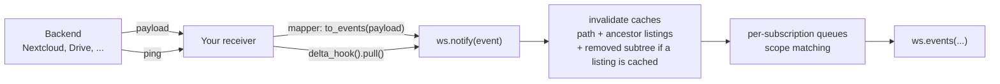

## How it works

Files on a mounted backend change outside your workspace all the time: a
teammate uploads to Nextcloud, a pipeline rewrites an S3 object, a cron job
deletes a report. Mirage turns those external changes into notifications about
files and directories in the virtual filesystem. Agents subscribe with
`ws.events()` and react to changes as they arrive.

<CodeGroup>

```python Python
from mirage import Workspace
from mirage.vfs.nextcloud import NextcloudConfig, NextcloudVFS

ws = Workspace({"/nc": NextcloudVFS(NextcloudConfig(...))})

async for event in ws.events("/nc/Documents"):
    print(event.kind, event.path.virtual)
    result = await ws.shell(f"cat {event.path.virtual}")
```

```typescript TypeScript
import { NextcloudVFS, Workspace } from '@struktoai/mirage-node'

const ws = new Workspace({ '/nc': new NextcloudVFS({ url: process.env.NEXTCLOUD_URL! }) })

for await (const event of ws.events('/nc/Documents')) {
  console.log(event.kind, event.path.virtual)
  const result = await ws.shell(`cat ${event.path.virtual}`)
}
```

</CodeGroup>

The read after an event is always fresh. No setup call is needed: the event
runtime attaches lazily on first use, and an idle workspace carries no event
state at all. Mirage runs **no server and no background loop**. The signal is
the provider's push, received by your service: either a payload that names the
change, or a ping that says only that something changed. Mirage's job is
everything after it: turning it into paths, cache invalidation, scope matching,
and delivery.



## Scopes

The root's shape defines the depth, GNU shell glob style. `*` never crosses
`/`, and matching happens at delivery time, so files created after the subscription
started still match.

| root | scope |
| --- | --- |
| `/nc/data` | the whole subtree |
| `/nc/data/*` | the entries at that level only (shallow, no descent) |
| `/nc/data/*/` | everything inside child directories (GNU `*/` matches directories) |
| `/nc/data/*.txt` | the `.txt` entries at that level |
| `/nc/data/*/reports/` | everything inside each child's `reports` directory |
| `["/nc/docs", "/nc/cfg/app.yaml"]` | any of several roots, one event stream |

<CodeGroup>

```python Python
async for event in ws.events("/nc/data/*.pdf"):
    ...

async for event in ws.events(["/nc/inbox/*", "/nc/config"]):
    ...
```

```typescript TypeScript
for await (const event of ws.events('/nc/data/*.pdf')) {
}

for await (const event of ws.events(['/nc/inbox/*', '/nc/config'])) {
}
```

</CodeGroup>

## The Event

<CodeGroup>

```python Python
@dataclass(frozen=True, slots=True)
class FileEvent:
    kind: FileChangeKind
    path: PathSpec
    timestamp: datetime
    previous_path: PathSpec | None = None
    metadata: FileMetadata | None = None
```

```typescript TypeScript
class FileEvent {
  readonly kind: FileChangeKind
  readonly path: PathSpec
  readonly timestamp: Date
  readonly previousPath: PathSpec | null
  readonly metadata: FileMetadata | null
}
```

</CodeGroup>

- `kind` is `create`, `update`, `delete`, `move` or `unknown`.
- `path` is the virtual path of the changed entry, and `previous_path`
  (`previousPath`) the path it left on a `move`.
- `timestamp` is when the change was observed, in UTC.
- `metadata` is the file's state after the change, when the source has it:
  `fingerprint` (the backend's ETag or rev, or an `mtime|size` composite),
  `size`, and `modified`. Producers fill only what their signal honestly knows:
  a payload that describes the file can fill them, a ping fills none.

`unknown` is the overflow signal: if a burst exceeds the queue cap, pending
events collapse into one `unknown` event per event root, meaning
"re-inventory this subtree". Precision degrades; dirtiness is never lost.

Events are **level-triggered**: an event says *what is dirty*, not every
intermediate edit. Read current content through the workspace after receiving
one. Mirage invalidates the changed path and every cached ancestor listing up
to the mount root *before* the event reaches any subscriber. A `delete`, or the
old path of a `move`, drops the cached subtree when a listing is retained at or
below that path. Without one, descendant file bodies can remain cached until
their TTL. An `unknown` event always invalidates the subtree, regardless of
retained listings.

## Payloads

Your service hosts the endpoint; Mirage opens no socket and runs no watcher.
When the provider's push names what changed, the backend's mapper turns that
payload into paths with `to_events` (`toEvents`):

<CodeGroup>

```python Python
from mirage.core.slack.events import SlackEventHook

hook = SlackEventHook(vfs.accessor)


async def handle(request):
    event = (await request.json())["event"]
    for change in await hook.to_events(root, event["type"], event):
        await ws.notify(change)
    return web.json_response({"ok": True})
```

```typescript TypeScript
import { SlackEventHook } from '@struktoai/mirage-core/core/slack/events/index'

const hook = new SlackEventHook(vfs.accessor)

const { event } = await request.json()
for (const change of await hook.toEvents(root, event.type, event)) {
  await ws.notify(change)
}
```

</CodeGroup>

You import the mapper for the backend you mounted rather than asking the
mount for one, because a payload has no vendor-neutral shape: the code that
builds the call already names the backend.

| Backend | Python | TypeScript | Payload |
| --- | --- | --- | --- |
| Slack | `mirage.core.slack.events` | `mirage-core/core/slack/events/index` | Events API delivery (inner `event` object) |
| Disk | `mirage.core.disk.events` | `mirage-node/core/disk/events/hook` | file watcher fields (`src_path`, `dest_path`) |
| Redis | `mirage.core.redis.events` | `mirage-node/core/redis/events/hook` | keyspace notification (`__keyevent@N__:<verb>`, the key) |
| S3 | `mirage.core.s3.events` | `mirage-core/core/s3/events` | one record of an S3 Event Notification, with its `eventName` |
| GitHub | `mirage.core.github.events` | `mirage-core/core/github/events` | a `push` webhook delivery, with its `X-GitHub-Event` header |
| Nextcloud | `mirage.core.nextcloud.events` | `mirage-node` | a `webhook_listeners` delivery, with its `event.class` |
| MongoDB | `mirage.core.mongodb.events` | `mirage-core/core/mongodb/events` | one change stream event, with its `operationType` |
| GridFS | `mirage.core.gridfs.events` | `mirage-node/core/gridfs/events` | one change stream event on `<bucket>.files` |
| Box | `mirage.core.box.events` | `mirage-core/core/box/events` | one `/events` entry |
| Discord | `mirage.core.discord.events` | `mirage-core/core/discord/events` | a Gateway dispatch's `d`, with its `t` |
| Linear | `mirage.core.linear.events` | `mirage-core/core/linear/events` | a webhook delivery, with its `type` |
| Trello | `mirage.core.trello.events` | `mirage-core/core/trello/events` | a webhook delivery (`action` and `model`), with the action's `type` |
| Notion | `mirage.core.notion.events` | `mirage-core/core/notion/events` | a webhook event, with its `type` |
| Email | `mirage.core.email.events` | `mirage-node/core/email/events` | an IMAP IDLE response's name, with `{"mailbox": <name>}` |

Each module exports one mapper, named after the backend: `SlackEventHook`,
`DiskEventHook`, `RedisEventHook`, `S3EventHook`, `GitHubEventHook`,
`NextcloudEventHook`, `MongoDBEventHook`, `GridFSEventHook`, `BoxEventHook`,
`DiscordEventHook`, `LinearEventHook`, `TrelloEventHook`, `NotionEventHook`,
`EmailEventHook`.

A mapper answers with zero or more `FileEvent`s and never invents a path it was
not told about. When a payload names only a scope, it returns `unknown` on that
directory, which the hub reads as "re-inventory everything below": a forced
GitHub push does not say which files changed, a Slack `file_shared` cannot name
the rendered filename, and an IMAP `EXISTS` names a message by its number in
the mailbox, never by the UID its file is named after.

Slack is where the mapping earns its place. A message maps to
`channels/<name>__<CID>/<YYYY-MM-DD>/chat.jsonl`, and the day is bucketed in
**UTC** while Slack's client shows local time, so a hand-written mapper names
tomorrow's directory for a fifth of every day and never errors, because
notifying a path the mount does not serve evicts nothing. A **thread reply** is
the other trap: `chat.jsonl` renders `conversations.history`, which returns
parents only, so a reply appears in no day file at all. What changed is the
parent's `reply_count`, in the parent's day. Discord has both traps: an edit, a
delete or a reaction names a message from any earlier day, which is its id's
UTC date, and a thread message changes its starter message in the parent
channel.

Runnable examples:

- [`slack/slack_events.py`](https://github.com/strukto-ai/mirage/blob/main/examples/python/slack/slack_events.py) answers Slack's Events API.
- [`nextcloud/events.py`](https://github.com/strukto-ai/mirage/blob/main/examples/python/nextcloud/events.py) is a Nextcloud receiver, with the one-time `occ` registration commands.
- [`disk/events.py`](https://github.com/strukto-ai/mirage/blob/main/examples/python/disk/events.py) and [`disk/events.ts`](https://github.com/strukto-ai/mirage/blob/main/examples/typescript/disk/events.ts) need no credentials: they map file watcher events with `DiskEventHook` and read the changed file back through the workspace.

For a backend with no mapper, build the `FileEvent` yourself:

<CodeGroup>

```python Python
await ws.notify(
    FileEvent(
        kind=FileChangeKind.CREATE,
        path=PathSpec.from_str_path("/s3/exports/jan.csv"),
        timestamp=datetime.now(timezone.utc),
    )
)
```

```typescript TypeScript
import { FileChangeKind, FileEvent, PathSpec } from '@struktoai/mirage-node'

await ws.notify(
  new FileEvent({
    kind: FileChangeKind.CREATE,
    path: PathSpec.fromStrPath('/s3/exports/jan.csv'),
    timestamp: new Date(),
  }),
)
```

</CodeGroup>

## Pings

Many providers push only a ping: Gmail and Calendar push notifications, Drive
`changes.watch` channels, Graph change notifications for OneDrive and
SharePoint, Dropbox webhooks and `list_folder/longpoll`, Box's long poll and
Airtable webhooks all say that something changed, not what. A mount on one of
those backends has a `delta_hook()` (`deltaHook()`), and your receiver answers
each ping with one `pull` from the checkpoint the last one handed back. Answer
pings one at a time: two pulls from the same checkpoint would race, and the
slower one would hand back the older cursor. Keep the checkpoint where a
restart can read it (a file, Redis, your database), saved after the changes it
covers are notified:

<CodeGroup>

```python Python
hook = ws.registry.mount_for("/drive").vfs.delta_hook()
root = PathSpec.from_str_path("/drive", vfs_path="")
lock = asyncio.Lock()
checkpoint = await store.get("drive-events")
if checkpoint is None:
    checkpoint = (await hook.pull(root, None)).checkpoint
    await store.set("drive-events", checkpoint)


async def on_ping(request):
    global checkpoint
    async with lock:
        delta = await hook.pull(root, checkpoint)
        for change in delta.changes:
            await ws.notify(change)
        checkpoint = delta.checkpoint
        await store.set("drive-events", checkpoint)
    return web.json_response({"ok": True})
```

```typescript TypeScript
import { PathSpec } from '@struktoai/mirage-node'

const mount = ws.registry.mountFor('/drive')
if (mount === null || mount.vfs.deltaHook === undefined) {
  throw new Error('mount has no ping handler')
}
const hook = mount.vfs.deltaHook()
const root = PathSpec.fromStrPath('/drive', '')
let checkpoint = await store.get('drive-events')
if (checkpoint === null) {
  checkpoint = (await hook.pull(root, null)).checkpoint
  await store.set('drive-events', checkpoint)
}
let queue: Promise<void> = Promise.resolve()

function onPing(): Promise<void> {
  const run = queue.then(async () => {
    const delta = await hook.pull(root, checkpoint)
    for (const change of delta.changes) await ws.notify(change)
    checkpoint = delta.checkpoint
    await store.set('drive-events', checkpoint)
  })
  queue = run.catch(() => undefined)
  return run
}
```

</CodeGroup>

Each pull reads the provider's own change feed from a cursor: Gmail history,
the Calendar sync token, Drive `changes.list`, Graph `/delta`, Dropbox
`list_folder/continue`, Box `/events`, each Airtable webhook's `payloads`. None
of them lists the tree. The baseline pull (no checkpoint) takes the cursor at
the present and reports nothing. A service that comes back with its saved
checkpoint catches up on everything it missed with its next pull; one that
takes a new baseline instead starts at the present and never sees what changed
while it was down. A cursor the provider no longer honors (a Dropbox reset, a
Graph `resyncRequired`, a Gmail history id it no longer keeps, an Airtable
payload past its seven days) answers `unknown` on the event root and starts
again from the present.

A feed that names items by id says where an item is now, not where it was, so
the checkpoint also keeps the path of each item a pull has placed: a later
rename or delete leaves that path. An item seen for the first time is a
`create` when the provider says it is as it was made, and an `update`
otherwise. [`dropbox/events.py`](https://github.com/strukto-ai/mirage/blob/main/examples/python/dropbox/events.py)
and [`dropbox/events.ts`](https://github.com/strukto-ai/mirage/blob/main/examples/typescript/dropbox/events.ts)
answer each `list_folder/longpoll` with one pull; the
[Notification support](/home/notifications/support#the-dropbox-longpoll-example) has the setup.

## Queues

Each `events()` owns its own delivery queue: `notify` fans one event out into
every queue whose scope matches, so two subscriptions on overlapping scopes each
consume at their own pace and a slow consumer only overflows its own queue.

The default `RAMEventQueue` coalesces per path with level-triggered semantics
(create then update stays create; create then delete cancels; delete then
create becomes update), so pending size is bounded by distinct dirty paths,
not event volume. Overflow policy is `collapse` (default, the `unknown`
rescan event), `drop_oldest`, or `error`.

To customize, attach the runtime yourself before the first `events()` or
`notify()`:

<CodeGroup>

```python Python
from functools import partial
from mirage.events import RAMEventQueue, EventHub

ws.attach_event_runtime(
    EventHub(ws.registry, queue_factory=partial(RAMEventQueue, max_pending=64))
)
```

```typescript TypeScript
import { RAMEventQueue, EventHub } from '@struktoai/mirage-node'

ws.attachEventRuntime(
  new EventHub(ws.registry, (roots) => new RAMEventQueue(roots, { maxPending: 64 })),
)
```

</CodeGroup>

Any object satisfying the async `EventQueue` protocol (`push`, `pop`,
`pending`, `clear` and `close`) drops in, so a Redis-, SQS- or
database-backed queue needs no interface changes. See
[`nextcloud/events_custom_queue.py`](https://github.com/strukto-ai/mirage/blob/main/examples/python/nextcloud/events_custom_queue.py)
for a runnable custom-queue setup.

To tear down without closing the workspace, call `await ws.detach_event_runtime()`
(`await ws.detachEventRuntime()`): every subscriber queue closes, active `events` loops
end cleanly, and the workspace returns to its idle state. The next `events()` or
`notify()` lazily attaches a fresh default runtime.

## Scope Notes

- Event roots are fixed at subscription time: there is no API to add or
  remove roots on a live subscription. To change scope, start a new `events()` with
  the updated list and stop iterating the old one (its pending events are
  dropped when it closes).
- A subscription may span mounts, including a mount nested inside another
  mount's subtree: scope matching is on virtual paths, and each event is
  invalidated on the mount that owns its path (longest prefix). Detection
  stays per backend, so each mount needs its own signal feeding
  `ws.notify`.
- Mappers and ping handlers ship for the backends in the
  [Notification support](/home/notifications/support); `ws.notify` accepts events from any
  detection you run, so every backend can deliver events.
- Events are in-memory and at-most-once per subscriber unless you provide a
  durable queue.
