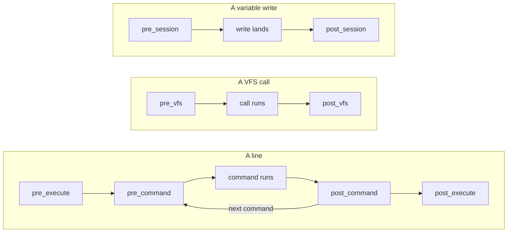

A policy is a Python or TypeScript class that controls what the agent
does. Before an action runs, and again once it returns, the policy gets
the full context: the line, each command with its expanded arguments, the
paths it touches, the session, and what came back. It then lets the
action through (`None`), refuses it, holds it until a host approves, caps
its output, or chooses the underlying runtime.

<CodeGroup>

```python Python
from mirage import Workspace
from mirage.policy import CommandContext, Deny, Policy

class NoForcePush(Policy):
    async def pre_command(self, ctx: CommandContext) -> Deny | None:
        texts = [w.text for w in ctx.words]
        if texts[:2] == ["git", "push"] and "--force" in texts:
            return Deny("force pushes go through an operator")
        return None

no_force_push = NoForcePush()
ws = Workspace(mounts, policies=[no_force_push])

r = await ws.shell("git push --force origin main")
# b'git: Permission denied\n' 126
print(r.stderr, r.exit_code)

# ws.policies.add(no_force_push) puts it back
ws.policies.remove(no_force_push)
```

```typescript TypeScript
import { Workspace, type Policy } from '@struktoai/mirage-node'

const noForcePush: Policy = {
  preCommand(ctx) {
    const texts = (ctx.words ?? []).map((w) => w.text)
    const force = texts[0] === 'git' && texts[1] === 'push' && texts.includes('--force')
    return force ? { kind: 'deny', reason: 'force pushes go through an operator' } : null
  },
}

const ws = new Workspace(mounts, { policies: [noForcePush] })

const r = await ws.shell('git push --force origin main')
// git: Permission denied 126
console.log(r.stderrText, r.exitCode)

// ws.policies.add(noForcePush) puts it back
ws.policies.remove(noForcePush)
```

</CodeGroup>

## Lifecycle

A policy implements any of eight methods, in pairs. The `pre_` one runs
before an action, the `post_` one after it, with the same context plus
what came back. A `post_` method never undoes what ran; it holds back
what came back.



| Python | TypeScript | Runs | May answer |
| --- | --- | --- | --- |
| `pre_execute` | `preExecute` | once per line, before any of it runs | Deny, Ask, Route |
| `pre_command` | `preCommand` | before each command or CLI, once the line is parsed and expanded | Deny, Ask |
| `post_command` | `postCommand` | after each command, once its output drained | Deny, Ask |
| `post_execute` | `postExecute` | once per line, after it ends | Deny, Ask, Limit |
| `pre_vfs` | `preVfs` | before each VFS call, not a command's own reads and writes | Deny, Ask |
| `post_vfs` | `postVfs` | after each VFS call | Deny, Ask |
| `pre_session` | `preSession` | before each variable write | Deny, Ask |
| `post_session` | `postSession` | after the write lands | Deny, Ask |

| What | Example | Covered by |
| --- | --- | --- |
| A line | `cat /data/a.txt && rm /data/b` | `pre_execute`, `post_execute` |
| A command or CLI | `rm /data/b` | `pre_command`, `post_command` |
| A VFS call | `session.vfs.read("/data/a.txt")` | `pre_vfs`, `post_vfs` |
| A variable write | `export X=1`, `X=1`, `unset X` | `pre_session`, `post_session` |

| Entry point | Sends |
| --- | --- |
| `ws.shell`, `session.shell` | a line, with its commands and variable writes |
| the `shell`, `ls` and `grep` tools | a line, with its commands and variable writes |
| `mirage shell`, HTTP `/shell`, RPC `shell`, SSH | a line, with its commands and variable writes |
| `session.vfs` | a VFS call |
| the `read`, `write`, `edit` and `glob` tools | a VFS call |
| `mirage vfs`, HTTP `/vfs/<call>`, RPC `vfs/<call>` | a VFS call |
| FUSE, FSKit, SFTP | a VFS call |

## Context

Each method gets one argument, `ctx`. Every `ctx` carries the session,
plus what its method is about, and a `post_` method adds what came back.
TypeScript spells the fields in camelCase (`ctx.sessionId`, `ctx.exitCode`).

| Methods | What it is about | `post_` adds |
| --- | --- | --- |
| `pre_execute`, `post_execute` | `line` and `commands`: every command of the line | `exit_code`, `output`, `results` |
| `pre_command`, `post_command` | `line` and the command: `command`, `words`, `paths`, `walks` | `exit_code`, `stderr`, `records` |
| `pre_vfs`, `post_vfs` | `call`, `path`, `write` | `result` |
| `pre_session`, `post_session` | `verb`, `key`, `value` | `old` |

`pre_command` is `pre_execute` narrowed to one command: each entry of
`ctx.commands` is the context `pre_command` gets for that command, read
before the line runs, so a word only the run can expand (`$X`) is not
resolved there yet.

Every `ctx` also carries:

| Field | What it is |
| --- | --- |
| `session_id` | the session the action runs as |
| `session` | the session, read only: `get(name)`, `snapshot()`, `cwd()`, `is_readonly(name)`, `profile()` |
| `ns` | the session's namespace, as commands get it: mounts, links, the stat overlay, hides applied |
| `vfs` | the session's files, read only: `read`, `stat`, `readdir`, `exists`; unset on a TypeScript runtime that does not isolate async tasks (the browser fallback) |

`words` is the command line word by word, after expansion. Each word has
a `text`, a `kind` (`name`, `subcommand`, `option`, `value`, `operand` or
`redirect`), the `option` a value belongs to, and the `path` it names.
For `tar -cf a.tar -C /mnt /data`:

| `text` | `kind` | `option` | `path` |
| --- | --- | --- | --- |
| `tar` | `name` | | |
| `-cf` | `option` | | |
| `a.tar` | `value` | `-cf` | `/a.tar` |
| `-C` | `option` | | |
| `/mnt` | `value` | `-C` | `/mnt` |
| `/data` | `operand` | | `/data` |

- `paths` is every path the command reaches, flat: its words' paths, the
  targets of links it names, and the working directory a bare `ls` reads.
- `line` is the line the command was parsed from: the line the agent
  typed, or for `eval`, `$( )` and a function body, that text.
- `results` is the line's execution tree: a node per command with its
  exit code, stderr and records.
- `records` are the calls a command made, one dict each: `op`, `path`,
  `source`, `bytes` and timing.
- `call` is the function called: its `name`, `effect` (read, write,
  metadata), `target`, and whether it `creates` or reaches the `subtree`.
  Every function a VFS marks reaches `pre_vfs` and `post_vfs`: `find`,
  `du_size`, `search` and `copy` too.

A method only reads. A write it makes through Mirage is refused (`EROFS`
for a file, `EACCES` for a variable), and its reads are not judged again.

A policy written as a program, on monty or Python on wasm, gets the same
`ctx` as JSON: see [Scripts](/home/policy/scripts).

## Examples

### pre_execute

<CodeGroup>

```python Python
from mirage.policy import Policy, Route, RouteContext

class JobsInDocker(Policy):
    async def pre_execute(self, ctx: RouteContext) -> Route | None:
        paths = [p.virtual for c in ctx.commands for p in c.paths]
        if any(p.startswith("/jobs/") for p in paths):
            return Route("docker")
        return None
```

```typescript TypeScript
const jobsInDocker: Policy = {
  preExecute(ctx) {
    const jobs = ctx.commands.some((c) => c.paths.some((p) => p.virtual.startsWith('/jobs/')))
    return jobs ? { kind: 'route', runtime: 'docker' } : null
  },
}
```

</CodeGroup>

`python3 /jobs/train.py` runs on the workspace's `docker` runtime. See
[Route policy](/home/policy/route-policy) for runtimes.

### post_execute

<CodeGroup>

```python Python
from mirage import Limit
from mirage.policy import ExecuteResultContext, Policy

class FirstHundredLines(Policy):
    async def post_execute(self, ctx: ExecuteResultContext) -> Limit:
        return Limit(max_lines=100)
```

```typescript TypeScript
const firstHundredLines: Policy = {
  postExecute() {
    return new Limit({ maxLines: 100 })
  },
}
```

</CodeGroup>

A longer output stops at 100 lines, and stderr says
`output truncated at limit (100 lines); ...`. A Deny here drops the
output: exit 126 and a refusal record.

### pre_command

`NoForcePush`, at the top of this page.

### post_command

<CodeGroup>

```python Python
from mirage.policy import CommandResultContext, Deny, Policy

class NoSecretsShown(Policy):
    async def post_command(self, ctx: CommandResultContext) -> Deny | None:
        if any(r.get("path", "").startswith("/vault/") for r in ctx.records):
            return Deny("vault reads need an operator")
        return None
```

```typescript TypeScript
const noSecretsShown: Policy = {
  postCommand(ctx) {
    const vault = ctx.records.some((r) => typeof r.path === 'string' && r.path.startsWith('/vault/'))
    return vault ? { kind: 'deny', reason: 'vault reads need an operator' } : null
  },
}
```

</CodeGroup>

`cat /vault/k && echo next` exits 126 with `cat: Permission denied`, and
`echo` does not run. Output already sent stays sent. A runtime that takes
a line whole runs its commands itself, so no result comes back to judge:
while a `post_command` method is installed, such a line is refused.

### pre_vfs

<CodeGroup>

```python Python
from mirage.policy import Deny, Policy, VfsContext

class ReadOnlyReports(Policy):
    async def pre_vfs(self, ctx: VfsContext) -> Deny | None:
        if ctx.write and ctx.path.virtual.startswith("/reports/"):
            return Deny("reports are read-only")
        return None
```

```typescript TypeScript
const readOnlyReports: Policy = {
  preVfs(ctx) {
    return ctx.write && ctx.path.virtual.startsWith('/reports/')
      ? { kind: 'deny', reason: 'reports are read-only' }
      : null
  },
}
```

</CodeGroup>

`session.vfs.write("/reports/q3.md", ...)` raises `EACCES`. A
command's own write (`echo x > /reports/q3.md`) does not reach `pre_vfs`.

### post_vfs

<CodeGroup>

```python Python
from mirage.policy import Deny, Policy, VfsResultContext

class NoKeysOut(Policy):
    async def post_vfs(self, ctx: VfsResultContext) -> Deny | None:
        if isinstance(ctx.result, bytes) and b"PRIVATE KEY" in ctx.result:
            return Deny("holds a private key")
        return None
```

```typescript TypeScript
const noKeysOut: Policy = {
  postVfs(ctx) {
    const text = ctx.result instanceof Uint8Array ? new TextDecoder().decode(ctx.result) : ''
    return text.includes('PRIVATE KEY') ? { kind: 'deny', reason: 'holds a private key' } : null
  },
}
```

</CodeGroup>

Reading a file that holds a private key with `session.vfs.read` raises
`EACCES`. `post_vfs` can refuse a read but not shorten it: the file comes
back whole or not at all. To cap how much a command prints, use
`post_execute`.

### pre_session

<CodeGroup>

```python Python
from mirage.policy import Deny, Policy, SessionContext

class NoCredentials(Policy):
    async def pre_session(self, ctx: SessionContext) -> Deny | None:
        if ctx.key.startswith("AWS_"):
            return Deny("credentials are set by the operator")
        return None
```

```typescript TypeScript
const noCredentials: Policy = {
  preSession(ctx) {
    return ctx.key.startsWith('AWS_')
      ? { kind: 'deny', reason: 'credentials are set by the operator' }
      : null
  },
}
```

</CodeGroup>

`export AWS_SECRET=x` gets `AWS_SECRET: permission denied`, exit 1. A
Deny at `post_session` gives the same answer and puts the old value back.

## Answers

| Return | Effect |
| --- | --- |
| `None` | no opinion |
| `Deny(reason)` | refuses the action |
| `Deny(reason, path=p)` | fails the command with `p`'s own error; the rest of the line still runs |
| `Ask(reason)` | holds the action until a host approves it; see [Asks](#asks) |
| `Route(runtime)` | chooses the underlying runtime |
| `Limit(max_lines=, max_bytes=)` | cuts the output at the bound, with a notice on stderr; with `on_exceed` set to error, no output and exit 1 |

TypeScript returns `{ kind: 'deny', reason }`, with
`path` for a path, `{ kind: 'ask', reason }`,
`{ kind: 'route', runtime }` and `new Limit({ maxLines })`. A method that
raises refuses too. What the agent reads for each is on
[Explain](/home/policy/explain#what-the-agent-reads).

## Asks

An Ask refuses the action as a Deny does and records a question in the
workspace's ledger. Once a host allows it, the agent's retry runs:

- `allow`, scope `once` (default): the retry runs and spends it.
- `allow`, scope `session`: everything the ask covers, for the rest of
  that session.
- `deny`: the retry is refused; running it again asks again.

A host answers inline with `on_ask` (`onAsk`), or later through
[`ws.decisions`](/python/access/in-app#ws-decisions),
[`mirage workspace allow`](/home/access/cli#asks) or
[`POST /asks/{ask_id}`](/home/access/http#asks). An Ask from a `post_`
method comes after the action ran, so nothing is undone: what came back is
held, and the approved retry runs it again.

## When answers disagree

- Any Deny beats any Ask, so answering an ask never reopens a refusal.
- The first Deny speaks. The built-ins come first, then the session's
  profile, then its script, then `policies=`, then `add()`.
- Every Ask is put to the host, and the action runs once all are
  approved.
- Limits merge to the tightest value of each field.
- Two Routes to different runtimes refuse the line.
- A policy may give several answers at once, a tuple in Python or an
  array in TypeScript; each counts as if a policy of its own gave it.

## Examples on GitHub

[policy.py](https://github.com/strukto-ai/mirage/blob/main/examples/python/permissions/policy.py)
and
[policy.ts](https://github.com/strukto-ai/mirage/blob/main/examples/typescript/permissions/policy.ts)
run a coded policy beside a profile's script.
