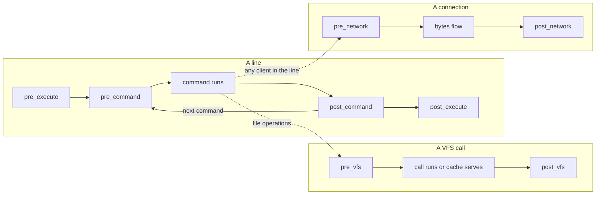

A policy is a Python or TypeScript class that controls what the agent
does. Before an action runs, and again once it returns, the policy gets
the full context: the line, each command with its expanded arguments, the
paths it touches, the session, and what came back. It then lets the
action through (`None`), refuses it, asks a host, caps its output, or
picks the machine that runs it.

<CodeGroup>

```python Python
from mirage import RAMVFS, Workspace
from mirage.policy import CommandContext, Deny, Policy

class NoForcePush(Policy):
    async def pre_command(self, ctx: CommandContext) -> Deny | None:
        texts = [w.text for w in ctx.words]
        if texts[:2] == ["git", "push"] and "--force" in texts:
            return Deny("force pushes go through an operator")
        return None

no_force_push = NoForcePush()
ws = Workspace({"/": RAMVFS()}, policies=[no_force_push])

r = await ws.shell("git push --force origin main")
# b'git: Permission denied\n' 126
print(r.stderr, r.exit_code)

# ws.policies.add(no_force_push) puts it back
ws.policies.remove(no_force_push)
```

```typescript TypeScript
import { RAMVFS, Workspace, type Policy } from '@struktoai/mirage-node'

const noForcePush: Policy = {
  preCommand(ctx) {
    const texts = (ctx.words ?? []).map((w) => w.text)
    const force = texts[0] === 'git' && texts[1] === 'push' && texts.includes('--force')
    return force ? { kind: 'deny', reason: 'force pushes go through an operator' } : null
  },
}

const ws = new Workspace({ '/': new RAMVFS() }, { policies: [noForcePush] })

const r = await ws.shell('git push --force origin main')
// git: Permission denied 126
console.log(r.stderrText, r.exitCode)

// ws.policies.add(noForcePush) puts it back
ws.policies.remove(noForcePush)
```

</CodeGroup>

## Lifecycle

A policy implements any of nine methods: four pairs, plus `pre_workspace`
on a server. A `pre_` method runs before an action; a `post_` method runs
after it, with the same context and what came back. A `post_` method never
undoes what ran: its Deny or Ask holds back what came back.



| Methods | Run | Can return |
| --- | --- | --- |
| [`pre_execute`, `post_execute`](/home/policy/line) | once per line, before and after it | Deny, Ask or Route before; Deny, Ask or Limit after |
| [`pre_command`, `post_command`](/home/policy/command) | before and after each command or CLI | Deny, Ask or Route before; Deny or Ask after |
| [`pre_vfs`, `post_vfs`](/home/policy/vfs) | before and after each VFS call | Deny or Ask |
| [`pre_network`, `post_network`](/home/policy/network) | before a connection carries any byte, and once it is over | Deny, Ask or Limit before; nothing after |
| [`pre_workspace`](/home/policy/workspace) | on a server, before a create, clone or load builds anything | Deny |

TypeScript spells each method in camelCase (`preExecute`).

Every entry point reaches the same methods:

| Entry point | Sends |
| --- | --- |
| `ws.shell`, `session.shell` | a line, with its commands and file operations |
| the `shell`, `ls` and `grep` tools | a line, with its commands and file operations |
| `mirage shell`, HTTP `/shell`, RPC `shell`, SSH | a line, with its commands and file operations |
| `session.vfs` | a VFS call |
| the `read`, `write`, `edit` and `glob` tools | a VFS call |
| `mirage workspace vfs`, HTTP `/vfs/<call>`, RPC `vfs/<call>` | a VFS call |
| FUSE, FSKit, SFTP | a VFS call |

## Context

Each method gets one argument, `ctx`: what its method is about, on that
method's page, plus the session. TypeScript spells the fields in camelCase
(`ctx.sessionId`). Every `ctx` carries:

| Field | What it is |
| --- | --- |
| `session_id` | the session the action runs as |
| `session` | the session, read only: `get(name)`, `snapshot()`, `cwd()`, `is_readonly(name)`, `profile()` |
| `vfs` | the session's files, read only: `read`, `stat`, `readdir`, `exists`, and where the mounts are (`mount_of`, `is_mount`, `submounts`), hides applied |
| `caller` | who makes the call (a `PolicyCaller`), a frozen copy: `caller.session` is the session above, with its `session_id` and `cwd` when the method was asked, and `caller.account` the account a server holds the workspace for (the one its requests sign in as), null outside a server or without accounts |

A method only reads. A write it makes through Mirage is refused (`EROFS`
for a file, `EACCES` for a variable), and its reads are not judged again.
The session's history is `/.bash_history`, which a method reads through
`ctx.vfs` like any file.

### What the agent controls

Most of a `ctx` comes from what the agent did, so a policy reads it as a
claim to check, not as a credential:

| The agent sets | Through |
| --- | --- |
| `line`, `command`, `words`, `argv`, `paths`, `walks` | the line it types, after expansion |
| `cwd`, `session.cwd()`, `caller.session.cwd` | `cd` |
| `env`, `session.get()`, `session.snapshot()` | `export`, assignments and `readonly` |
| `call`, `path`, `write` at `pre_vfs` | the file call it made |
| `exit_code`, `stderr`, `output`, `records`, `result` | what its own command or call produced |

The host sets `session_id` (`caller.session.session_id` too), `profile`,
`mounts`, `prefix` and `mode`, and what `vfs` shows: the agent cannot
change them from inside the session. Decide who may do what from those, and
from a variable only when the workspace's or the profile's `env` sets it with
`readonly: true`. `session.is_readonly()` is also true for a name the agent
marked with `readonly NAME` itself.

A policy written as a program, on monty or Python on wasm, gets the same
`ctx` as JSON: see [Scripts](/home/policy/scripts).

### Variables

A variable write reaches no method: a variable does nothing until a
command, a file call or a connection uses it, and each of those methods
reads the session (`ctx.session`, and a command's `env`), so a rule about
a value goes in the method that uses it.

## Answers

| Return | Effect |
| --- | --- |
| `None` | no opinion |
| `Deny(reason)` | refuses the action |
| `Deny(reason, path=p)` | fails the command with `p`'s own error; the rest of the line still runs |
| `Ask(reason)` | asks the host; see [Asks](#asks) |
| `Route(machine)` | chooses the machine that runs it |
| `Limit(max_lines=, max_bytes=)` | cuts the output at the bound, with a notice on stderr; with `on_exceed` set to error, no output and exit 1 |

TypeScript returns `{ kind: 'deny', reason }`, with
`path` for a path, `{ kind: 'ask', reason }`,
`{ kind: 'route', machine }` and `new Limit({ maxLines })`. A method that
raises refuses too. What the agent reads for each is on
[Explain](/home/policy/explain#when-an-action-is-refused).

## Asks

An Ask records a question in the workspace's ledger:

- With `on_ask` (`onAsk`), an inline allow answer continues the current request;
  a deny answer refuses it.
- Without an inline answer, including when the callback returns no decision,
  the request returns pending. The host records a decision in the ledger, allowing the caller to retry.

Ledger answers apply as follows:

- `allow`, scope `once` (default): the retry runs and spends it.
- `allow`, scope `session`: everything the ask covers, for the rest of
  that session.
- `deny`: the retry is refused; running it again asks again.

A host answers through [`ws.decisions`](/python/access/in-app#workspace-methods),
[`mirage workspace allow`](/home/access/cli#asks) or
[`POST /asks/{ask_id}`](/api/operations/asks/respond-to-ask). An Ask from a `post_`
method comes after the action ran, so nothing is undone: what came back is
held, and the approved retry runs it again.

## When answers disagree

- Any Deny beats any Ask, so answering an ask never reopens a refusal.
- The first Deny speaks. The built-ins come first, then the session's
  profile, then its script, then `policies=`, then `add()`.
- Every Ask is put to the host, and the action runs once all are
  approved.
- Limits merge to the tightest value of each field.
- Two Routes to different machines refuse the line.
- A policy may give several answers at once, a tuple in Python or an
  array in TypeScript; each counts as if a policy of its own gave it.

## Examples

[policy.py](https://github.com/strukto-ai/mirage/blob/main/examples/python/policy/policy.py)
and
[policy.ts](https://github.com/strukto-ai/mirage/blob/main/examples/typescript/policy/policy.ts)
run a profile's scripts.
