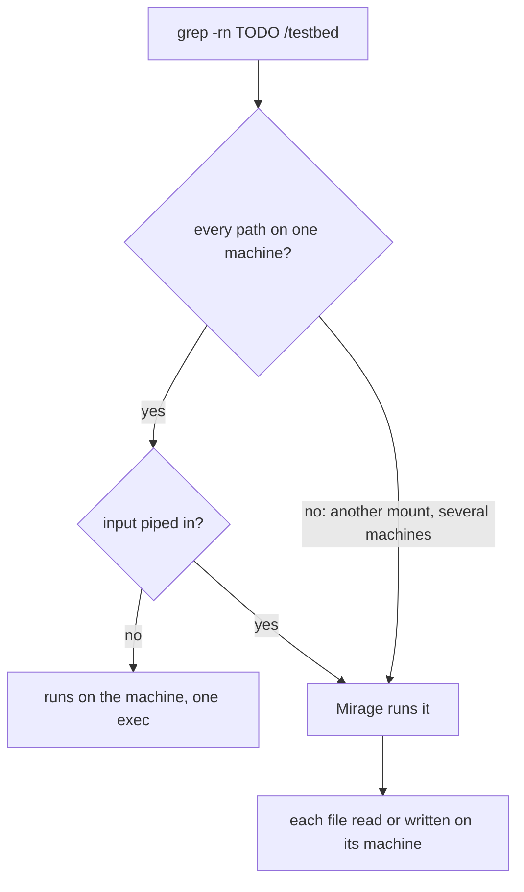
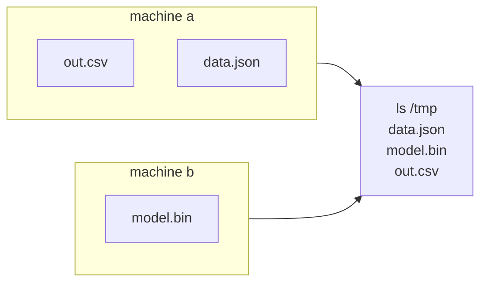

A machine keeps files of its own: scratch files in `/tmp`, a repository its
image holds, a model a program downloaded. The `machine` VFS shows them at a
prefix, reached through the exec Mirage already holds for the machine. Nothing
is copied, served or installed.

```bash
cat > /tmp/fix.py << 'EOF'
print("patched")
EOF
python3 /tmp/fix.py
# patched
```

Mirage's `cat` writes `/tmp/fix.py` on the machine, and the machine's `python3`
reads it there.

## Connect

A workspace with machines mounts `/tmp` and `/dev/shm` this way unless a
mount claims them. Mark any other path with `"@local"`: the machines' own
files at that same path.

<Tabs>
  <Tab title="YAML" icon="file-code">
    ```yaml workspace.yaml
    machines:
      sandbox:
        provider: docker
        container: task-001499
        captures: [python, git, pip, bash]

    mounts:
      /testbed: "@local"
      /gpu:
        vfs: machine
        config:
          machines: [sandbox]
          root: /
    ```
  </Tab>
  <Tab title="Python" icon="/images/python-logo.svg">
    ```python
    from mirage import MountMode, Workspace

    ws = Workspace(
        {"/testbed": "@local"},
        mode=MountMode.WRITE,
        machines={
            "sandbox": {
                "provider": "docker",
                "container": "task-001499",
                "captures": ["python", "git", "pip", "bash"],
            }
        },
    )
    result = await ws.shell("cd /testbed && git status --short")
    print(await result.stdout_str())
    await ws.close()
    ```
  </Tab>
  <Tab title="TypeScript" icon="/images/typescript-logo.svg">
    ```typescript
    import { MountMode, Workspace } from '@struktoai/mirage-node'

    const ws = new Workspace(
      { '/testbed': '@local' },
      {
        mode: MountMode.WRITE,
        machines: {
          sandbox: {
            provider: 'docker',
            container: 'task-001499',
            captures: ['python', 'git', 'pip', 'bash'],
          },
        },
      },
    )
    const result = await ws.shell('cd /testbed && git status --short')
    console.log(result.stdoutText)
    await ws.close()
    ```
  </Tab>
</Tabs>

`"@local"` needs a workspace with machines. A workspace without machines keeps
no `/tmp` mount of its own.

| Field | Default | Meaning |
| --- | --- | --- |
| `machines` | every machine | Whose files the mount shows |
| `root` | `/` | The path on each machine that becomes the mount root |
| `default_machine` | the machine running programs nothing in Mirage resolves, else the first | Where a new name lands when the command writing it runs no program on a machine |

## Where a command runs



- **On the machine:** `grep -rn`, `find`, `sed -i`, `ls -la`, `du`, a program
  at a path there (`/tmp/venv/bin/python`), `ln` and `readlink` in the
  folder. Output is the machine's own.
- **`xargs` and `< /dev/null`** count as no input: `find . | xargs grep x`
  still runs there.
- **Stays in Mirage:** piped input (`... | while read f; do grep x "$f"; done`),
  a link Mirage made, a restricted or read-only mount, a program the machine
  lacks.
- **`/dev`** is Mirage's (`/dev/null`, `/dev/stdin`); only `/dev/shm` is the
  machine's.

## Several machines



| Operation | Lands on |
| --- | --- |
| Read, write, `rm` an existing name | The machine holding it |
| Write a new name | The machine running the program (`python3 gen.py > /tmp/out`), else `default_machine` |
| `ls`, `find`, `grep -r` | Every machine, each name once |
| `mv` | The source's machine |
| `cp` to another machine | Bytes move through Mirage |

A name on two machines is refused as ambiguous unless the command's program
runs on one of them.

## Behavior

- **Caching:** none. Programs change these files behind Mirage's back, so
  every read and listing asks the machine.
- **Snapshots:** a snapshot keeps the mount's config; the files stay on the
  machines.
- **Owners:** `stat` and listings report the machine's own owners and modes;
  `chmod`, `chown` and `touch` apply on the machine.
- **Tools:** the machine needs GNU `find` (for `-printf`), `cat`, `head`,
  `tail`, `dd` and the coreutils sums; a stock Debian or Ubuntu image has them.
- **Daytona:** its exec takes no input, so writes go through Daytona's file
  API, and a command that needs piped input stays with Mirage.
- **Serving:** with `mount_type: ssh`, a path the machine holds itself is
  never served back to it; any other machine mount is served like any mount.

## SDK guides

<CardGroup cols={2}>
  <Card title="Python" icon="/images/python-logo.svg" href="/python/vfs/machine">
    Every config field and the VFS.md.
  </Card>
  <Card title="TypeScript" icon="/images/typescript-logo.svg" href="/typescript/setup/machine">
    Every config field and the VFS.md.
  </Card>
</CardGroup>
