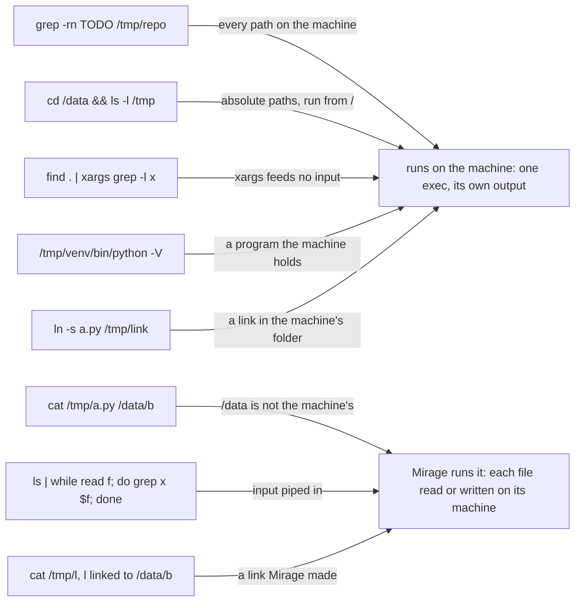
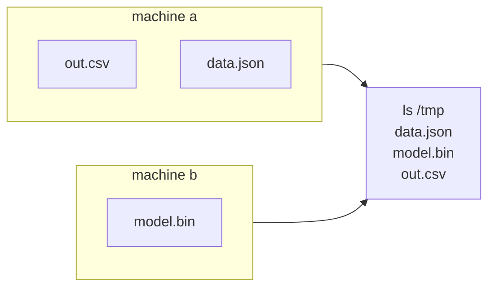

<Note>
  Machine Files is experimental: its config and behavior may still change.
</Note>

When an agent's commands run on a machine (a container, a sandbox, a
server over ssh), the files those programs read and write live on the
machine. A machine mount shows a folder of the machine in the workspace, so
a file the agent writes from Mirage's shell is the file the machine's
programs read, and a file a program leaves behind is one the agent can
open. With the machine's `/tmp` mounted at `/tmp`:

```bash
cat > /tmp/fix.py << 'EOF'
print("patched")
EOF
python3 /tmp/fix.py
# patched
```

Mirage's `cat` writes `/tmp/fix.py` on the machine, and the machine's
`python3` reads it there. Nothing is copied or synced: the file lives on the
machine.

## Set Up

Mount `"@<machine>"` at a path to show the folder that machine has at the
same path. Here `/tmp` is the `/tmp` of machine `sandbox`:

<Tabs>
  <Tab title="YAML" icon="file-code">
    ```yaml workspace.yaml
    machines:
      sandbox:
        provider: docker
        container: my-sandbox

    mounts:
      /tmp: "@sandbox"
    ```
  </Tab>
  <Tab title="Python" icon="/images/python-logo.svg">
    ```python
    from mirage import MountMode, Workspace

    ws = Workspace(
        {"/tmp": "@sandbox"},
        mode=MountMode.WRITE,
        machines={"sandbox": {"provider": "docker", "container": "my-sandbox"}},
    )
    await ws.shell("echo hello > /tmp/note.txt")
    result = await ws.shell("python3 -c 'print(open(\"/tmp/note.txt\").read())'")
    print(await result.stdout_str())
    # hello
    await ws.close()
    ```
  </Tab>
  <Tab title="TypeScript" icon="/images/typescript-logo.svg">
    ```typescript
    import { MountMode, Workspace } from '@struktoai/mirage-node'

    const ws = new Workspace(
      { '/tmp': '@sandbox' },
      {
        mode: MountMode.WRITE,
        machines: { sandbox: { provider: 'docker', container: 'my-sandbox' } },
      },
    )
    await ws.shell('echo hello > /tmp/note.txt')
    const result = await ws.shell(`python3 -c 'print(open("/tmp/note.txt").read())'`)
    console.log(result.stdoutText)
    // hello
    await ws.close()
    ```
  </Tab>
</Tabs>

Any folder works the same way: `/home/user/project: "@sandbox"` shows the
project the machine holds there. For a folder at another path, see
[Mount Block](#mount-block).

The name must be one under `machines:`. A typo such as `/tmp: "@sandbx"`
stops the workspace from starting and lists the names it knows:

```text
mount '/tmp': no machine 'sandbx' (machines: 'sandbox')
```

A workspace with a machine mounts `/tmp` and `/dev/shm` this way by itself,
unless another mount claims them:

| Workspace | `/tmp` and `/dev/shm` |
| --- | --- |
| No machine, no mount there | None: `ls /tmp` fails with `No such file or directory` |
| A machine, no mount there | The machine's own, mounted by Mirage |
| Another mount there, such as `/tmp: {vfs: ram}` | That mount; no machine's is shown |

## Mount Block

`"@sandbox"` is short for a `machine` mount block. Write the block out for
what the short form cannot say: a folder at another path (`root`), some
machines but not all (`machines`), or where a new file lands
(`default_machine`). This shows machine `sandbox`'s `/home/user/project` at
`/project`:

```yaml workspace.yaml
mounts:
  /project:
    vfs: machine
    config:
      machines: [sandbox]
      root: /home/user/project
```

| Field | Default | Meaning |
| --- | --- | --- |
| `machines` | every machine | Whose files the mount shows |
| `root` | `/` | The folder on each machine the mount shows |
| `default_machine` | the machine running the program, else the first | Where a new file lands when no program on a machine writes it |

`"@sandbox"` at `/tmp` is the same as `machines: [sandbox]` with
`root: /tmp`.

## Where a Command Runs

A command whose paths all sit on one machine runs on the machine itself, in
one go, and prints exactly what the machine's own tools print. A command
that also reaches the rest of the workspace runs in Mirage, which still
reads and writes each machine file on its machine. With one machine, its
`/tmp` mounted, and a `ram` mount at `/data`, whose files live in Mirage and
not on the machine:



A restricted or read-only mount, a coded file policy and a program the
machine lacks keep a command in Mirage too. `/dev` is Mirage's (`/dev/null`,
`/dev/stdin`); only `/dev/shm` is the machine's.

The command runs from the current folder when that folder is the machine's.
When the folder is Mirage's, `ls`, `stat`, `readlink`, `cat`, `head`, `tail`
and `grep` still run on the machine, from `/`, if every path they name is
absolute: `cd /data && ls -l /tmp` lists the machine's `/tmp` with the
machine's own `ls`. With the machine's disk at `/`, `ls -ld /bin` shows its
link and `ls /proc/self/fd` its descriptors from any folder the same way. A
relative path, no path at all (`ls`), or a command that can use the folder
without naming it (`tar -x`, `find -exec`, `sed`) needs the folder on the
machine.

A program's `2>&1` is applied on its machine, so its errors land among its
output in the order the program wrote them, as in bash.

## Several Machines

With several machines, the `/tmp` Mirage mounts by itself shows all of their
`/tmp` files together. `/tmp: "@gpu"` shows machine `gpu`'s only.



| Operation | Lands on |
| --- | --- |
| Read, write, `rm` an existing name | The machine holding it |
| Write a new name | The machine running the program (`python3 gen.py > /tmp/out`), else `default_machine` |
| `ls`, `find`, `grep -r` | Every machine, each name once |
| `mv` | The source's machine |
| `cp` to another machine | Bytes move through Mirage |

A name on two machines is refused as ambiguous unless the command's program
runs on one of them.

## Behavior

- **Caching:** none. Programs change these files behind Mirage's back, so
  every read and listing asks the machine.
- **Snapshots:** a snapshot keeps the mount's config; the files stay on the
  machines.
- **Owners:** `stat` and listings report the machine's own owners and modes;
  `chmod`, `chown` and `touch` apply on the machine.
- **Tools:** the machine needs GNU `find` (for `-printf`), `cat`, `head`,
  `tail`, `dd` and the coreutils sums; a stock Debian or Ubuntu image has them.
- **Daytona:** its exec takes no input, so a write to its files is refused
  (`Operation not supported`), and a command that needs piped input stays
  with Mirage.
- **Serving:** with `mount_type: ssh`, a path the machine holds itself is
  never served back to it; any other machine mount is served like any mount.

## SDK Guides

<CardGroup cols={2}>
  <Card title="Python" icon="/images/python-logo.svg" href="/python/vfs/machine">
    Every config field and the VFS.md.
  </Card>
  <Card title="TypeScript" icon="/images/typescript-logo.svg" href="/typescript/vfs/machine">
    Every config field and the VFS.md.
  </Card>
</CardGroup>
