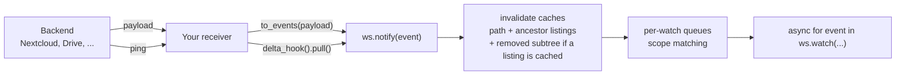

## What It Does

Files on a mounted backend change outside your workspace all the time: a
teammate uploads to Nextcloud, a pipeline rewrites an S3 object, a cron job
deletes a report. `watch` turns those external changes into an async event
stream, so an agent reacts instead of rescanning and diffing directories.

```python
from mirage import Workspace
from mirage.vfs.nextcloud import NextcloudConfig, NextcloudVFS

ws = Workspace({"/nc": NextcloudVFS(NextcloudConfig(...))})

async for event in ws.watch("/nc/Documents"):
    print(event.kind, event.path.virtual)   # e.g. "update /nc/Documents/report.txt"
    result = await ws.shell(f"cat {event.path.virtual}")  # guaranteed fresh
```

No setup call is needed: the watch runtime attaches lazily on first use, and an
idle workspace carries no watch state at all. Mirage runs **no server and no
background loop**. The signal is the provider's push, received by your service:
either a payload that names the change, or a ping that says only that something
changed. Mirage's job is everything after it: turning it into paths, cache
invalidation, scope matching, and delivery.



## Scopes

The root's shape defines the depth, GNU shell glob style. `*` never crosses
`/`, and matching happens at delivery time, so files created after the watch
started still match.

| root | scope |
| --- | --- |
| `/nc/data` | the whole subtree |
| `/nc/data/*` | the entries at that level only (shallow, no descent) |
| `/nc/data/*/` | everything inside child directories (GNU `*/` matches directories) |
| `/nc/data/*.txt` | the `.txt` entries at that level |
| `/nc/data/*/reports/` | everything inside each child's `reports` directory |
| `["/nc/docs", "/nc/cfg/app.yaml"]` | any of several roots, one event stream |

```python
async for event in ws.watch("/nc/data/*.pdf"):   # pattern
    ...

async for event in ws.watch(["/nc/inbox/*", "/nc/config"]):  # list
    ...
```

## The Event

```python
@dataclass(frozen=True, slots=True)
class FileEvent:
    kind: FileChangeKind                   # create / update / delete / move / unknown
    path: PathSpec                         # virtual path of the changed entry
    timestamp: datetime                    # UTC time the change was observed
    previous_path: PathSpec | None = None  # prior path for MOVE events
    metadata: FileMetadata | None = None   # post-change metadata, when the source has it
```

`FileMetadata` carries `fingerprint` (the backend's ETag/rev, or an
`mtime|size` composite), `size`, and `modified`. Producers fill only what their
signal honestly knows: a payload that describes the file can fill them, a ping
fills none.

`unknown` is the overflow signal: if a burst exceeds the queue cap, pending
events collapse into one `unknown` event per watch root, meaning
"re-inventory this subtree". Precision degrades; dirtiness is never lost.

Events are **level-triggered**: an event says *what is dirty*, not every
intermediate edit. Read current content through the workspace after receiving
one. Mirage invalidates the changed path and every cached ancestor listing up
to the mount root *before* the event reaches any subscriber.
A `delete`, or the old path of a `move`, drops the cached subtree when a listing
is retained at or below that path. Without one, descendant file bodies can
remain cached until their TTL. An `unknown` event always invalidates the
subtree, regardless of retained listings.

## Payloads

Your service hosts the endpoint; Mirage opens no socket and runs no watcher.
When the provider's push names what changed, the backend's mapper turns that
payload into paths:

```python
from mirage.core.slack.watch import SlackEventHook

hook = SlackEventHook(vfs.accessor)


async def handle(request):
    event = (await request.json())["event"]
    for change in await hook.to_events(root, event["type"], event):
        await ws.notify(change)
    return web.json_response({"ok": True})
```

You import the mapper for the backend you mounted rather than asking the
mount for one, because a payload has no vendor-neutral shape: the code that
builds the call already names the backend.

| Backend | Import | Payload |
| --- | --- | --- |
| Slack | `mirage.core.slack.watch.SlackEventHook` | Events API delivery (inner `event` object) |
| Disk | `mirage.core.disk.watch.DiskEventHook` | watchdog `FileSystemEvent` fields (`src_path`, `dest_path`) |
| Redis | `mirage.core.redis.watch.RedisEventHook` | keyspace notification (`__keyevent@N__:<verb>`, the key) |
| S3 | `mirage.core.s3.watch.S3EventHook` | one record of an S3 Event Notification, with its `eventName` |
| GitHub | `mirage.core.github.watch.GitHubEventHook` | a `push` webhook delivery, with its `X-GitHub-Event` header |
| Nextcloud | `mirage.core.nextcloud.watch.NextcloudEventHook` | a `webhook_listeners` delivery, with its `event.class` |
| MongoDB | `mirage.core.mongodb.watch.MongoDBEventHook` | one change stream event, with its `operationType` |
| GridFS | `mirage.core.gridfs.watch.GridFSEventHook` | one change stream event on `<bucket>.files` |
| Box | `mirage.core.box.watch.BoxEventHook` | one `/events` entry |

A mapper answers with zero or more `FileEvent`s and never invents a path it
was not told about. When a payload names only a scope, it returns `UNKNOWN`
on that directory, which the watcher reads as "re-inventory everything
below": a forced GitHub push does not say which files changed, and a Slack
`file_shared` cannot name the rendered filename.

Slack is where the mapping earns its place. A message maps to
`channels/<name>__<CID>/<YYYY-MM-DD>/chat.jsonl`, and the day is bucketed in
**UTC** while Slack's client shows local time, so a hand-written mapper names
tomorrow's directory for a fifth of every day and never errors, because
notifying a path the mount does not serve evicts nothing. A **thread reply**
is the other trap: `chat.jsonl` renders `conversations.history`, which returns
parents only, so a reply appears in no day file at all. What changed is the
parent's `reply_count`, in the parent's day. Runnable example:
[`examples/python/slack/slack_watch.py`](https://github.com/strukto-ai/mirage/blob/main/examples/python/slack/slack_watch.py).
A Nextcloud receiver, with the one-time `occ` registration commands, is
[`examples/python/nextcloud/watch.py`](https://github.com/strukto-ai/mirage/blob/main/examples/python/nextcloud/watch.py).
One that needs no credentials,
[`examples/python/disk/watch.py`](https://github.com/strukto-ai/mirage/blob/main/examples/python/disk/watch.py),
maps filesystem watcher events with `DiskEventHook` and reads the changed file
back through the workspace.

For a backend with no mapper, build the `FileEvent` yourself:

```python
await ws.notify(
    FileEvent(
        kind=FileChangeKind.CREATE,
        path=PathSpec.from_str_path("/s3/exports/jan.csv"),
        timestamp=datetime.now(timezone.utc),
    )
)
```

## Pings

Many providers push only a ping: Gmail and Calendar push notifications, Drive
`changes.watch` channels, Graph change notifications for OneDrive and
SharePoint, Dropbox webhooks and `list_folder/longpoll`, and Box's long poll
all say that something changed, not what. A mount on one of those backends has
a `delta_hook()`, and your receiver answers each ping with one `pull` from the
checkpoint the last one handed back. Answer pings one at a time: two pulls
from the same checkpoint would race, and the slower one would hand back the
older cursor. Keep the checkpoint where a restart can read it (a file, Redis,
your database), saved after the changes it covers are notified:

```python
hook = ws.registry.mount_for("/drive").vfs.delta_hook()
root = PathSpec.from_str_path("/drive", vfs_path="")
lock = asyncio.Lock()
checkpoint = await store.get("drive-watch")
if checkpoint is None:
    checkpoint = (await hook.pull(root, None)).checkpoint
    await store.set("drive-watch", checkpoint)


async def on_ping(request):
    global checkpoint
    async with lock:
        delta = await hook.pull(root, checkpoint)
        for change in delta.changes:
            await ws.notify(change)
        checkpoint = delta.checkpoint
        await store.set("drive-watch", checkpoint)
    return web.json_response({"ok": True})
```

Each pull reads the provider's own change feed from a cursor: Gmail history,
the Calendar sync token, Drive `changes.list`, Graph `/delta`, Dropbox
`list_folder/continue`, Box `/events`. None of them lists the tree. The
baseline pull (`checkpoint=None`) takes the cursor at the present and reports
nothing. A service that comes back with its saved checkpoint catches up on
everything it missed with its next pull; one that takes a new baseline instead
starts at the present and never sees what changed while it was down. A cursor the provider no longer honors (a Dropbox reset, a Graph
`resyncRequired`, a Gmail history id it no longer keeps) answers `unknown` on
the watch root and starts again from the present.

A feed that names items by id says where an item is now, not where it was, so
the checkpoint also keeps the path of each item a pull has placed: a later
rename or delete leaves that path. An item seen for the first time is a
`create` when the provider says it is as it was made, and an `update`
otherwise. Runnable example:
[`examples/python/dropbox/watch.py`](https://github.com/strukto-ai/mirage/blob/main/examples/python/dropbox/watch.py)
answers each `list_folder/longpoll` with one pull.

## Queues

Each `watch()` owns its own delivery queue: `notify` fans one event out into
every queue whose scope matches, so two watches on overlapping scopes each
consume at their own pace and a slow consumer only overflows its own queue.

The default `RAMWatchQueue` coalesces per path with level-triggered semantics
(create then update stays create; create then delete cancels; delete then
create becomes update), so pending size is bounded by distinct dirty paths,
not event volume. Overflow policy is `collapse` (default, the `unknown`
rescan event), `drop_oldest`, or `error`.

To customize, attach the runtime explicitly before the first watch:

```python
from functools import partial
from mirage.watch import RAMWatchQueue, Watcher

ws.attach_watch_runtime(
    Watcher(ws.registry,
            queue_factory=partial(RAMWatchQueue, max_pending=64)))
```

Any object satisfying the async `WatchQueue` protocol (`push` / `pop` /
`pending` / `clear` / `close`) drops in, so a Redis- or SQS-backed queue needs
no interface changes. See
[`examples/python/nextcloud/watch_custom_queue.py`](https://github.com/strukto-ai/mirage/blob/main/examples/python/nextcloud/watch_custom_queue.py)
for a runnable custom-queue setup.

To tear down without closing the workspace, `await
ws.detach_watch_runtime()`: every subscriber queue closes (active `watch`
loops end cleanly) and the workspace returns to its idle state; the next
`watch` lazily attaches a fresh default runtime.

## Scope Notes

- Watch roots are fixed at subscription time: there is no API to add or
  remove roots on a live watch. To change scope, start a new `watch()` with
  the updated list and stop iterating the old one (its pending events are
  dropped when it closes). A mutable subscription handle is future work.
- A watch may span mounts, including a mount nested inside another
  mount's subtree: scope matching is on virtual paths, and each event is
  invalidated on the mount that owns its path (longest prefix). Detection
  stays per backend, so each mount needs its own signal feeding
  `ws.notify`.
- The TypeScript API has the same delivery, queues, mappers and ping
  handlers; see [TypeScript Watch](/typescript/watch).
- Mappers and ping handlers ship for the backends in the
  [Watch Matrix](/python/watch-matrix); `ws.notify` accepts events from any
  detection you run, so every backend is watchable.
- Events are in-memory and at-most-once per subscriber; durable queues and
  acknowledgement are future work.
