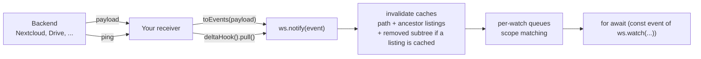

## What It Does

Files on a mounted backend change outside your workspace all the time: a
teammate uploads to Nextcloud, a pipeline rewrites an S3 object, or a cron job
deletes a report. `watch` turns those changes into an async event stream.

```ts
import { NextcloudVFS, Workspace } from "@struktoai/mirage-node";

const vfs = new NextcloudVFS({ url: process.env.NEXTCLOUD_URL! });
const ws = new Workspace({ "/nc": vfs });

for await (const event of ws.watch("/nc/Documents")) {
  console.log(event.kind, event.path.virtual);
  const result = await ws.shell(`cat ${event.path.virtual}`); // guaranteed fresh
  console.log(result.stdoutText);
}
```

No setup call is needed. The watch runtime attaches lazily on first use, and an
idle workspace carries no watch state. Mirage runs **no server and no
background loop**. The signal is the provider's push, received by your
application: either a payload that names the change, or a ping that says only
that something changed. Mirage turns it into paths and handles cache
invalidation, scope matching, and delivery.



## Scopes

The root's shape defines the depth, using GNU shell glob semantics. `*` never
crosses `/`, and matching happens at delivery time, so newly created files can
match.

| root                               | scope                                              |
| ---------------------------------- | -------------------------------------------------- |
| `/nc/data`                         | the whole subtree                                  |
| `/nc/data/*`                       | entries at that level only (shallow)               |
| `/nc/data/*/`                      | everything inside child directories                |
| `/nc/data/*.txt`                   | `.txt` entries at that level                       |
| `/nc/data/*/reports/`              | everything inside each child's `reports` directory |
| `['/nc/docs', '/nc/cfg/app.yaml']` | any of several roots, one event stream             |

```ts
for await (const event of ws.watch("/nc/data/*.pdf")) {
  // ...
}

for await (const event of ws.watch(["/nc/inbox/*", "/nc/config"])) {
  // ...
}
```

## The Event

```ts
class FileEvent {
  readonly kind: FileChangeKind; // create / update / delete / move / unknown
  readonly path: PathSpec;
  readonly timestamp: Date;
  readonly previousPath: PathSpec | null;
  readonly metadata: FileMetadata | null;
}
```

`FileMetadata` carries `fingerprint`, `size`, and `modified`. Producers fill
only what their signal honestly knows. A payload that describes the file can
supply them; a ping supplies none.

Events are **level-triggered**: an event says what is dirty, not every
intermediate edit. Read current content through the workspace after receiving
one. Mirage invalidates the changed path and every cached ancestor listing up
to its mount root before the event reaches a subscriber.
A `delete`, or the old path of a `move`, drops the cached subtree when a listing
is retained at or below that path. Without one, descendant file bodies can
remain cached until their TTL. An `unknown` event always invalidates the
subtree, regardless of retained listings.

`unknown` is the overflow signal. If a burst exceeds the queue cap, pending
events collapse into one `unknown` event per watch root, meaning “re-inventory
this subtree.” Precision degrades, but dirtiness is not lost.

## Payloads

Your application hosts the endpoint; Mirage opens no socket and runs no
watcher. When the provider's push names what changed, the backend's mapper
turns that payload into paths:

```ts
import { SlackEventHook } from "@struktoai/mirage-core/core/slack/watch/index";

const hook = new SlackEventHook(vfs.accessor);

const { event } = await request.json();
for (const change of await hook.toEvents(root, event.type, event)) {
  await ws.notify(change);
}
```

You import the mapper for the backend you mounted rather than asking the
mount for one, because a payload has no vendor-neutral shape: the code that
builds the call already names the backend.

| Backend | Import | Payload |
| --- | --- | --- |
| Slack | `SlackEventHook` (`mirage-core/core/slack/watch/index`) | Events API delivery (inner `event` object) |
| Disk | `DiskEventHook` (`mirage-node`, `core/disk/watch/hook`) | watchdog-shaped fields (`src_path`, `dest_path`) |
| Redis | `RedisEventHook` (`mirage-node`, `core/redis/watch/hook`) | keyspace notification (`__keyevent@N__:<verb>`, the key) |
| S3 | `S3EventHook` (`mirage-core/core/s3/watch`) | one record of an S3 Event Notification, with its `eventName` |
| GitHub | `GitHubEventHook` (`mirage-core/core/github/watch`) | a `push` webhook delivery, with its `X-GitHub-Event` header |
| Nextcloud | `NextcloudEventHook` (`mirage-node`) | a `webhook_listeners` delivery, with its `event.class` |
| MongoDB | `MongoDBEventHook` (`mirage-core/core/mongodb/watch`) | one change stream event, with its `operationType` |
| GridFS | `GridFSEventHook` (`mirage-node`, `core/gridfs/watch`) | one change stream event on `<bucket>.files` |
| Box | `BoxEventHook` (`mirage-core/core/box/watch`) | one `/events` entry |

A mapper answers with zero or more `FileEvent`s and never invents a path it
was not told about. When a payload names only a scope, it returns `UNKNOWN`
on that directory, which the watcher reads as "re-inventory everything
below".

Slack is where the mapping earns its place. A message maps to
`channels/<name>__<CID>/<YYYY-MM-DD>/chat.jsonl`, and the day is bucketed in
**UTC** while Slack's client shows local time, so a hand-written mapper names
tomorrow's directory for a fifth of every day and never errors, because
notifying a path the mount does not serve evicts nothing. A **thread reply**
is the other trap: `chat.jsonl` renders `conversations.history`, which returns
parents only, so a reply appears in no day file at all. What changed is the
parent's `reply_count`, in the parent's day. A runnable example that needs no
credentials,
[`examples/typescript/disk/watch.ts`](https://github.com/strukto-ai/mirage/blob/main/examples/typescript/disk/watch.ts),
maps filesystem watcher events with `DiskEventHook` and reads the changed file
back through the workspace.

For a backend with no mapper, build the `FileEvent` yourself:

```ts
import { FileChangeKind, FileEvent, PathSpec } from "@struktoai/mirage-node";

await ws.notify(
  new FileEvent({
    kind: FileChangeKind.CREATE,
    path: PathSpec.fromStrPath("/s3/exports/jan.csv"),
    timestamp: new Date(),
  }),
);
```

The provider receiver stays in your application, so it can use your existing
HTTP framework, authentication, retries, and deployment model.

## Pings

Many providers push only a ping: Gmail and Calendar push notifications, Drive
`changes.watch` channels, Graph change notifications for OneDrive and
SharePoint, Dropbox webhooks and `list_folder/longpoll`, and Box's long poll
all say that something changed, not what. A mount on one of those backends has
a `deltaHook()`, and your receiver answers each ping with one `pull` from the
checkpoint the last one handed back. Answer pings one at a time: two pulls from
the same checkpoint would race, and the slower one would hand back the older
cursor.

```ts
import { PathSpec } from "@struktoai/mirage-node";

const mount = ws.registry.mountFor("/drive");
if (mount === null || mount.vfs.deltaHook === undefined) {
  throw new Error("mount has no ping handler");
}
const hook = mount.vfs.deltaHook();
const root = PathSpec.fromStrPath("/drive", "");
let checkpoint = (await hook.pull(root, null)).checkpoint;
let queue: Promise<void> = Promise.resolve();

function onPing(): Promise<void> {
  const run = queue.then(async () => {
    const delta = await hook.pull(root, checkpoint);
    checkpoint = delta.checkpoint;
    for (const change of delta.changes) await ws.notify(change);
  });
  queue = run.catch(() => undefined);
  return run;
}
```

Each pull reads the provider's own change feed from a cursor: Gmail history,
the Calendar sync token, Drive `changes.list`, Graph `/delta`, Dropbox
`list_folder/continue`, Box `/events`. None of them lists the tree. The
baseline pull (`checkpoint === null`) takes the cursor at the present and
reports nothing, so a ping missed while your service was down is caught up by
the next one. A cursor the provider no longer honors (a Dropbox reset, a Graph
`resyncRequired`, a Gmail history id it no longer keeps) answers `unknown` on
the watch root and starts again from the present.

A feed that names items by id says where an item is now, not where it was, so
the checkpoint also keeps the path of each item a pull has placed: a later
rename or delete leaves that path. An item seen for the first time is a
`create` when the provider says it is as it was made, and an `update`
otherwise.

## Queues

Each `watch()` owns its own queue. `notify` fans an event out to every matching
queue, so overlapping watches consume independently and a slow consumer only
overflows its own queue.

The default `RAMWatchQueue` keeps one pending change per path. Create followed
by update stays create; create followed by delete cancels; delete followed by
create becomes update. Overflow policy is `collapse` (default), `drop_oldest`,
or `error`.

Attach a custom runtime before the first `watch()` or `notify()` call:

```ts
import { RAMWatchQueue, Watcher } from "@struktoai/mirage-node";

ws.attachWatchRuntime(
  new Watcher(
    ws.registry,
    (roots) => new RAMWatchQueue(roots, { maxPending: 64 }),
  ),
);
```

Any object satisfying `WatchQueue` (`push`, `pop`, `pending`, `clear`, and
`close`) can replace the RAM queue. This is the extension point for a durable
Redis, SQS, or database-backed queue.

Call `await ws.detachWatchRuntime()` to close subscriber queues and end active
watch loops cleanly without closing the workspace. The next `watch()` or
`notify()` lazily creates a fresh default runtime.

## Scope Notes

- Watch roots are fixed at subscription time. Start a new `watch()` to change
  the scope.
- One watch may span mounts, including nested mounts. Each event is invalidated
  on the longest-prefix mount that owns its path.
- Delivery works on every backend. Mappers and ping handlers ship for the
  backends in the [Watch Matrix](/typescript/watch-matrix).
- Events are in-memory and at-most-once per subscriber unless you provide a
  durable queue implementation.
