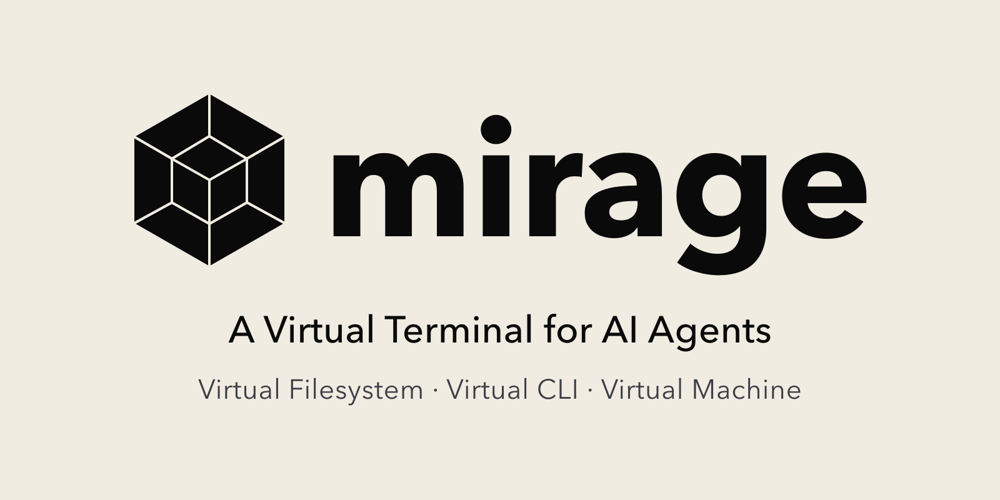
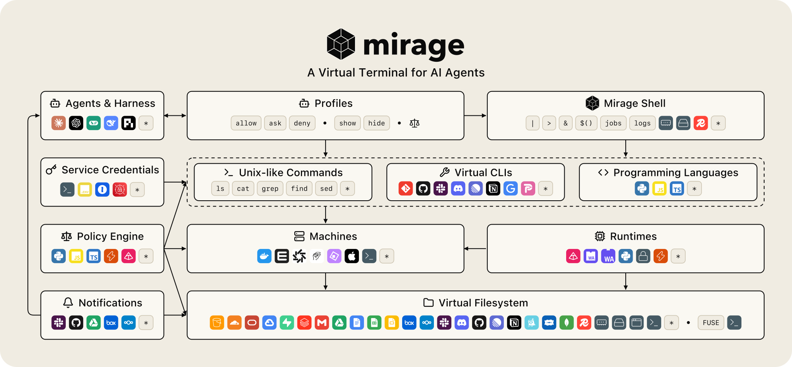

<p align="center">
  <picture>
    <source media="(prefers-color-scheme: dark)" srcset="../assets/mirage-og-dark@2x.png">
    
  </picture>
</p>

<p align="center">
  <a href="https://agentvfs.org">
    <picture>
      <source media="(max-width: 767px) and (prefers-color-scheme: dark)" srcset="../assets/agentvfs-banner-narrow-dark.svg">
      <source media="(max-width: 767px)" srcset="../assets/agentvfs-banner-narrow-light.svg">
      <source media="(prefers-color-scheme: dark)" srcset="../assets/agentvfs-banner-dark.svg">
      
    </picture>
  </a>
</p>

<p align="center">
    <a href="https://docs.mirage.strukto.ai" alt="Dokumentation">
        </a>
    <a href="https://www.strukto.ai" alt="Website">
        </a>
    <a href="https://github.com/strukto-ai/mirage/blob/main/LICENSE" alt="Lizenz">
        </a>
    <a href="https://doi.org/10.5281/zenodo.23504502" alt="DOI">
        </a>
    <a href="https://discord.gg/u8BPQ65KsS" alt="Discord-Community">
        </a>
    <a href="../assets/wechat-qr-code.jpg" aria-label="WeChat-Community">
        </a>
    <br/>
    <a href="https://docs.mirage.strukto.ai/python/quickstart" alt="Python-Dokumentation">
        </a>
    <a href="https://pypi.org/project/mirage-ai/" alt="PyPI-Version">
        </a>
    <br/>
    <a href="https://docs.mirage.strukto.ai/typescript/quickstart" alt="TypeScript-Dokumentation">
        </a>
    <a href="https://www.npmjs.com/package/@struktoai/mirage-node" alt="NPM-Version">
        </a>
</p>

<p align="center">
  <a href="../README.md"></a>
  <a href="./README.zh-CN.md"></a>
  <a href="./README.zh-TW.md"></a>
  <a href="./README.fr.md"></a>
  <a href="./README.de.md"></a>
  <a href="./README.vi.md"></a>
  <a href="./README.ko.md"></a>
</p>

KI-Agenten arbeiten in einem Terminal. Mirage ist **ein virtuelles Terminal**, das die Terminal-Schnittstelle, den Datenspeicher und die Rechenmaschinen voneinander trennt. Mirage leitet jeden Befehl an die Maschine weiter, die zu ihm passt, über heterogene Maschinen wie Container, microVMs, Cloud-Sandboxes und SSH-Hosts hinweg. Dateien, CLIs und Maschinen werden ihm getrennt hinzugefügt. Das hält es flexibel und die Infrastrukturkosten niedrig und lässt Agenten so effizient und sicher wie möglich arbeiten.

<p align="center">
  <picture>
    <source media="(prefers-color-scheme: dark)" srcset="../assets/mirage-terminal-dark.svg">
    
  </picture>
</p>

- **Kontrollierbar.** Lege fest, was jeder Agent erreicht, welche Dateien er sieht, welche Zugangsdaten seine virtuellen Dateisysteme und CLIs verwenden, ohne sie ihm zu zeigen, und welche Maschine jedes seiner Programme ausführt.
- **Skriptbar.** Das gesamte Terminal wird in Code oder einer Konfigurationsdatei definiert, von seinen virtuellen Dateisystemen, CLIs und Maschinen bis zu seinen Regeln, etwa welche Befehle eine Freigabe brauchen und wie viel Ausgabe ein Agent zurückbekommt.
- **Verwaltet.** Mirage verwaltet die Infrastruktur des virtuellen Terminals, zusammengesetzt aus den gewählten Backends. Das virtuelle Dateisystem liegt auf S3, Drive, einer Datenbank oder im RAM, Jobs und History im RAM, in Redis oder auf der Festplatte, und ganze Workspaces lassen sich als Snapshots speichern. Jeder Befehl, den ein Agent ausführt, wird aufgezeichnet und kann als Trace an ein OpenTelemetry-Backend gesendet werden.

<p align="center">
  <picture>
    <source media="(prefers-color-scheme: dark)" srcset="../assets/mirage-arch-dark.svg">
    
  </picture>
</p>

Hier ein Beispiel, wie Mirage in einer Anwendung gestartet wird:

```python
ws = Workspace(
    {
        "/s3":    (S3VFS(S3Config(bucket="my-bucket")), MountMode.WRITE),
        "/slack": (SlackVFS(SlackConfig(token=slack_bot_token)), MountMode.EXEC),
        "/gmail": (GmailVFS(GmailConfig(**google_credentials)), MountMode.READ),
    },
    # installiert die Slack-CLI, per Name aufgerufen und wie jedes Programm von `man` und `which` gelistet
    clis={"slack": (SLACK, {"token": slack_bot_token})},
    # das Profil analyst verbirgt /s3/secrets und verbietet Posts in Slack sowie curl
    profiles={
        "analyst": {
            "paths": {"hide": ["/s3/secrets"]},
            "commands": {"deny": ["slack send-message", "curl"]},
        },
    },
    # Python läuft im Prozess auf monty oder in der e2b-Sandbox
    machines={
        "py": {"provider": "in_process", "runtime": "monty"},
        "box": {"provider": "e2b", "sandbox_id": sandbox_id, "mount_type": "ssh", "captures": ["python", "python3"]},
    },
    # leitet die Berechnung: numpy-Zeilen laufen auf der Maschine, der Rest auf monty
    route_policy=lambda ctx: "box" if "numpy" in ctx.line else None,
)

# fügt einen Agenten mit dem Profil analyst hinzu
alice = await ws.session("alice", profile="analyst")

# ein grep durchsucht S3, Slack und Gmail, mit der eigenen Suche jedes Dienstes, wo es eine gibt
await alice.shell("grep -rlw invoice /s3 /slack /gmail")

# führt ein Skript aus Slack auf monty aus und legt den Bericht in S3 ab
await alice.shell("python3 /slack/channels/general__C0123/2026-10-21/files/report__F0456.py > /s3/report.txt")

# numpy fehlt in monty, also schickt die Routing-Policy diese Zeile an e2b
await alice.shell("python3 -c 'import numpy; print(numpy.arange(10).sum())'")
```

Und das sieht `alice` in der Shell:

```console
$ grep -rlw invoice /s3 /slack /gmail
/s3/billing/2026-10.csv
/gmail/INBOX/2026-10-21/Invoice_1042__18f3a9c2b7d1e0f4.gmail.json
$ ls /s3
billing
report.txt
$ cat /s3/secrets/aws.txt
cat: /s3/secrets/aws.txt: No such file or directory
$ slack send-message --channel general --text "report is up"
slack: Permission denied
```

## Überblick

- **Eine einheitliche virtuelle Terminal-Schnittstelle statt N SDKs und M MCPs.** Jedes Backend spricht dieselbe Dateisystem-Semantik, sodass sich Pipelines über Dienste hinweg zusammensetzen lassen.
- **Ein virtuelles Dateisystem über alle Quellen.** S3, Google Drive, Slack, Gmail, Redis und die übrigen werden nebeneinander unter einer einzigen Wurzel eingehängt, sodass ein Agent sie alle über eine einheitliche Schnittstelle erreicht, mit den Unix-Werkzeugen, die er ohnehin kennt, etwa `ls`, `grep`, `find` und `jq`.
- **Virtuelle Kommandozeilenwerkzeuge (CLIs).** `git`, `slack` und `ntn` beantwortet Mirage selbst, sodass ein Agent den Dienst ohne jede Installation bedient, über verschiedene Laufzeitumgebungen und Maschinen hinweg; ein Werkzeug lässt sich zudem in zwei oder mehr virtualisieren, jedes unter eigenem Namen mit eigenen Zugangsdaten.
- **Geroutete, dynamische Maschinen.** Python, JavaScript und jeder andere Befehl kann an eine konfigurierte Maschine geschickt werden, im Prozess, in einer Sandbox oder entfernt, was Berechnung von Speicher entkoppelt und beide unabhängig voneinander austauschbar macht.
- **Die virtualisierte Mirage-Shell.** Sie verbindet Dateisystem, CLIs und Maschinen zu einer einzigen Kommandozeile, sodass Pipes, Umleitungen, Variablen, Jobs und History über alle drei hinweg funktionieren.
- **Von Grund auf leichtgewichtig.** Ein Workspace, das virtuelle Terminal selbst, belegt etwa 100 KB Speicher und jede neue Session etwa 10 KB, sodass ein Prozess viele Agenten bedient, ohne Container oder VM pro Agent.
- **Profile, die für Agenten entworfen sind.** `allow`, `ask` und `deny` steuern Befehle und CLIs, `hide` und `show` steuern Dateien und Ordner, sodass ein verborgener Pfad nicht bloß unlesbar ist, sondern in dem Dateisystem, das der Agent sieht, gar nicht existiert.
- **Eine skriptfähige Policy-Engine.** Ein Policy-Skript kann jede gefährliche Aktion verhindern, bevor sie ausgeführt wird, und derselbe Stapel prüft jede VFS-Operation und jeden Session-Schreibzugriff, sodass weder eine Datei noch eine Umgebungsvariable nach außen dringt.
- **Benachrichtigungen, die mit dem VFS und den Agenten verdrahtet sind.** Externe Änderungen werden zu einem Ereignisstrom auf dem Mount, sodass eine neue Slack-Antwort als Änderung der Chat-Datei im virtuellen Dateisystem erscheint und der Agent darauf reagiert, statt den Baum erneut zu durchsuchen.

## Virtuelles Dateisystem

[Mirage](https://www.strukto.ai/mirage) „mountet“ alles als ein einheitliches virtuelles Dateisystem für KI-Agenten. Jeder Dienst liegt nebeneinander unter einer einzigen Wurzel und folgt derselben POSIX-Semantik.

|                                      | VFS                                                                                                                                                                                                                                                                                                                                                                                                                                                                                                                                                                                                                                                                                                                                                                                                                                                                                                                                                                                                                                                                                                                                                                                                                                                                                                                                                                                                                                                                                                                                                                                                                                                                                                                                                                                                                                                                                                                                                                                                                                                                                                                                                                                                                                                                                                                                                                                                                                                                                                                                                                                                                                                                                                                                                                                                                                                                                                                                                                                                                                                                                                                                                                                                     |
| ------------------------------------ | ------------------------------------------------------------------------------------------------------------------------------------------------------------------------------------------------------------------------------------------------------------------------------------------------------------------------------------------------------------------------------------------------------------------------------------------------------------------------------------------------------------------------------------------------------------------------------------------------------------------------------------------------------------------------------------------------------------------------------------------------------------------------------------------------------------------------------------------------------------------------------------------------------------------------------------------------------------------------------------------------------------------------------------------------------------------------------------------------------------------------------------------------------------------------------------------------------------------------------------------------------------------------------------------------------------------------------------------------------------------------------------------------------------------------------------------------------------------------------------------------------------------------------------------------------------------------------------------------------------------------------------------------------------------------------------------------------------------------------------------------------------------------------------------------------------------------------------------------------------------------------------------------------------------------------------------------------------------------------------------------------------------------------------------------------------------------------------------------------------------------------------------------------------------------------------------------------------------------------------------------------------------------------------------------------------------------------------------------------------------------------------------------------------------------------------------------------------------------------------------------------------------------------------------------------------------------------------------------------------------------------------------------------------------------------------------------------------------------------------------------------------------------------------------------------------------------------------------------------------------------------------------------------------------------------------------------------------------------------------------------------------------------------------------------------------------------------------------------------------------------------------------------------------------------------------------------------- |
| **Objektspeicher**                   | <a href="https://docs.mirage.strukto.ai/home/setup/s3"></a>  <a href="https://docs.mirage.strukto.ai/home/setup/r2"></a>  <a href="https://docs.mirage.strukto.ai/home/setup/gcs"></a>  <a href="https://docs.mirage.strukto.ai/home/setup/oci"></a>  <a href="https://docs.mirage.strukto.ai/home/setup/supabase"></a>  <a href="https://docs.mirage.strukto.ai/home/setup/minio"></a>  <a href="https://docs.mirage.strukto.ai/home/setup/ceph"></a>  <a href="https://docs.mirage.strukto.ai/home/setup/seaweedfs"></a>  <a href="https://docs.mirage.strukto.ai/home/setup/wasabi"></a>  <a href="https://docs.mirage.strukto.ai/home/setup/backblaze"></a>  <a href="https://docs.mirage.strukto.ai/home/setup/digitalocean"></a>  <a href="https://docs.mirage.strukto.ai/home/setup/aliyun"></a>  <a href="https://docs.mirage.strukto.ai/home/setup/tencent"></a>  <a href="https://docs.mirage.strukto.ai/home/setup/scaleway"></a>  <a href="https://docs.mirage.strukto.ai/home/setup/qingstor"></a>  <a href="https://docs.mirage.strukto.ai/home/setup/hf_buckets"></a>  <a href="https://docs.mirage.strukto.ai/home/setup/gridfs"></a> |
| **Dateien und Dokumente**            | <a href="https://docs.mirage.strukto.ai/home/setup/google"></a>  <a href="https://docs.mirage.strukto.ai/home/setup/google"></a>  <a href="https://docs.mirage.strukto.ai/home/setup/google"></a>  <a href="https://docs.mirage.strukto.ai/home/setup/google"></a>  <a href="https://docs.mirage.strukto.ai/home/setup/onedrive"></a>  <a href="https://docs.mirage.strukto.ai/home/setup/sharepoint"></a>  <a href="https://docs.mirage.strukto.ai/home/setup/box"></a>  <a href="https://docs.mirage.strukto.ai/home/setup/dropbox"></a>  <a href="https://docs.mirage.strukto.ai/home/setup/nextcloud"></a> <a href="https://docs.mirage.strukto.ai/home/setup/tidb"></a>                                                                                                                                                                                                                                                                                                                                                                                                                                                                                                                                                                                                                                                                                                                                                                                                                                                                                                                                                                                                                                                     |
| **Messaging und Arbeit**             | <a href="https://docs.mirage.strukto.ai/home/setup/slack"></a>  <a href="https://docs.mirage.strukto.ai/home/setup/discord"></a>  <a href="https://docs.mirage.strukto.ai/home/setup/google"></a>  <a href="https://docs.mirage.strukto.ai/home/setup/email"></a>  <a href="https://docs.mirage.strukto.ai/home/setup/github"></a>  <a href="https://docs.mirage.strukto.ai/home/setup/linear"></a>  <a href="https://docs.mirage.strukto.ai/home/setup/notion"></a>  <a href="https://docs.mirage.strukto.ai/home/setup/trello"></a>  <a href="https://docs.mirage.strukto.ai/home/setup/gcal"></a>                                                                                                                                                                                                                                                                                                                                                                                                                                                                                                                                                                                                                                                                                                                                                                                                                                                                                                                                                                                                                                                                                                                                                                                                                                                                                                                                                                                                                                                                                                          |
| **Datenbanken und Datenplattformen** | <a href="https://docs.mirage.strukto.ai/home/setup/postgres"></a>  <a href="https://docs.mirage.strukto.ai/home/setup/mongodb"></a>  <a href="https://docs.mirage.strukto.ai/home/setup/redis"></a> <a href="https://docs.mirage.strukto.ai/home/setup/redis"></a> <a href="https://docs.mirage.strukto.ai/home/setup/sql"></a> <a href="https://docs.mirage.strukto.ai/home/setup/airtable"></a>  <a href="https://docs.mirage.strukto.ai/home/setup/lancedb"></a>  <a href="https://docs.mirage.strukto.ai/home/setup/qdrant"></a>  <a href="https://docs.mirage.strukto.ai/home/setup/chroma"></a>  <a href="https://docs.mirage.strukto.ai/home/setup/mem0"></a>  <a href="https://docs.mirage.strukto.ai/home/setup/hf_datasets"></a>  <a href="https://docs.mirage.strukto.ai/home/setup/hf_models"></a>  <a href="https://docs.mirage.strukto.ai/home/setup/hf_spaces"></a>  <a href="https://docs.mirage.strukto.ai/home/setup/databricks"></a>  <a href="https://docs.mirage.strukto.ai/home/setup/dify"></a>                                                                                                                                                                                                                                                                                                                                                                                                                            |
| **Observability**                    | <a href="https://docs.mirage.strukto.ai/home/setup/langfuse"></a>  <a href="https://docs.mirage.strukto.ai/home/setup/jaeger"></a> <a href="https://docs.mirage.strukto.ai/home/setup/wandb"></a>                                                                                                                                                                                                                                                                                                                                                                                                                                                                                                                                                                                                                                                                                                                                                                                                                                                                                                                                                                                                                                                                                                                                                                                                                                                                                                                                                                                                                                                                                                                                                                                                                                                                                                                                                                                                                                                                                                                                                                                                                                                                                                                                                                                                                                                                                                                                                                                                                                                                                                                                                                                                                                                              |
| **Lokal und entfernt**               | <a href="https://docs.mirage.strukto.ai/home/setup/ram"></a>  <a href="https://docs.mirage.strukto.ai/home/setup/disk"></a>  <a href="https://docs.mirage.strukto.ai/home/setup/opfs"></a>  <a href="https://docs.mirage.strukto.ai/home/setup/ssh"></a>                                                                                                                                                                                                                                                                                                                                                                                                                                                                                                                                                                                                                                                                                                                                                                                                                                                                                                                                                                                                                                                                                                                                                                                                                                                                                                                                                                                                                                                                                                                                                                                                                                                                                                                                                                                                                                                                                                                                                                                                                                                                                                                                                                                                                                                                                                                                                                                                                                                                  |

Agenten erreichen es über die Python- und TypeScript-SDKs, die CLI `mirage` oder einen echten Mountpoint über FUSE und FSKit und bearbeiten es dann mit den Unix-Werkzeugen, die sie schon kennen, etwa `ls`, `grep`, `find` und `jq`.

## Virtuelle Kommandozeilenwerkzeuge

Diese Kommandozeilenwerkzeuge sind virtualisiert: [Mirage](https://www.strukto.ai/mirage) beantwortet `git`, `slack` oder `ntn` selbst, sodass ein Agent den Dienst bedient, ohne dass das Programm auf der Maschine installiert ist. Jedes ahmt das echte Werkzeug nach, ein Agent, der die CLI kennt, braucht also nichts Neues. Weil sie virtuell sind, lässt sich dasselbe Werkzeug mehrfach unter verschiedenen Namen installieren, jedes mit eigenen Zugangsdaten, sodass jeder Agent genau die Konten erhält, die ihm zugewiesen sind.

|                      | CLIs                                                                                                                                                                                                                                                                                                                                                                                                                                                                                                                                                                                                                                                                                                                                                                                                                                                                                                                                                                                                                                                                                                                                                                                                                                                                                                                                                                                                                                                                                                                                                                                                                                                                       |
| -------------------- | -------------------------------------------------------------------------------------------------------------------------------------------------------------------------------------------------------------------------------------------------------------------------------------------------------------------------------------------------------------------------------------------------------------------------------------------------------------------------------------------------------------------------------------------------------------------------------------------------------------------------------------------------------------------------------------------------------------------------------------------------------------------------------------------------------------------------------------------------------------------------------------------------------------------------------------------------------------------------------------------------------------------------------------------------------------------------------------------------------------------------------------------------------------------------------------------------------------------------------------------------------------------------------------------------------------------------------------------------------------------------------------------------------------------------------------------------------------------------------------------------------------------------------------------------------------------------------------------------------------------------------------------------------------------------- |
| **Code**             | <a href="https://docs.mirage.strukto.ai/home/setup/cli/git"></a>  <a href="https://docs.mirage.strukto.ai/home/setup/cli/gh"></a>                                                                                                                                                                                                                                                                                                                                                                                                                                                                                                                                                                                                                                                                                                                                                                                                                                                                                                                                                                                                                                                                                                                                                                                                                                                                                                                                       |
| **Kommunikation**    | <a href="https://docs.mirage.strukto.ai/home/setup/cli/slack"></a>  <a href="https://docs.mirage.strukto.ai/home/setup/cli/discord"></a>  <a href="https://docs.mirage.strukto.ai/home/setup/cli/himalaya"></a>                                                                                                                                                                                                                                                                                                                                                                                                                                                                                                                                                                                                                                                                                                                                                                                                                                                                                                                                                                                                                                                                                                                                       |
| **Arbeit und Daten** | <a href="https://docs.mirage.strukto.ai/home/setup/cli/linear"></a>  <a href="https://docs.mirage.strukto.ai/home/setup/cli/ntn"></a> <a href="https://docs.mirage.strukto.ai/home/setup/cli/trello"></a> <a href="https://docs.mirage.strukto.ai/home/setup/cli/airtable"></a>  <a href="https://docs.mirage.strukto.ai/home/setup/cli/gws"></a>  <a href="https://docs.mirage.strukto.ai/home/setup/cli/hf"></a> <a href="https://docs.mirage.strukto.ai/home/setup/cli/office"></a> <a href="https://docs.mirage.strukto.ai/home/setup/cli/pdftotext"></a> <a href="https://docs.mirage.strukto.ai/home/setup/cli/pdfinfo"></a> |

## Virtuelle Maschine

Maschinen werden auf dieselbe Weise virtualisiert, und nicht nur für Programmiersprachen. Jeder Befehl auf der Zeile kann an eine konfigurierte Maschine gehen: Python läuft etwa im Prozess mit [Monty](https://pydantic.dev/articles/pydantic-monty), während ein anderer Befehl, sagen wir `kubectl`, per SSH auf einer entfernten Maschine läuft. Welche Maschine eine Zeile bedient, kann ein [geskripteter Maschinen-Router](https://docs.mirage.strukto.ai/home/policy/route-machine) entscheiden.

|                | Maschinen                                                                                                                                                                                                                                                                                                                                                                                                                                                                                                                                                                                                                                                                                                                                                                                                                                                                                                                                                                                                                                                                                                                                                                                                                                                                                                                                                                                                                                                                                                                                                                                                                                                                                                                                                                                                                                                   |
| -------------- | ----------------------------------------------------------------------------------------------------------------------------------------------------------------------------------------------------------------------------------------------------------------------------------------------------------------------------------------------------------------------------------------------------------------------------------------------------------------------------------------------------------------------------------------------------------------------------------------------------------------------------------------------------------------------------------------------------------------------------------------------------------------------------------------------------------------------------------------------------------------------------------------------------------------------------------------------------------------------------------------------------------------------------------------------------------------------------------------------------------------------------------------------------------------------------------------------------------------------------------------------------------------------------------------------------------------------------------------------------------------------------------------------------------------------------------------------------------------------------------------------------------------------------------------------------------------------------------------------------------------------------------------------------------------------------------------------------------------------------------------------------------------------------------------------------------------------------------------------------------- |
| **Python**     | <a href="https://docs.mirage.strukto.ai/home/setup/runtime/monty"></a>  <a href="https://docs.mirage.strukto.ai/home/setup/runtime/wasi"></a>  <a href="https://docs.mirage.strukto.ai/home/setup/runtime/pyodide"></a>  <a href="https://docs.mirage.strukto.ai/home/setup/machine/host"></a>  <a href="https://docs.mirage.strukto.ai/home/setup/machine/host"></a>                                                                                                                                                                                                                                                                                                                                                                                                                                                                                                                                                                                                                                                                                                                                                                                                                                                                                                                      |
| **JavaScript** | <a href="https://docs.mirage.strukto.ai/home/setup/runtime/quickjs"></a> <a href="https://docs.mirage.strukto.ai/home/setup/runtime/quickjs"></a> <a href="https://docs.mirage.strukto.ai/home/setup/runtime/quickjs"></a>                                                                                                                                                                                                                                                                                                                                                                                                                                                                                                                                                                                                                                                                                                                                                                                                                                                                                                                                                                                                                                                                                                                                                                                                                                                            |
| **Maschinen**  | <a href="https://docs.mirage.strukto.ai/home/setup/machine/docker"></a> <a href="https://docs.mirage.strukto.ai/home/setup/machine/kubernetes"></a>  <a href="https://docs.mirage.strukto.ai/home/setup/machine/e2b"></a>  <a href="https://docs.mirage.strukto.ai/home/setup/machine/daytona"></a> <a href="https://docs.mirage.strukto.ai/home/setup/machine/cloudflare_container"></a> <a href="https://docs.mirage.strukto.ai/home/setup/machine/boxd"></a>  <a href="https://docs.mirage.strukto.ai/home/setup/machine/smolvm"></a> <a href="https://docs.mirage.strukto.ai/home/setup/machine/microsandbox"></a> <a href="https://docs.mirage.strukto.ai/home/setup/machine/apple_container"></a>  <a href="https://docs.mirage.strukto.ai/home/setup/machine/ssh"></a> |

## Sicherheit

Ein Profil legt fest, was eine Session ausführen und was sie sehen darf. Befehle werden durch anpassbare `allow`-, `ask`- und `deny`-Regeln gesteuert, Pfade durch `hide` und `show`, sodass eine verborgene Datei nicht bloß unlesbar ist, sondern in dem Dateisystem, das der Agent sieht, gar nicht existiert. Für alles, was diese Regeln nicht ausdrücken können, kann ein Profil ein Policy-Skript benennen, das bei jedem Befehl an der Schranke läuft und selbst mit allow, deny oder ask antwortet; wie jede Regel kann es jedoch nur einschränken und nie gewähren. Unabhängig davon kann ein Host eigene Policies bei der [Policy-Engine](https://docs.mirage.strukto.ai/home/policy/policies) registrieren, einem geordneten Stapel, den der Workspace bei jedem Befehl, jeder VFS-Operation und jedem Session-Schreibzugriff befragt. Siehe die [Policy-Dokumentation](https://docs.mirage.strukto.ai/home/policy/overview).

## Dienst-Zugangsdaten

Dienst-Zugangsdaten binden die Speicher ein, in denen Secrets bereits liegen, darunter AWS Secrets Manager, 1Password und dotenv, sodass eine Umgebungsvariable in Mirage direkt zu Zugangsdaten aus einem davon aufgelöst werden kann.

|                       | Quellen                                                                                                                                                                                                                                                                                                                                                                                                                                    |
| --------------------- | ------------------------------------------------------------------------------------------------------------------------------------------------------------------------------------------------------------------------------------------------------------------------------------------------------------------------------------------------------------------------------------------------------------------------------------------ |
| **Integriert**        | <a href="https://docs.mirage.strukto.ai/home/service-credentials#sources"></a> <a href="https://docs.mirage.strukto.ai/home/service-credentials#sources"></a>                                                                    |
| **Benutzerdefiniert** | <a href="https://docs.mirage.strukto.ai/home/service-credentials/1password"></a> <a href="https://docs.mirage.strukto.ai/home/service-credentials/aws-secrets-manager"></a> |

## Installation

- **Python** ≥ 3.12 für das Paket `mirage-ai` und die CLI `mirage`
- **Node.js** 22.20+ auf Node 22, 24.12+ auf Node 24 oder 25+ für das TypeScript-SDK

### Python

```bash
uv add mirage-ai              # installiert die Bibliothek `mirage` und die CLI `mirage`
uv add 'mirage-ai[openai]'    # OpenAI-Agents-Adapter; jedes Agent-Framework ist ein Extra
uv add 'mirage-ai[monty]'     # Monty, die In-Process-Python-Laufzeitumgebung der Beispiele
```

### TypeScript

```bash
npm install @struktoai/mirage-node      # Node.js-Server und CLI
npm install @struktoai/mirage-browser   # Browser- und Edge-Laufzeitumgebungen
```

Beide Runtime-Pakete installieren `@struktoai/mirage-core` automatisch mit.

### CLI

```bash
npm install -g @struktoai/mirage-cli
# oder
uvx --from mirage-ai mirage
# oder
npx @struktoai/mirage-cli
```

Zum Einstieg siehe die Schnellstarts für [Python](https://docs.mirage.strukto.ai/python/quickstart), [TypeScript](https://docs.mirage.strukto.ai/typescript/quickstart) und die [CLI](https://docs.mirage.strukto.ai/home/access/cli).

## Skriptfähige Policies

Ein Profil kann Policy-Skripte für das benennen, was seine Regeln nicht ausdrücken können. Das `pre_command` eines Skripts erhält den Befehl, kann die darin genannten Dateien öffnen und gibt ein deny, ein ask oder `None` zurück. Dieses hier sperrt `rm` sowie jedes Python-Skript, dessen Code Dateien löscht:

```python
def deletes(path):
    try:
        code = open(path).read()
    except OSError:
        return False
    return any(call in code for call in ("os.remove", "os.unlink", "shutil.rmtree"))


def pre_command(ctx):
    if ctx["command"] == "rm" or (
        ctx["command"].startswith("python") and any(deletes(p) for p in ctx["paths"])
    ):
        return {"kind": "deny", "reason": "deleting files is disabled"}
```

Registriere es in einem Profil, hier so, dass es vor jedem Befehl auf Monty läuft:

```python
ws = Workspace(
    {"/s3": (S3VFS(S3Config(bucket="my-bucket")), MountMode.WRITE)},
    profiles={
        "analyst": {
            "policy": {
                "pre_command": [{"script": ScriptSource(Path("guard.py").read_text()), "runtime": "monty"}],
            },
        },
    },
    profile="analyst",
)
```

```console
$ cat /s3/clean.py
import os
os.remove("/s3/report.txt")
$ rm /s3/report.txt
rm: Permission denied
$ python3 /s3/clean.py
python3: Permission denied
```

Die übrigen Stufen, an denen ein Skript antworten kann, beschreiben die [Policy-Skripte](https://docs.mirage.strukto.ai/home/policy/scripts).

## Beispiele

- **[In-Process Terminal](https://docs.mirage.strukto.ai/home/examples/in-process-terminal).** Ein Terminal für Agenten in deiner Anwendung, sogar in einem FastAPI- oder Express-Server, ohne feste Maschine oder Sandbox.
- **[Multi-machine Terminal](https://docs.mirage.strukto.ai/home/examples/multi-machine-terminal).** Ein einheitliches virtuelles Terminal über verschiedene Maschinen, das jede Aufgabe auf der passenden Maschine ausführt, sodass KI-Agenten effizienter und günstiger arbeiten.
- **[Secured Terminal](https://docs.mirage.strukto.ai/home/examples/secured-terminal).** Lege in einer Workspace-Konfiguration fest, welche Dateien ein Agent sieht, welche Befehle und CLIs er ausführt und welche Zugangsdaten seine Werkzeuge nutzen.
- **[Infra-agnostic Terminal](https://docs.mirage.strukto.ai/home/examples/infra-agnostic-terminal).** Ein virtuelles Terminal, das an keine feste Infrastruktur gebunden ist und Dateien, Sessions und Befehlsprotokolle auf den bereits vorhandenen Backends ablegt.

## Mitwirkende

Dank an alle, die zu Mirage beigetragen haben.

<a href="https://github.com/strukto-ai/mirage/graphs/contributors">
  
</a>
