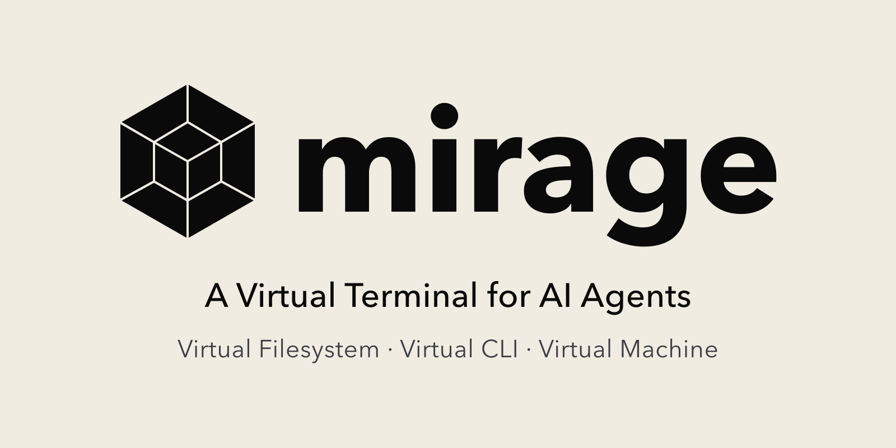
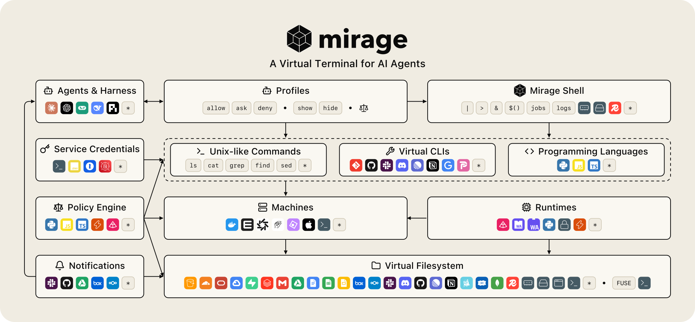

<p align="center">
  <picture>
    <source media="(prefers-color-scheme: dark)" srcset="../assets/mirage-og-dark@2x.png">
    
  </picture>
</p>

<p align="center">
  <a href="https://agentvfs.org">
    <picture>
      <source media="(max-width: 767px) and (prefers-color-scheme: dark)" srcset="../assets/agentvfs-banner-narrow-dark.svg">
      <source media="(max-width: 767px)" srcset="../assets/agentvfs-banner-narrow-light.svg">
      <source media="(prefers-color-scheme: dark)" srcset="../assets/agentvfs-banner-dark.svg">
      
    </picture>
  </a>
</p>

<p align="center">
    <a href="https://docs.mirage.strukto.ai" alt="Documentation">
        </a>
    <a href="https://www.strukto.ai" alt="Site web">
        </a>
    <a href="https://github.com/strukto-ai/mirage/blob/main/LICENSE" alt="Licence">
        </a>
    <a href="https://doi.org/10.5281/zenodo.23504502" alt="DOI">
        </a>
    <a href="https://discord.gg/u8BPQ65KsS" alt="Communauté Discord">
        </a>
    <a href="../assets/wechat-qr-code.jpg" aria-label="Communauté WeChat">
        </a>
    <br/>
    <a href="https://docs.mirage.strukto.ai/python/quickstart" alt="Documentation Python">
        </a>
    <a href="https://pypi.org/project/mirage-ai/" alt="Version PyPI">
        </a>
    <br/>
    <a href="https://docs.mirage.strukto.ai/typescript/quickstart" alt="Documentation TypeScript">
        </a>
    <a href="https://www.npmjs.com/package/@struktoai/mirage-node" alt="Version NPM">
        </a>
</p>

<p align="center">
  <a href="../README.md"></a>
  <a href="./README.zh-CN.md"></a>
  <a href="./README.zh-TW.md"></a>
  <a href="./README.fr.md"></a>
  <a href="./README.de.md"></a>
  <a href="./README.vi.md"></a>
  <a href="./README.ko.md"></a>
</p>

Les LLM sont post-entraînés dans des environnements de terminal, si bien que l'interface que les agents IA connaissent le mieux est celle du terminal. Mais aujourd'hui, un terminal est lié à une seule machine et au noyau de son système d'exploitation, avec ses fichiers et ses calculs sur cette même machine.

Mirage est **un terminal virtuel pour les agents IA** qui sépare l'interface du terminal du stockage des données et des machines de calcul. Il virtualise le shell, le système de fichiers, les CLI et les machines. Chaque terminal virtuel démarre avec seulement quelques Ko de mémoire, si bien que les agents IA peuvent utiliser un terminal partout, dans une application, une application mobile, un onglet de navigateur, un serveur FastAPI ou Express, et même un appareil en périphérie comme un Raspberry Pi.

<p align="center">
  <picture>
    <source media="(prefers-color-scheme: dark)" srcset="../assets/mirage-terminal-dark.svg">
    
  </picture>
</p>

- **Contrôlable.** Chaque agent n'obtient que les fichiers, les commandes, les identifiants et les machines que son profil autorise.
- **Scriptable.** Le terminal entier se définit en code ou dans un seul fichier de configuration, de ses systèmes de fichiers, CLI et machines jusqu'à ses règles.
- **Géré.** L'état repose sur une infrastructure déjà en place, comme la RAM, le disque, Redis ou S3, et chaque commande est enregistrée et peut être exportée sous forme de trace OpenTelemetry.
- **Léger.** Chaque espace de travail n'occupe que quelques Ko de mémoire et Mirage est asynchrone du shell jusqu'à chaque appel de service, si bien qu'un seul processus sert de nombreux agents à la fois. Il se déploie presque partout, sur un serveur Python ou TypeScript, dans un onglet de navigateur, un Cloudflare Worker ou un Raspberry Pi.

<p align="center">
  <picture>
    <source media="(prefers-color-scheme: dark)" srcset="../assets/mirage-arch-dark.svg">
    
  </picture>
</p>

Voici un exemple de lancement de Mirage dans une application :

```python
ws = Workspace(
    {
        "/s3":    (S3VFS(S3Config(bucket="my-bucket")), MountMode.WRITE),
        "/slack": (SlackVFS(SlackConfig(token=slack_bot_token)), MountMode.EXEC),
        "/gmail": (GmailVFS(GmailConfig(**google_credentials)), MountMode.READ),
    },
    # installe le CLI Slack, lancé par son nom et listé par `man` et `which` comme tout programme
    clis={"slack": (SLACK, {"token": slack_bot_token})},
    # le profil analyst masque /s3/secrets et interdit de publier sur Slack et curl
    profiles={
        "analyst": {
            "paths": {"hide": ["/s3/secrets"]},
            "commands": {"deny": ["slack send-message", "curl"]},
        },
    },
    # python tourne sur monty dans le processus, ou dans le bac à sable e2b
    machines={
        "py": {"provider": "in_process", "runtime": "monty"},
        "box": {"provider": "e2b", "sandbox_id": sandbox_id, "mount_type": "ssh", "captures": ["python", "python3"]},
    },
    # route le calcul sous-jacent : les lignes numpy tournent sur la machine, le reste sur monty
    route_policy=lambda ctx: "box" if "numpy" in ctx.line else None,
)

# ajoute un agent qui utilise le profil analyst
alice = await ws.session("alice", profile="analyst")

# un seul grep balaie S3, Slack et Gmail, via la recherche propre à chaque service quand elle existe
await alice.shell("grep -rlw invoice /s3 /slack /gmail")

# exécute sur monty un script hébergé dans Slack, écrit le rapport dans S3
await alice.shell("python3 /slack/channels/general__C0123/2026-10-21/files/report__F0456.py > /s3/report.txt")

# numpy n'est pas dans monty, donc la politique de routage envoie cette ligne à e2b
await alice.shell("python3 -c 'import numpy; print(numpy.arange(10).sum())'")
```

Et ce que `alice` voit dans le shell :

```console
$ grep -rlw invoice /s3 /slack /gmail
/s3/billing/2026-10.csv
/gmail/INBOX/2026-10-21/Invoice_1042__18f3a9c2b7d1e0f4.gmail.json
$ ls /s3
billing
report.txt
$ cat /s3/secrets/aws.txt
cat: /s3/secrets/aws.txt: No such file or directory
$ slack send-message --channel general --text "report is up"
slack: Permission denied
```

## À propos

- **Une interface de terminal virtuel unifiée, au lieu de N SDK et M MCP.** Chaque backend parle la même sémantique de système de fichiers, si bien que les pipelines se composent entre services.
- **Un système de fichiers virtuel sur toutes les sources.** S3, Google Drive, Slack, Gmail, Redis et les autres se montent côte à côte sous une seule racine, si bien qu'un agent les atteint tous via une interface unifiée, avec les outils unix qu'il connaît déjà comme `ls`, `grep`, `find` et `jq`.
- **Outils en ligne de commande virtuels (CLI).** `git`, `slack` et `ntn` sont servis par Mirage lui-même, si bien qu'un agent pilote le service sans rien installer, à travers différents runtimes et machines, et un même outil peut être virtualisé en deux ou plus, chacun sous son propre nom avec ses propres identifiants.
- **Machines dynamiques et routées.** Python, JavaScript et n'importe quelle autre commande peuvent être envoyés à la machine configurée, en processus, en bac à sable ou à distance, ce qui découple le calcul du stockage et permet de changer l'un sans toucher à l'autre.
- **Le shell Mirage virtualisé.** Il relie le système de fichiers, les CLI et les machines en une seule ligne de commande, si bien que tubes, redirections, variables, jobs et historique fonctionnent à travers les trois.
- **Léger par conception.** Un espace de travail, le terminal virtuel lui-même, occupe environ 100 Ko de mémoire et chaque nouvelle session environ 10 Ko, si bien qu'un seul processus sert de nombreux agents sans conteneur ni VM par agent.
- **Des profils conçus pour les agents.** `allow`, `ask` et `deny` régissent les commandes et les CLI, tandis que `hide` et `show` régissent fichiers et dossiers, si bien qu'un chemin masqué n'est pas seulement illisible mais absent du système de fichiers que voit l'agent.
- **Un moteur de politiques scriptable.** Un script de politique peut interdire toute action dangereuse avant son exécution, et la même pile filtre chaque opération VFS et chaque écriture de session, si bien que ni un fichier ni une variable d'environnement ne fuit.
- **Des notifications câblées au VFS et aux agents.** Les changements externes deviennent un flux d'événements sur le montage, si bien qu'une nouvelle réponse Slack apparaît comme une modification du fichier de conversation dans le système de fichiers virtuel, et l'agent y réagit au lieu de re-parcourir l'arborescence.

## Système de fichiers virtuel unifié

[Mirage](https://www.strukto.ai/mirage) « monte » tout comme un seul système de fichiers virtuel unifié pour les agents IA. Chaque service se place côte à côte sous une seule racine et répond à la même sémantique POSIX.

|                                                | VFS                                                                                                                                                                                                                                                                                                                                                                                                                                                                                                                                                                                                                                                                                                                                                                                                                                                                                                                                                                                                                                                                                                                                                                                                                                                                                                                                                                                                                                                                                                                                                                                                                                                                                                                                                                                                                                                                                                                                                                                                                                                                                                                                                                                                                                                                                                                                                                                                                                                                                                                                                                                                                                                                                                                                                                                                                                                                                                                                                                                                                                                                                                                                                                                                     |
| ---------------------------------------------- | ------------------------------------------------------------------------------------------------------------------------------------------------------------------------------------------------------------------------------------------------------------------------------------------------------------------------------------------------------------------------------------------------------------------------------------------------------------------------------------------------------------------------------------------------------------------------------------------------------------------------------------------------------------------------------------------------------------------------------------------------------------------------------------------------------------------------------------------------------------------------------------------------------------------------------------------------------------------------------------------------------------------------------------------------------------------------------------------------------------------------------------------------------------------------------------------------------------------------------------------------------------------------------------------------------------------------------------------------------------------------------------------------------------------------------------------------------------------------------------------------------------------------------------------------------------------------------------------------------------------------------------------------------------------------------------------------------------------------------------------------------------------------------------------------------------------------------------------------------------------------------------------------------------------------------------------------------------------------------------------------------------------------------------------------------------------------------------------------------------------------------------------------------------------------------------------------------------------------------------------------------------------------------------------------------------------------------------------------------------------------------------------------------------------------------------------------------------------------------------------------------------------------------------------------------------------------------------------------------------------------------------------------------------------------------------------------------------------------------------------------------------------------------------------------------------------------------------------------------------------------------------------------------------------------------------------------------------------------------------------------------------------------------------------------------------------------------------------------------------------------------------------------------------------------------------------------------- |
| **Stockage objet**                             | <a href="https://docs.mirage.strukto.ai/home/setup/s3"></a>  <a href="https://docs.mirage.strukto.ai/home/setup/r2"></a>  <a href="https://docs.mirage.strukto.ai/home/setup/gcs"></a>  <a href="https://docs.mirage.strukto.ai/home/setup/oci"></a>  <a href="https://docs.mirage.strukto.ai/home/setup/supabase"></a>  <a href="https://docs.mirage.strukto.ai/home/setup/minio"></a>  <a href="https://docs.mirage.strukto.ai/home/setup/ceph"></a>  <a href="https://docs.mirage.strukto.ai/home/setup/seaweedfs"></a>  <a href="https://docs.mirage.strukto.ai/home/setup/wasabi"></a>  <a href="https://docs.mirage.strukto.ai/home/setup/backblaze"></a>  <a href="https://docs.mirage.strukto.ai/home/setup/digitalocean"></a>  <a href="https://docs.mirage.strukto.ai/home/setup/aliyun"></a>  <a href="https://docs.mirage.strukto.ai/home/setup/tencent"></a>  <a href="https://docs.mirage.strukto.ai/home/setup/scaleway"></a>  <a href="https://docs.mirage.strukto.ai/home/setup/qingstor"></a>  <a href="https://docs.mirage.strukto.ai/home/setup/hf_buckets"></a>  <a href="https://docs.mirage.strukto.ai/home/setup/gridfs"></a> |
| **Fichiers et documents**                      | <a href="https://docs.mirage.strukto.ai/home/setup/google"></a>  <a href="https://docs.mirage.strukto.ai/home/setup/google"></a>  <a href="https://docs.mirage.strukto.ai/home/setup/google"></a>  <a href="https://docs.mirage.strukto.ai/home/setup/google"></a>  <a href="https://docs.mirage.strukto.ai/home/setup/onedrive"></a>  <a href="https://docs.mirage.strukto.ai/home/setup/sharepoint"></a>  <a href="https://docs.mirage.strukto.ai/home/setup/box"></a>  <a href="https://docs.mirage.strukto.ai/home/setup/dropbox"></a>  <a href="https://docs.mirage.strukto.ai/home/setup/nextcloud"></a> <a href="https://docs.mirage.strukto.ai/home/setup/tidb"></a>                                                                                                                                                                                                                                                                                                                                                                                                                                                                                                                                                                                                                                                                                                                                                                                                                                                                                                                                                                                                                                                     |
| **Messagerie et travail**                      | <a href="https://docs.mirage.strukto.ai/home/setup/slack"></a>  <a href="https://docs.mirage.strukto.ai/home/setup/discord"></a>  <a href="https://docs.mirage.strukto.ai/home/setup/google"></a>  <a href="https://docs.mirage.strukto.ai/home/setup/email"></a>  <a href="https://docs.mirage.strukto.ai/home/setup/github"></a>  <a href="https://docs.mirage.strukto.ai/home/setup/linear"></a>  <a href="https://docs.mirage.strukto.ai/home/setup/notion"></a>  <a href="https://docs.mirage.strukto.ai/home/setup/trello"></a>  <a href="https://docs.mirage.strukto.ai/home/setup/gcal"></a>                                                                                                                                                                                                                                                                                                                                                                                                                                                                                                                                                                                                                                                                                                                                                                                                                                                                                                                                                                                                                                                                                                                                                                                                                                                                                                                                                                                                                                                                                                          |
| **Bases de données et plateformes de données** | <a href="https://docs.mirage.strukto.ai/home/setup/postgres"></a>  <a href="https://docs.mirage.strukto.ai/home/setup/mongodb"></a>  <a href="https://docs.mirage.strukto.ai/home/setup/redis"></a> <a href="https://docs.mirage.strukto.ai/home/setup/redis"></a> <a href="https://docs.mirage.strukto.ai/home/setup/sql"></a> <a href="https://docs.mirage.strukto.ai/home/setup/airtable"></a>  <a href="https://docs.mirage.strukto.ai/home/setup/lancedb"></a>  <a href="https://docs.mirage.strukto.ai/home/setup/qdrant"></a>  <a href="https://docs.mirage.strukto.ai/home/setup/chroma"></a>  <a href="https://docs.mirage.strukto.ai/home/setup/mem0"></a>  <a href="https://docs.mirage.strukto.ai/home/setup/hf_datasets"></a>  <a href="https://docs.mirage.strukto.ai/home/setup/hf_models"></a>  <a href="https://docs.mirage.strukto.ai/home/setup/hf_spaces"></a>  <a href="https://docs.mirage.strukto.ai/home/setup/databricks"></a>  <a href="https://docs.mirage.strukto.ai/home/setup/dify"></a>                                                                                                                                                                                                                                                                                                                                                                                                                            |
| **Observabilité**                              | <a href="https://docs.mirage.strukto.ai/home/setup/langfuse"></a>  <a href="https://docs.mirage.strukto.ai/home/setup/jaeger"></a> <a href="https://docs.mirage.strukto.ai/home/setup/wandb"></a>                                                                                                                                                                                                                                                                                                                                                                                                                                                                                                                                                                                                                                                                                                                                                                                                                                                                                                                                                                                                                                                                                                                                                                                                                                                                                                                                                                                                                                                                                                                                                                                                                                                                                                                                                                                                                                                                                                                                                                                                                                                                                                                                                                                                                                                                                                                                                                                                                                                                                                                                                                                                                                                              |
| **Local et distant**                           | <a href="https://docs.mirage.strukto.ai/home/setup/ram"></a>  <a href="https://docs.mirage.strukto.ai/home/setup/disk"></a>  <a href="https://docs.mirage.strukto.ai/home/setup/opfs"></a>  <a href="https://docs.mirage.strukto.ai/home/setup/ssh"></a>                                                                                                                                                                                                                                                                                                                                                                                                                                                                                                                                                                                                                                                                                                                                                                                                                                                                                                                                                                                                                                                                                                                                                                                                                                                                                                                                                                                                                                                                                                                                                                                                                                                                                                                                                                                                                                                                                                                                                                                                                                                                                                                                                                                                                                                                                                                                                                                                                                                                  |

Les agents y accèdent par les SDK Python et TypeScript, le CLI `mirage` ou un vrai point de montage via FUSE et FSKit, puis le manipulent avec les outils unix qu'ils connaissent déjà, comme `ls`, `grep`, `find` et `jq`.

## CLI virtuelles

Ces outils en ligne de commande sont virtualisés : [Mirage](https://www.strukto.ai/mirage) répond lui-même à `git`, `slack` ou `ntn`, si bien qu'un agent pilote le service sans que le programme soit installé sur la machine. Chacun imite l'outil réel, donc un agent qui connaît le CLI n'a rien de nouveau à apprendre. Parce qu'ils sont virtuels, un même outil peut être installé plusieurs fois sous des noms différents, chacun avec ses propres identifiants, si bien que chaque agent obtient exactement les comptes qui lui sont confiés.

|                        | CLI                                                                                                                                                                                                                                                                                                                                                                                                                                                                                                                                                                                                                                                                                                                                                                                                                                                                                                                                                                                                                                                                                                                                                                                                                                                                                                                                                                                                                                                                                                                                                                                                                                                                        |
| ---------------------- | -------------------------------------------------------------------------------------------------------------------------------------------------------------------------------------------------------------------------------------------------------------------------------------------------------------------------------------------------------------------------------------------------------------------------------------------------------------------------------------------------------------------------------------------------------------------------------------------------------------------------------------------------------------------------------------------------------------------------------------------------------------------------------------------------------------------------------------------------------------------------------------------------------------------------------------------------------------------------------------------------------------------------------------------------------------------------------------------------------------------------------------------------------------------------------------------------------------------------------------------------------------------------------------------------------------------------------------------------------------------------------------------------------------------------------------------------------------------------------------------------------------------------------------------------------------------------------------------------------------------------------------------------------------------------- |
| **Code**               | <a href="https://docs.mirage.strukto.ai/home/setup/cli/git"></a>  <a href="https://docs.mirage.strukto.ai/home/setup/cli/gh"></a>                                                                                                                                                                                                                                                                                                                                                                                                                                                                                                                                                                                                                                                                                                                                                                                                                                                                                                                                                                                                                                                                                                                                                                                                                                                                                                                                       |
| **Communication**      | <a href="https://docs.mirage.strukto.ai/home/setup/cli/slack"></a>  <a href="https://docs.mirage.strukto.ai/home/setup/cli/discord"></a>  <a href="https://docs.mirage.strukto.ai/home/setup/cli/himalaya"></a>                                                                                                                                                                                                                                                                                                                                                                                                                                                                                                                                                                                                                                                                                                                                                                                                                                                                                                                                                                                                                                                                                                                                       |
| **Travail et données** | <a href="https://docs.mirage.strukto.ai/home/setup/cli/linear"></a>  <a href="https://docs.mirage.strukto.ai/home/setup/cli/ntn"></a> <a href="https://docs.mirage.strukto.ai/home/setup/cli/trello"></a> <a href="https://docs.mirage.strukto.ai/home/setup/cli/airtable"></a>  <a href="https://docs.mirage.strukto.ai/home/setup/cli/gws"></a>  <a href="https://docs.mirage.strukto.ai/home/setup/cli/hf"></a> <a href="https://docs.mirage.strukto.ai/home/setup/cli/office"></a> <a href="https://docs.mirage.strukto.ai/home/setup/cli/pdftotext"></a> <a href="https://docs.mirage.strukto.ai/home/setup/cli/pdfinfo"></a> |

## Machines virtuelles

Les machines sont virtualisées de la même façon, et pas seulement pour les langages de programmation. N'importe quelle commande de la ligne peut être envoyée vers une machine configurée : Python peut ainsi s'exécuter en processus avec [Monty](https://pydantic.dev/articles/pydantic-monty) tandis qu'une autre commande, disons `kubectl`, s'exécute sur une machine distante via SSH. La machine qui sert une ligne donnée peut être choisie par un [routeur de machines scripté](https://docs.mirage.strukto.ai/home/policy/route-machine).

|                | Machines                                                                                                                                                                                                                                                                                                                                                                                                                                                                                                                                                                                                                                                                                                                                                                                                                                                                                                                                                                                                                                                                                                                                                                                                                                                                                                                                                                                                                                                                                                                                                                                                                                                                                                                                                                                                                                                    |
| -------------- | ----------------------------------------------------------------------------------------------------------------------------------------------------------------------------------------------------------------------------------------------------------------------------------------------------------------------------------------------------------------------------------------------------------------------------------------------------------------------------------------------------------------------------------------------------------------------------------------------------------------------------------------------------------------------------------------------------------------------------------------------------------------------------------------------------------------------------------------------------------------------------------------------------------------------------------------------------------------------------------------------------------------------------------------------------------------------------------------------------------------------------------------------------------------------------------------------------------------------------------------------------------------------------------------------------------------------------------------------------------------------------------------------------------------------------------------------------------------------------------------------------------------------------------------------------------------------------------------------------------------------------------------------------------------------------------------------------------------------------------------------------------------------------------------------------------------------------------------------------------- |
| **Python**     | <a href="https://docs.mirage.strukto.ai/home/setup/runtime/monty"></a>  <a href="https://docs.mirage.strukto.ai/home/setup/runtime/wasi"></a>  <a href="https://docs.mirage.strukto.ai/home/setup/runtime/pyodide"></a>  <a href="https://docs.mirage.strukto.ai/home/setup/machine/host"></a>  <a href="https://docs.mirage.strukto.ai/home/setup/machine/host"></a>                                                                                                                                                                                                                                                                                                                                                                                                                                                                                                                                                                                                                                                                                                                                                                                                                                                                                                                      |
| **JavaScript** | <a href="https://docs.mirage.strukto.ai/home/setup/runtime/quickjs"></a> <a href="https://docs.mirage.strukto.ai/home/setup/runtime/quickjs"></a> <a href="https://docs.mirage.strukto.ai/home/setup/runtime/quickjs"></a>                                                                                                                                                                                                                                                                                                                                                                                                                                                                                                                                                                                                                                                                                                                                                                                                                                                                                                                                                                                                                                                                                                                                                                                                                                                            |
| **Machines**   | <a href="https://docs.mirage.strukto.ai/home/setup/machine/docker"></a> <a href="https://docs.mirage.strukto.ai/home/setup/machine/kubernetes"></a>  <a href="https://docs.mirage.strukto.ai/home/setup/machine/e2b"></a>  <a href="https://docs.mirage.strukto.ai/home/setup/machine/daytona"></a> <a href="https://docs.mirage.strukto.ai/home/setup/machine/cloudflare_container"></a> <a href="https://docs.mirage.strukto.ai/home/setup/machine/boxd"></a>  <a href="https://docs.mirage.strukto.ai/home/setup/machine/smolvm"></a> <a href="https://docs.mirage.strukto.ai/home/setup/machine/microsandbox"></a> <a href="https://docs.mirage.strukto.ai/home/setup/machine/apple_container"></a>  <a href="https://docs.mirage.strukto.ai/home/setup/machine/ssh"></a> |

## Sécurité

Un profil décide de ce qu'une session peut exécuter et de ce qu'elle peut voir. Les commandes sont régies par des règles `allow`, `ask` et `deny` personnalisables, et les chemins par `hide` et `show`, si bien qu'un fichier masqué n'est pas seulement illisible mais absent du système de fichiers que voit l'agent. Pour tout ce que ces règles ne peuvent exprimer, un profil peut désigner un script de politique qui s'exécute à l'entrée de chaque commande et répond lui-même allow, deny ou ask, mais comme toute règle il ne peut que restreindre, jamais accorder. Par ailleurs, un hôte peut enregistrer ses propres politiques sur le [moteur de politiques](https://docs.mirage.strukto.ai/home/policy/policies), une pile ordonnée que l'espace de travail consulte à chaque commande, opération VFS et écriture de session. Voir la [documentation des politiques](https://docs.mirage.strukto.ai/home/policy/overview).

## Identifiants de service

Les identifiants de service s'intègrent aux coffres où vivent déjà les secrets, dont AWS Secrets Manager, 1Password et dotenv, si bien qu'une variable d'environnement dans Mirage peut se résoudre directement en un identifiant conservé dans l'un d'eux.

|                    | Sources                                                                                                                                                                                                                                                                                                                                                                                                                                    |
| ------------------ | ------------------------------------------------------------------------------------------------------------------------------------------------------------------------------------------------------------------------------------------------------------------------------------------------------------------------------------------------------------------------------------------------------------------------------------------ |
| **Intégrées**      | <a href="https://docs.mirage.strukto.ai/home/service-credentials#sources"></a> <a href="https://docs.mirage.strukto.ai/home/service-credentials#sources"></a>                                                                    |
| **Personnalisées** | <a href="https://docs.mirage.strukto.ai/home/service-credentials/1password"></a> <a href="https://docs.mirage.strukto.ai/home/service-credentials/aws-secrets-manager"></a> |

## Installation

- **Python** ≥ 3.12 pour le paquet `mirage-ai` et le CLI `mirage`
- **Node.js** 22.20+ sur Node 22, 24.12+ sur Node 24, ou 25+ pour le SDK TypeScript

### Python

```bash
uv add mirage-ai              # installe la bibliothèque `mirage` et le binaire CLI `mirage`
uv add 'mirage-ai[openai]'    # adaptateur OpenAI Agents ; chaque framework d'agents est un extra
uv add 'mirage-ai[monty]'     # Monty, le runtime Python en processus des exemples
```

### TypeScript

```bash
npm install @struktoai/mirage-node      # serveurs Node.js et CLI
npm install @struktoai/mirage-browser   # navigateur / runtimes edge
```

Les deux paquets runtime installent automatiquement `@struktoai/mirage-core`.

### CLI

```bash
npm install -g @struktoai/mirage-cli
# ou
uvx --from mirage-ai mirage
# ou
npx @struktoai/mirage-cli
```

Pour démarrer, consultez les guides de démarrage rapide pour [Python](https://docs.mirage.strukto.ai/python/quickstart), [TypeScript](https://docs.mirage.strukto.ai/typescript/quickstart) et le [CLI](https://docs.mirage.strukto.ai/home/access/cli).

## Politiques scriptables

Un profil peut désigner des scripts de politique pour ce que ses règles ne peuvent exprimer. Le `pre_command` d'un script reçoit la commande, peut ouvrir les fichiers qu'elle nomme et renvoie un deny, un ask ou `None`. Celui-ci désactive `rm`, ainsi que tout script Python dont le code supprime des fichiers :

```python
def deletes(path):
    try:
        code = open(path).read()
    except OSError:
        return False
    return any(call in code for call in ("os.remove", "os.unlink", "shutil.rmtree"))


def pre_command(ctx):
    if ctx["command"] == "rm" or (
        ctx["command"].startswith("python") and any(deletes(p) for p in ctx["paths"])
    ):
        return {"kind": "deny", "reason": "deleting files is disabled"}
```

Enregistrez-le dans un profil, ici pour qu'il s'exécute sur Monty avant chaque commande :

```python
ws = Workspace(
    {"/s3": (S3VFS(S3Config(bucket="my-bucket")), MountMode.WRITE)},
    profiles={
        "analyst": {
            "policy": {
                "pre_command": [{"script": ScriptSource(Path("guard.py").read_text()), "runtime": "monty"}],
            },
        },
    },
    profile="analyst",
)
```

```console
$ cat /s3/clean.py
import os
os.remove("/s3/report.txt")
$ rm /s3/report.txt
rm: Permission denied
$ python3 /s3/clean.py
python3: Permission denied
```

Voir les [scripts de politique](https://docs.mirage.strukto.ai/home/policy/scripts) pour les autres étapes auxquelles un script peut répondre.

## Exemples

- **[In-Process Terminal](https://docs.mirage.strukto.ai/home/examples/in-process-terminal).** Un terminal pour agents au sein de votre application, même dans un serveur FastAPI ou Express, sans machine ni sandbox fixe.
- **[Multi-machine Terminal](https://docs.mirage.strukto.ai/home/examples/multi-machine-terminal).** Un terminal virtuel unifié sur différentes machines, qui exécute chaque tâche sur la machine qui lui convient, pour que les agents IA travaillent plus efficacement et à moindre coût.
- **[Secured Terminal](https://docs.mirage.strukto.ai/home/examples/secured-terminal).** Décidez dans une seule configuration de workspace quels fichiers un agent voit, quelles commandes et CLI il exécute et quels identifiants ses outils utilisent.
- **[Infra-agnostic Terminal](https://docs.mirage.strukto.ai/home/examples/infra-agnostic-terminal).** Un terminal virtuel qui n'est lié à aucune infrastructure fixe et garde ses fichiers, ses sessions et ses journaux de commandes sur les backends déjà en place.

## Contributeurs

Merci à toutes les personnes qui ont contribué à Mirage.

<a href="https://github.com/strukto-ai/mirage/graphs/contributors">
  
</a>
