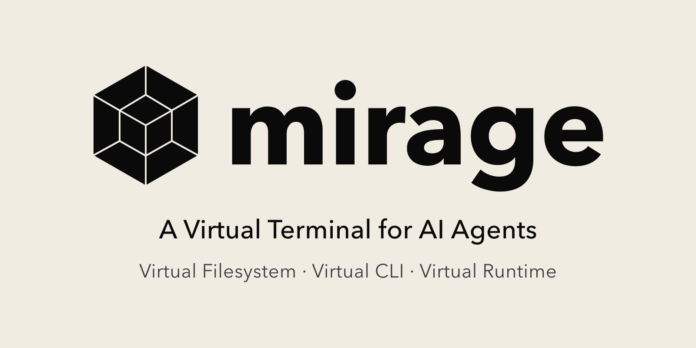
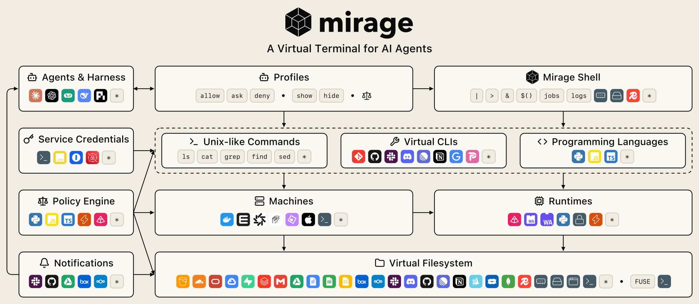
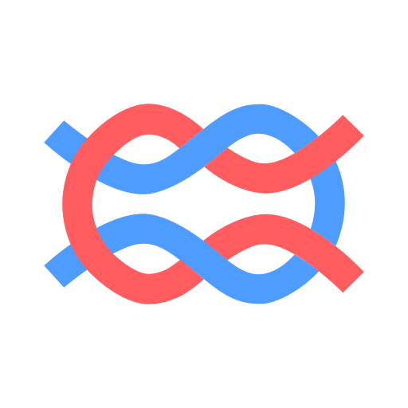

<p align="center">
  <picture>
    <source media="(prefers-color-scheme: dark)" srcset="../assets/mirage-og-dark@2x.png">
    
  </picture>
</p>

<p align="center">
  <a href="https://agentvfs.org">
    <picture>
      <source media="(max-width: 767px) and (prefers-color-scheme: dark)" srcset="../assets/agentvfs-banner-narrow-dark.svg">
      <source media="(max-width: 767px)" srcset="../assets/agentvfs-banner-narrow-light.svg">
      <source media="(prefers-color-scheme: dark)" srcset="../assets/agentvfs-banner-dark.svg">
      
    </picture>
  </a>
</p>

<p align="center">
    <a href="https://docs.mirage.strukto.ai" alt="문서">
        </a>
    <a href="https://www.strukto.ai" alt="웹사이트">
        </a>
    <a href="https://github.com/strukto-ai/mirage/blob/main/LICENSE" alt="라이선스">
        </a>
    <a href="https://doi.org/10.5281/zenodo.23504502" alt="DOI">
        </a>
    <a href="https://discord.gg/u8BPQ65KsS" alt="Discord">
        </a>
    <a href="../assets/wechat-qr-code.jpg" aria-label="WeChat 커뮤니티">
        </a>
    <br/>
    <a href="https://docs.mirage.strukto.ai/python/quickstart" alt="Python 문서">
        </a>
    <a href="https://pypi.org/project/mirage-ai/" alt="PyPI 버전">
        </a>
    <br/>
    <a href="https://docs.mirage.strukto.ai/typescript/quickstart" alt="TypeScript 문서">
        </a>
    <a href="https://www.npmjs.com/package/@struktoai/mirage-node" alt="NPM 버전">
        </a>
</p>

<p align="center">
  <a href="../README.md"></a>
  <a href="./README.zh-CN.md"></a>
  <a href="./README.zh-TW.md"></a>
  <a href="./README.fr.md"></a>
  <a href="./README.de.md"></a>
  <a href="./README.vi.md"></a>
  <a href="./README.ko.md"></a>
</p>

Mirage는 **AI 에이전트를 위한 가상 터미널**입니다. 데이터와 CLI, 런타임을 하나로 아우르는 셸입니다. Unix 도구가 모든 서비스에 닿고, `grep`은 Gmail이나 Slack처럼 각 서비스 자체의 검색 위에서 실행됩니다. Mirage는 각 명령을 알맞은 런타임으로 라우팅하므로 대부분의 명령줄은 프로세스 안에서 실행되고 무거운 작업만 샌드박스로 가서 인프라 비용과 토큰을 줄입니다. 터미널 자체도 가볍습니다. 워크스페이스 하나는 메모리를 **약 100 KB**, 새 세션은 **약 10 KB** 차지하므로 하나의 프로세스가 많은 에이전트를 동시에 처리합니다. 프로파일은 에이전트가 무엇을 실행하고 무엇을 볼 수 있는지까지 정하며, 스크립트로 작성하는 정책은 그 규칙으로 표현할 수 없는 것을 거부합니다.

<p align="center">
  <picture>
    <source media="(prefers-color-scheme: dark)" srcset="../assets/mirage-arch-dark.svg">
    
  </picture>
</p>

다음은 애플리케이션 안에서 Mirage를 실행하는 예입니다:

```python
ws = Workspace(
    {
        "/s3":    (S3VFS(S3Config(bucket="my-bucket")), MountMode.WRITE),
        "/slack": (SlackVFS(SlackConfig(token=slack_bot_token)), MountMode.EXEC),
        "/gmail": (GmailVFS(GmailConfig(**google_credentials)), MountMode.READ),
    },
    # Slack CLI를 설치한다. 다른 프로그램처럼 이름으로 실행되고 `man`과 `which`에 나타난다
    clis={"slack": (SLACK, {"token": slack_bot_token})},
    # analyst 프로파일은 /s3/secrets를 숨기고 Slack 게시와 curl을 금지한다
    profiles={
        "analyst": {
            "paths": {"hide": ["/s3/secrets"]},
            "commands": {"deny": ["slack send-message", "curl"]},
        },
    },
    # python은 워커의 monty에서, 또는 e2b 샌드박스에서 실행된다
    machines={
        "py": {"provider": "worker"},
        "box": {"provider": "e2b", "sandbox_id": sandbox_id, "mount_type": "ssh", "captures": ["python", "python3"]},
    },
    # 연산을 라우팅한다: numpy 줄은 머신에서, 나머지는 monty에서 실행된다
    route_policy=lambda ctx: "box" if "numpy" in ctx.line else None,
)

# analyst 프로파일을 쓰는 에이전트를 추가한다
alice = await ws.session("alice", profile="analyst")

# grep 한 번으로 S3, Slack, Gmail을 훑는다. 자체 검색이 있는 서비스는 그 검색을 쓴다
await alice.shell("grep -rlw invoice /s3 /slack /gmail")

# Slack에 있는 스크립트를 monty에서 실행하고 리포트를 S3에 기록한다
await alice.shell("python3 /slack/channels/general__C0123/2026-10-21/files/report__F0456.py > /s3/report.txt")

# monty에는 numpy가 없으므로 라우팅 정책이 이 줄을 e2b로 보낸다
await alice.shell("python3 -c 'import numpy; print(numpy.arange(10).sum())'")
```

`alice`가 셸에서 보는 화면은 다음과 같습니다:

```console
$ grep -rlw invoice /s3 /slack /gmail
/s3/billing/2026-10.csv
/gmail/INBOX/2026-10-21/Invoice_1042__18f3a9c2b7d1e0f4.gmail.json
$ ls /s3
billing
report.txt
$ cat /s3/secrets/aws.txt
cat: /s3/secrets/aws.txt: No such file or directory
$ slack send-message --channel general --text "report is up"
slack: Permission denied
```

## 소개

- **N개의 SDK와 M개의 MCP 대신 통합된 가상 터미널 인터페이스.** 모든 백엔드가 동일한 파일 시스템 의미론을 사용하므로 파이프라인이 서비스 간에 조합됩니다.
- **모든 소스를 아우르는 가상 파일 시스템.** S3, Google Drive, Slack, Gmail, Redis 등이 하나의 루트 아래 나란히 마운트되어, 에이전트는 이미 아는 unix 도구인 `ls`, `grep`, `find`, `jq`로 통합된 인터페이스를 통해 모두에 접근합니다.
- **가상 명령줄 도구(CLI).** `git`, `slack`, `ntn`은 Mirage가 직접 응답하므로 에이전트는 아무것도 설치하지 않고 서로 다른 런타임과 머신에 걸쳐 서비스를 다룰 수 있고, 하나의 도구를 둘 이상으로 가상화해 각각 고유한 이름과 자격 증명을 줄 수 있습니다.
- **라우팅되는 동적 런타임.** Python, JavaScript를 비롯한 모든 명령을 설정된 런타임으로, 프로세스 내부나 샌드박스 또는 원격으로 보낼 수 있어 연산과 저장소가 분리되고 한쪽을 건드리지 않고 다른 쪽을 바꿀 수 있습니다.
- **가상화된 Mirage 셸.** 파일 시스템과 CLI, 런타임을 하나의 명령줄로 묶어 파이프, 리다이렉션, 변수, 잡, 히스토리가 셋 모두에서 동작합니다.
- **가벼운 설계.** 가상 터미널 그 자체인 워크스페이스는 메모리를 약 100 KB, 새 세션은 약 10 KB 차지하므로, 에이전트마다 컨테이너나 VM 없이 하나의 프로세스가 많은 에이전트를 처리합니다.
- **에이전트를 위해 설계된 프로파일.** `allow`, `ask`, `deny`가 명령과 CLI를 통제하고 `hide`와 `show`가 파일과 폴더를 통제하므로, 숨겨진 경로는 단순히 읽을 수 없는 것이 아니라 에이전트가 보는 파일 시스템에 존재하지 않습니다.
- **스크립트로 작성하는 정책 엔진.** 정책 스크립트는 위험한 동작을 실행 전에 금지할 수 있으며, 같은 스택이 모든 VFS 작업과 세션 쓰기를 통제하므로 파일도 환경 변수도 새어 나가지 않습니다.
- **VFS와 에이전트에 연결된 알림.** 외부 변경이 마운트의 이벤트 스트림이 되므로 새로운 Slack 답장은 가상 파일 시스템의 대화 파일 변경으로 나타나고, 에이전트는 트리를 다시 훑는 대신 그에 반응합니다.

## 가상 파일 시스템

[Mirage](https://www.strukto.ai/mirage)는 모든 것을 AI 에이전트를 위한 하나의 통합 가상 파일 시스템으로 "마운트"합니다. 각 서비스는 하나의 루트 아래 나란히 놓이고 같은 POSIX 의미론을 따릅니다.

|                                  | VFS                                                                                                                                                                                                                                                                                                                                                                                                                                                                                                                                                                                                                                                                                                                                                                                                                                                                                                                                                                                                                                                                                                                                                                                                                                                                                                                                                                                                                                                                                                                                                                                                                                                                                                                                                                                                                                                                                                                                                                                                                                                                                                                                                                                                                                                                                                                                                                                                                                                                                                                                                                                                                                                                                                                                                                                                                                                                                                                                                                                               |
| -------------------------------- | ------------------------------------------------------------------------------------------------------------------------------------------------------------------------------------------------------------------------------------------------------------------------------------------------------------------------------------------------------------------------------------------------------------------------------------------------------------------------------------------------------------------------------------------------------------------------------------------------------------------------------------------------------------------------------------------------------------------------------------------------------------------------------------------------------------------------------------------------------------------------------------------------------------------------------------------------------------------------------------------------------------------------------------------------------------------------------------------------------------------------------------------------------------------------------------------------------------------------------------------------------------------------------------------------------------------------------------------------------------------------------------------------------------------------------------------------------------------------------------------------------------------------------------------------------------------------------------------------------------------------------------------------------------------------------------------------------------------------------------------------------------------------------------------------------------------------------------------------------------------------------------------------------------------------------------------------------------------------------------------------------------------------------------------------------------------------------------------------------------------------------------------------------------------------------------------------------------------------------------------------------------------------------------------------------------------------------------------------------------------------------------------------------------------------------------------------------------------------------------------------------------------------------------------------------------------------------------------------------------------------------------------------------------------------------------------------------------------------------------------------------------------------------------------------------------------------------------------------------------------------------------------------------------------------------------------------------------------------------------------------- |
| **오브젝트 스토리지**            | <a href="https://aws.amazon.com/s3/"></a>  <a href="https://developers.cloudflare.com/r2/"></a>  <a href="https://cloud.google.com/storage"></a>  <a href="https://www.oracle.com/cloud/storage/"></a>  <a href="https://supabase.com/storage"></a>  <a href="https://min.io"></a>  <a href="https://ceph.io/en/discover/technology/"></a>  <a href="https://github.com/seaweedfs/seaweedfs"></a>  <a href="https://wasabi.com/cloud-object-storage"></a>  <a href="https://www.backblaze.com/cloud-storage"></a>  <a href="https://www.digitalocean.com/products/spaces"></a>  <a href="https://www.alibabacloud.com/product/oss"></a>  <a href="https://www.tencentcloud.com/products/cos"></a>  <a href="https://www.scaleway.com/en/object-storage/"></a>  <a href="https://www.qingcloud.com/products/qingstor"></a>  <a href="https://huggingface.co/docs/hub/storage-buckets"></a>  <a href="https://www.mongodb.com/docs/manual/core/gridfs/"></a> |
| **파일과 문서**                  | <a href="https://workspace.google.com/products/drive/"></a>  <a href="https://docs.google.com"></a>  <a href="https://sheets.google.com"></a>  <a href="https://slides.google.com"></a>  <a href="https://www.microsoft.com/microsoft-365/onedrive/online-cloud-storage"></a>  <a href="https://www.microsoft.com/microsoft-365/sharepoint/collaboration"></a>  <a href="https://www.box.com"></a>  <a href="https://www.dropbox.com"></a>  <a href="https://nextcloud.com/files/"></a>                                                                                                                                                                                                                                                                                                                                                                                                                                                                                                                                                                                                                                                                                                                                                                                                                                                                                                                                                                                                                                                                                                                                                                                                                                     |
| **메시징과 업무**                | <a href="https://slack.com"></a>  <a href="https://discord.com"></a>  <a href="https://mail.google.com"></a>  <a href="https://en.wikipedia.org/wiki/Internet_Message_Access_Protocol"></a>  <a href="https://github.com"></a>  <a href="https://linear.app"></a>  <a href="https://www.notion.so"></a>  <a href="https://trello.com"></a>  <a href="https://workspace.google.com/products/calendar/"></a>                                                                                                                                                                                                                                                                                                                                                                                                                                                                                                                                                                                                                                                                                                                                                                                                                                                                                                                                                                                                                                                                                                                                                                                                                                                                                                                                                                                                                                                                                                         |
| **데이터베이스와 데이터 플랫폼** | <a href="https://www.postgresql.org"></a>  <a href="https://www.mongodb.com"></a>  <a href="https://redis.io"></a> <a href="https://upstash.com"></a>  <a href="https://lancedb.com"></a>  <a href="https://qdrant.tech"></a>  <a href="https://www.trychroma.com"></a>  <a href="https://mem0.ai"></a>  <a href="https://huggingface.co/datasets"></a>  <a href="https://huggingface.co/models"></a>  <a href="https://huggingface.co/spaces"></a>  <a href="https://docs.databricks.com/aws/en/volumes/"></a>  <a href="https://dify.ai"></a>                                                                                                                                                                                                                                                                                                                                                                                                                                                                                                                                                                                                                                                                                                                                                                                                                                                                                                                                          |
| **관측성**                       | <a href="https://langfuse.com"></a>  <a href="https://www.jaegertracing.io"></a>                                                                                                                                                                                                                                                                                                                                                                                                                                                                                                                                                                                                                                                                                                                                                                                                                                                                                                                                                                                                                                                                                                                                                                                                                                                                                                                                                                                                                                                                                                                                                                                                                                                                                                                                                                                                                                                                                                                                                                                                                                                                                                                                                                                                                                                                                                                                                                                                                                                                                                                                                                                                                                                                                                          |
| **로컬과 원격**                  | <a href="https://en.wikipedia.org/wiki/Random-access_memory"></a>  <a href="https://en.wikipedia.org/wiki/File_system"></a>  <a href="https://developer.mozilla.org/en-US/docs/Web/API/File_System_API/Origin_private_file_system"></a>  <a href="https://en.wikipedia.org/wiki/Secure_Shell"></a>                                                                                                                                                                                                                                                                                                                                                                                                                                                                                                                                                                                                                                                                                                                                                                                                                                                                                                                                                                                                                                                                                                                                                                                                                                                                                                                                                                                                                                                                                                                                                                                                                                                                                                                                                                                                                                                                                                                                                                                                                                                                                                                                                                                                                  |

에이전트는 Python과 TypeScript SDK, `mirage` CLI, 또는 FUSE와 FSKit을 통한 실제 마운트 지점으로 접근한 뒤, `ls`, `grep`, `find`, `jq`처럼 이미 아는 unix 도구로 다룹니다.

## 가상 명령줄 도구

이 명령줄 도구들은 가상화되어 있습니다. [Mirage](https://www.strukto.ai/mirage)가 `git`, `slack`, `ntn`에 직접 응답하므로, 에이전트는 머신에 해당 프로그램이 설치되지 않아도 서비스를 다룹니다. 각 도구는 실제 도구를 그대로 흉내 내므로 그 CLI를 아는 에이전트는 새로 배울 것이 없습니다. 가상이기 때문에 같은 도구를 서로 다른 이름으로 여러 번 설치하고 각각에 고유한 자격 증명을 줄 수 있어, 모든 에이전트가 정확히 주어진 계정만 갖습니다.

|                   | CLI                                                                                                                                                                                                                                                                                                                                                                                                                                                                                                                                                                    |
| ----------------- | ---------------------------------------------------------------------------------------------------------------------------------------------------------------------------------------------------------------------------------------------------------------------------------------------------------------------------------------------------------------------------------------------------------------------------------------------------------------------------------------------------------------------------------------------------------------------- |
| **코드**          | <a href="https://git-scm.com"></a>  <a href="https://cli.github.com"></a>                                                                                                                                                                                                                                                                                           |
| **커뮤니케이션**  | <a href="https://slack.com"></a>  <a href="https://discord.com"></a>  <a href="https://github.com/pimalaya/himalaya"></a>                                                                                                                         |
| **업무와 데이터** | <a href="https://linear.app"></a>  <a href="https://www.notion.so"></a>  <a href="https://workspace.google.com"></a>  <a href="https://huggingface.co"></a> |

## 가상 런타임

런타임도 같은 방식으로 가상화되며, 프로그래밍 언어에만 해당하지 않습니다. 명령줄의 어떤 명령이든 설정된 런타임으로 보낼 수 있어서, Python은 [Monty](https://pydantic.dev/articles/pydantic-monty)로 프로세스 안에서 실행하고 다른 명령, 예를 들어 `kubectl`은 SSH로 원격 머신에 보낼 수 있습니다. 어떤 줄을 어떤 런타임이 처리할지는 [스크립트 런타임 라우터](https://docs.mirage.strukto.ai/home/policy/route-runtime)가 결정할 수 있습니다.

|                | 런타임                                                                                                                                                                                                                                                                                                                                                                                                                                                                                                                                                                                                                                                                                                                                                                                                                                                                                                                                                                                                                                        |
| -------------- | --------------------------------------------------------------------------------------------------------------------------------------------------------------------------------------------------------------------------------------------------------------------------------------------------------------------------------------------------------------------------------------------------------------------------------------------------------------------------------------------------------------------------------------------------------------------------------------------------------------------------------------------------------------------------------------------------------------------------------------------------------------------------------------------------------------------------------------------------------------------------------------------------------------------------------------------------------------------------------------------------------------------------------------------- |
| **Python**     | <a href="https://pydantic.dev/articles/pydantic-monty"></a>  <a href="https://wasi.dev"></a>  <a href="https://pyodide.org"></a>  <a href="https://pypi.org/project/sandlock/"></a>  <a href="https://www.python.org"></a>                                                                                                                                                                                                                                                   |
| **JavaScript** | <a href="https://docs.mirage.strukto.ai/home/setup/runtime/quickjs"></a> <a href="https://developer.mozilla.org/en-US/docs/Web/JavaScript"></a> <a href="https://www.typescriptlang.org"></a>                                                                                                                                                                                                                                                                                                                                                                                                                                                                           |
| **머신**       | <a href="https://www.docker.com"></a>  <a href="https://e2b.dev"></a>  <a href="https://www.daytona.io"></a>  <a href="https://smolmachines.com"></a> <a href="https://microsandbox.dev"></a> <a href="https://github.com/apple/container"></a>  <a href="https://en.wikipedia.org/wiki/Secure_Shell"></a> |

## 보안

프로파일은 세션이 무엇을 실행하고 무엇을 볼 수 있는지 정합니다. 명령은 사용자 정의 가능한 `allow`, `ask`, `deny` 규칙으로, 경로는 `hide`와 `show`로 통제하므로, 숨겨진 파일은 단순히 읽을 수 없는 것이 아니라 에이전트가 보는 파일 시스템에 존재하지 않습니다. 이 규칙으로 표현할 수 없는 경우에는 프로파일이 정책 스크립트를 지정할 수 있습니다. 이 스크립트는 모든 명령의 관문에서 실행되어 allow, deny, ask를 직접 답하지만, 다른 모든 규칙처럼 제한만 할 수 있고 권한을 부여하지는 못합니다. 이와 별도로 호스트는 [정책 엔진](https://docs.mirage.strukto.ai/home/policy/policies)에 자체 정책을 등록할 수 있습니다. 정책 엔진은 워크스페이스가 모든 명령, VFS 작업, 세션 쓰기마다 참조하는 순서 있는 스택입니다. [정책 문서](https://docs.mirage.strukto.ai/home/policy/overview)를 참고하세요.

## 서비스 자격 증명

서비스 자격 증명은 비밀이 이미 저장된 곳, 즉 AWS Secrets Manager, 1Password, dotenv와 연동되므로, Mirage의 환경 변수가 그중 한 곳에 있는 자격 증명으로 바로 해석될 수 있습니다.

|                 | 소스                                                                                                                                                                                                                                                                                                                                                       |
| --------------- | ---------------------------------------------------------------------------------------------------------------------------------------------------------------------------------------------------------------------------------------------------------------------------------------------------------------------------------------------------------- |
| **내장**        | <a href="https://en.wikipedia.org/wiki/Environment_variable"></a> <a href="https://www.dotenv.org"></a>                                          |
| **사용자 정의** | <a href="https://1password.com"></a> <a href="https://aws.amazon.com/secrets-manager/"></a> |

## 설치

- **Python** ≥ 3.12: `mirage-ai` 패키지와 `mirage` CLI
- **Node.js** Node 22는 22.20+, Node 24는 24.12+, 또는 25+: TypeScript SDK

### Python

```bash
uv add mirage-ai              # `mirage` 라이브러리와 `mirage` CLI 바이너리를 설치
uv add 'mirage-ai[openai]'    # OpenAI Agents 어댑터, 에이전트 프레임워크마다 별도 extra
uv add 'mirage-ai[monty]'     # Monty, 예제가 쓰는 프로세스 내 Python 런타임
```

### TypeScript

```bash
npm install @struktoai/mirage-node      # Node.js 서버와 CLI
npm install @struktoai/mirage-browser   # 브라우저 / edge 런타임
npm install @struktoai/mirage-vercel    # Vercel AI 어댑터, 에이전트 프레임워크마다 별도 패키지
```

두 런타임 패키지 모두 `@struktoai/mirage-core`를 자동으로 가져옵니다.

### CLI

```bash
npm install -g @struktoai/mirage-cli
# 또는
uvx --from mirage-ai mirage
# 또는
npx @struktoai/mirage-cli
```

시작하려면 [Python](https://docs.mirage.strukto.ai/python/quickstart), [TypeScript](https://docs.mirage.strukto.ai/typescript/quickstart), [CLI](https://docs.mirage.strukto.ai/home/access/cli) 빠른 시작 가이드를 참고하세요.

## 스크립트 정책

프로파일은 규칙으로 표현할 수 없는 것을 위해 정책 스크립트를 지정할 수 있습니다. 스크립트의 `pre_command`는 명령을 받아 그 명령이 가리키는 파일을 열어 볼 수 있고, deny나 ask 또는 `None`을 반환합니다. 다음 스크립트는 `rm`과, 코드가 파일을 삭제하는 Python 스크립트를 막습니다:

```python
def deletes(path):
    try:
        code = open(path).read()
    except OSError:
        return False
    return any(call in code for call in ("os.remove", "os.unlink", "shutil.rmtree"))


def pre_command(ctx):
    if ctx["command"] == "rm" or (
        ctx["command"].startswith("python") and any(deletes(p) for p in ctx["paths"])
    ):
        return {"kind": "deny", "reason": "deleting files is disabled"}
```

프로파일에 등록합니다. 여기서는 모든 명령 전에 Monty에서 실행되도록 합니다:

```python
ws = Workspace(
    {"/s3": (S3VFS(S3Config(bucket="my-bucket")), MountMode.WRITE)},
    profiles={
        "analyst": {
            "policy": {
                "pre_command": [{"script": ScriptSource(Path("guard.py").read_text()), "runtime": "monty"}],
            },
        },
    },
    profile="analyst",
)
```

```console
$ cat /s3/clean.py
import os
os.remove("/s3/report.txt")
$ rm /s3/report.txt
rm: Permission denied
$ python3 /s3/clean.py
python3: Permission denied
```

스크립트가 응답할 수 있는 다른 단계는 [정책 스크립트](https://docs.mirage.strukto.ai/home/policy/scripts)를 참고하세요.

## 임베디드 터미널

대부분의 경우 에이전트에게 필요한 것은 샌드박스가 아니라 터미널 같은 인터페이스뿐이며, Mirage는 이를 애플리케이션 서버에 내장합니다. 각 터미널은 고유한 작업 디렉터리, 환경, 히스토리를 가진 Mirage 세션이고 Python은 Monty로 프로세스 안에서 실행되므로, 컨테이너나 VM 없이 터미널이 시작됩니다. 다음은 Express 예시이며, FastAPI 버전은 [문서](https://docs.mirage.strukto.ai/home/examples/lightweight-terminal)에 있습니다.

```bash
npm install @struktoai/mirage-node @pydantic/monty express
```

```ts
import express from 'express'
import { MountMode, RAMVFS, Workspace } from '@struktoai/mirage-node'

const ws = new Workspace(
  { '/work': new RAMVFS() },
  { mode: MountMode.EXEC, machines: { py: { provider: 'worker' } } },
)
const app = express()
app.use(express.json())

app.post('/sessions/:id', (req, res) => {
  ws.createSession(req.params.id)
  res.sendStatus(201)
})

app.post('/sessions/:id/run', async (req, res) => {
  const r = await ws.shell(req.body.command, { sessionId: req.params.id })
  res.json({ stdout: r.stdoutText, stderr: r.stderrText, exitCode: r.exitCode })
})

app.listen(3000, '127.0.0.1')
```

## 기여자

Mirage에 기여해 주신 모든 분께 감사드립니다.

<a href="https://github.com/strukto-ai/mirage/graphs/contributors">
  
</a>
