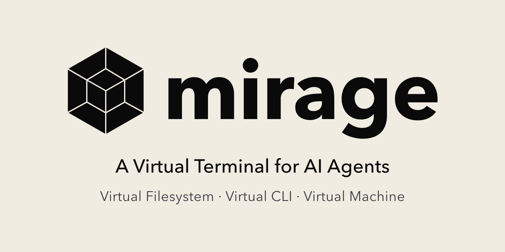
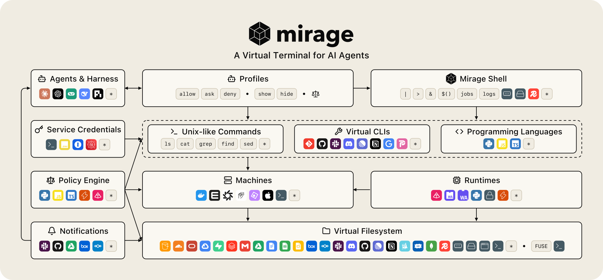
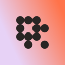
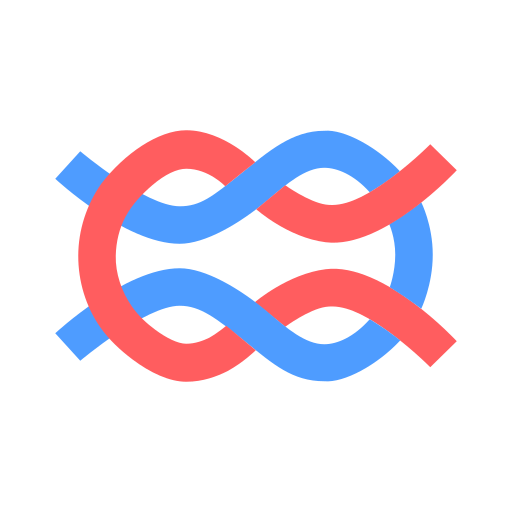

<p align="center">
  <picture>
    <source media="(prefers-color-scheme: dark)" srcset="../assets/mirage-og-dark@2x.png">
    
  </picture>
</p>

<p align="center">
  <a href="https://agentvfs.org">
    <picture>
      <source media="(max-width: 767px) and (prefers-color-scheme: dark)" srcset="../assets/agentvfs-banner-narrow-dark.svg">
      <source media="(max-width: 767px)" srcset="../assets/agentvfs-banner-narrow-light.svg">
      <source media="(prefers-color-scheme: dark)" srcset="../assets/agentvfs-banner-dark.svg">
      
    </picture>
  </a>
</p>

<p align="center">
    <a href="https://docs.mirage.strukto.ai" alt="Tài liệu">
        </a>
    <a href="https://www.strukto.ai" alt="Trang web">
        </a>
    <a href="https://github.com/strukto-ai/mirage/blob/main/LICENSE" alt="Giấy phép">
        </a>
    <a href="https://doi.org/10.5281/zenodo.23504502" alt="DOI">
        </a>
    <a href="https://discord.gg/u8BPQ65KsS" alt="Cộng đồng Discord">
        </a>
    <a href="../assets/wechat-qr-code.jpg" aria-label="Cộng đồng WeChat">
        </a>
    <br/>
    <a href="https://docs.mirage.strukto.ai/python/quickstart" alt="Tài liệu Python">
        </a>
    <a href="https://pypi.org/project/mirage-ai/" alt="Phiên bản PyPI">
        </a>
    <br/>
    <a href="https://docs.mirage.strukto.ai/typescript/quickstart" alt="Tài liệu TypeScript">
        </a>
    <a href="https://www.npmjs.com/package/@struktoai/mirage-node" alt="Phiên bản NPM">
        </a>
</p>

<p align="center">
  <a href="../README.md"></a>
  <a href="./README.zh-CN.md"></a>
  <a href="./README.zh-TW.md"></a>
  <a href="./README.fr.md"></a>
  <a href="./README.de.md"></a>
  <a href="./README.vi.md"></a>
  <a href="./README.ko.md"></a>
</p>

Các LLM được hậu huấn luyện (post-train) trong môi trường terminal, nên giao diện mà AI agent quen thuộc nhất là terminal. Nhưng terminal ngày nay gắn với một máy duy nhất và nhân hệ điều hành của nó, với file và việc tính toán đều nằm trên chính máy đó.

Mirage là **một terminal ảo cho AI agent**, tách giao diện terminal khỏi nơi lưu trữ dữ liệu và các máy tính toán. Nó ảo hóa shell, hệ thống file, các CLI và các máy. Mỗi terminal ảo khởi động chỉ với bộ nhớ cỡ KB, nên AI agent có thể dùng terminal ở mọi nơi, bên trong một ứng dụng, một ứng dụng di động, một tab trình duyệt, một server FastAPI hoặc Express, và cả một thiết bị biên như Raspberry Pi.

<p align="center">
  <picture>
    <source media="(prefers-color-scheme: dark)" srcset="../assets/mirage-terminal-dark.svg">
    
  </picture>
</p>

- **Kiểm soát được.** Mỗi agent chỉ nhận được những file, lệnh, thông tin xác thực và máy mà profile của nó cho phép.
- **Viết script được.** Toàn bộ terminal được định nghĩa bằng code hoặc một file cấu hình duy nhất, từ hệ thống file, CLI và máy cho tới các quy tắc.
- **Được quản lý.** Trạng thái nằm trên hạ tầng sẵn có, như RAM, ổ đĩa, Redis hoặc S3, và mọi lệnh đều được ghi lại và có thể xuất ra dưới dạng trace OpenTelemetry.
- **Nhẹ.** Mỗi workspace chỉ chiếm bộ nhớ cỡ KB và Mirage bất đồng bộ từ shell tới từng lời gọi dịch vụ, nên một tiến trình phục vụ được nhiều agent cùng lúc. Nó có thể được triển khai gần như ở mọi nơi, trên một server Python hoặc TypeScript, một tab trình duyệt, một Cloudflare Worker hoặc một Raspberry Pi.

<p align="center">
  <picture>
    <source media="(prefers-color-scheme: dark)" srcset="../assets/mirage-arch-dark.svg">
    
  </picture>
</p>

Dưới đây là ví dụ khởi chạy Mirage bên trong một ứng dụng:

```python
ws = Workspace(
    {
        "/s3":    (S3VFS(S3Config(bucket="my-bucket")), MountMode.WRITE),
        "/slack": (SlackVFS(SlackConfig(token=slack_bot_token)), MountMode.EXEC),
        "/gmail": (GmailVFS(GmailConfig(**google_credentials)), MountMode.READ),
    },
    # cài CLI Slack, chạy theo tên và được `man`, `which` liệt kê như mọi chương trình
    clis={"slack": (SLACK, {"token": slack_bot_token})},
    # profile analyst ẩn /s3/secrets và cấm đăng lên Slack cũng như curl
    profiles={
        "analyst": {
            "paths": {"hide": ["/s3/secrets"]},
            "commands": {"deny": ["slack send-message", "curl"]},
        },
    },
    # python chạy trên monty ngay trong tiến trình, hoặc trong sandbox e2b
    machines={
        "py": {"provider": "in_process", "runtime": "monty"},
        "box": {"provider": "e2b", "sandbox_id": sandbox_id, "mount_type": "ssh", "captures": ["python", "python3"]},
    },
    # định tuyến phần tính toán: dòng có numpy chạy trên máy, phần còn lại trên monty
    route_policy=lambda ctx: "box" if "numpy" in ctx.line else None,
)

# thêm một agent dùng profile analyst
alice = await ws.session("alice", profile="analyst")

# một lệnh grep quét S3, Slack và Gmail, dùng tìm kiếm riêng của từng dịch vụ nếu có
await alice.shell("grep -rlw invoice /s3 /slack /gmail")

# chạy script nằm trong Slack trên monty, ghi báo cáo vào S3
await alice.shell("python3 /slack/channels/general__C0123/2026-10-21/files/report__F0456.py > /s3/report.txt")

# monty không có numpy, nên chính sách định tuyến gửi dòng này tới e2b
await alice.shell("python3 -c 'import numpy; print(numpy.arange(10).sum())'")
```

Và đây là những gì `alice` thấy trong shell:

```console
$ grep -rlw invoice /s3 /slack /gmail
/s3/billing/2026-10.csv
/gmail/INBOX/2026-10-21/Invoice_1042__18f3a9c2b7d1e0f4.gmail.json
$ ls /s3
billing
report.txt
$ cat /s3/secrets/aws.txt
cat: /s3/secrets/aws.txt: No such file or directory
$ slack send-message --channel general --text "report is up"
slack: Permission denied
```

## Giới thiệu

- **Một giao diện terminal ảo thống nhất, thay vì N SDK và M MCP.** Mọi backend đều dùng cùng một ngữ nghĩa hệ thống tệp, nên pipeline kết hợp được giữa các dịch vụ.
- **Hệ thống tệp ảo trên mọi nguồn dữ liệu.** S3, Google Drive, Slack, Gmail, Redis và các nguồn khác được gắn cạnh nhau dưới một gốc duy nhất, nên agent tiếp cận tất cả qua một giao diện thống nhất bằng các công cụ unix nó đã biết như `ls`, `grep`, `find` và `jq`.
- **Công cụ dòng lệnh ảo (CLI).** `git`, `slack` và `ntn` do chính Mirage đáp ứng, nên agent điều khiển dịch vụ mà không cần cài gì, xuyên qua các runtime và máy khác nhau; một công cụ còn có thể ảo hóa thành hai hoặc nhiều hơn, mỗi cái mang tên riêng với thông tin xác thực riêng.
- **Máy động, có định tuyến.** Python, JavaScript và bất kỳ lệnh nào khác đều có thể được gửi tới máy đã cấu hình, trong tiến trình, trong sandbox hoặc từ xa, tách tính toán khỏi lưu trữ và cho phép đổi bên này mà không động tới bên kia.
- **Mirage shell ảo hóa.** Nó gắn hệ thống tệp, các CLI và các máy vào cùng một dòng lệnh, nên pipe, chuyển hướng, biến, job và lịch sử đều hoạt động xuyên cả ba.
- **Nhẹ ngay từ thiết kế.** Một workspace, tức chính terminal ảo, chiếm khoảng 100 KB bộ nhớ và mỗi session mới khoảng 10 KB, nên một tiến trình phục vụ nhiều agent mà không cần container hay VM cho từng agent.
- **Profile thiết kế cho agent.** `allow`, `ask` và `deny` chi phối lệnh và CLI, còn `hide` và `show` chi phối tệp và thư mục, nên một đường dẫn bị ẩn không chỉ là không đọc được mà còn không tồn tại trong hệ thống tệp mà agent nhìn thấy.
- **Công cụ chính sách viết được bằng script.** Một script chính sách có thể chặn mọi hành động nguy hiểm trước khi nó chạy, và cùng ngăn xếp đó kiểm soát mọi thao tác VFS và mọi lần ghi session, nên không tệp nào và không biến môi trường nào bị rò rỉ.
- **Thông báo nối vào VFS và agent.** Thay đổi bên ngoài trở thành luồng sự kiện trên mount, nên một trả lời Slack mới hiện ra như một thay đổi của tệp hội thoại trong hệ thống tệp ảo, và agent phản ứng theo đó thay vì quét lại toàn bộ cây.

## Hệ thống tệp ảo hợp nhất

[Mirage](https://www.strukto.ai/mirage) "mount" mọi thứ thành một hệ thống tệp ảo thống nhất cho AI agent. Mỗi dịch vụ nằm cạnh nhau dưới một gốc duy nhất và tuân theo cùng ngữ nghĩa POSIX.

|                                       | VFS                                                                                                                                                                                                                                                                                                                                                                                                                                                                                                                                                                                                                                                                                                                                                                                                                                                                                                                                                                                                                                                                                                                                                                                                                                                                                                                                                                                                                                                                                                                                                                                                                                                                                                                                                                                                                                                                                                                                                                                                                                                                                                                                                                                                                                                                                                                                                                                                                                                                                                                                                                                                                                                                                                                                                                                                                                                                                                                                                                                                                                                                                                                                                                                                     |
| ------------------------------------- | ------------------------------------------------------------------------------------------------------------------------------------------------------------------------------------------------------------------------------------------------------------------------------------------------------------------------------------------------------------------------------------------------------------------------------------------------------------------------------------------------------------------------------------------------------------------------------------------------------------------------------------------------------------------------------------------------------------------------------------------------------------------------------------------------------------------------------------------------------------------------------------------------------------------------------------------------------------------------------------------------------------------------------------------------------------------------------------------------------------------------------------------------------------------------------------------------------------------------------------------------------------------------------------------------------------------------------------------------------------------------------------------------------------------------------------------------------------------------------------------------------------------------------------------------------------------------------------------------------------------------------------------------------------------------------------------------------------------------------------------------------------------------------------------------------------------------------------------------------------------------------------------------------------------------------------------------------------------------------------------------------------------------------------------------------------------------------------------------------------------------------------------------------------------------------------------------------------------------------------------------------------------------------------------------------------------------------------------------------------------------------------------------------------------------------------------------------------------------------------------------------------------------------------------------------------------------------------------------------------------------------------------------------------------------------------------------------------------------------------------------------------------------------------------------------------------------------------------------------------------------------------------------------------------------------------------------------------------------------------------------------------------------------------------------------------------------------------------------------------------------------------------------------------------------------------------------------- |
| **Lưu trữ đối tượng**                 | <a href="https://docs.mirage.strukto.ai/home/setup/s3"></a>  <a href="https://docs.mirage.strukto.ai/home/setup/r2"></a>  <a href="https://docs.mirage.strukto.ai/home/setup/gcs"></a>  <a href="https://docs.mirage.strukto.ai/home/setup/oci"></a>  <a href="https://docs.mirage.strukto.ai/home/setup/supabase"></a>  <a href="https://docs.mirage.strukto.ai/home/setup/minio"></a>  <a href="https://docs.mirage.strukto.ai/home/setup/ceph"></a>  <a href="https://docs.mirage.strukto.ai/home/setup/seaweedfs"></a>  <a href="https://docs.mirage.strukto.ai/home/setup/wasabi"></a>  <a href="https://docs.mirage.strukto.ai/home/setup/backblaze"></a>  <a href="https://docs.mirage.strukto.ai/home/setup/digitalocean"></a>  <a href="https://docs.mirage.strukto.ai/home/setup/aliyun"></a>  <a href="https://docs.mirage.strukto.ai/home/setup/tencent"></a>  <a href="https://docs.mirage.strukto.ai/home/setup/scaleway"></a>  <a href="https://docs.mirage.strukto.ai/home/setup/qingstor"></a>  <a href="https://docs.mirage.strukto.ai/home/setup/hf_buckets"></a>  <a href="https://docs.mirage.strukto.ai/home/setup/gridfs"></a> |
| **Tệp và tài liệu**                   | <a href="https://docs.mirage.strukto.ai/home/setup/google"></a>  <a href="https://docs.mirage.strukto.ai/home/setup/google"></a>  <a href="https://docs.mirage.strukto.ai/home/setup/google"></a>  <a href="https://docs.mirage.strukto.ai/home/setup/google"></a>  <a href="https://docs.mirage.strukto.ai/home/setup/onedrive"></a>  <a href="https://docs.mirage.strukto.ai/home/setup/sharepoint"></a>  <a href="https://docs.mirage.strukto.ai/home/setup/box"></a>  <a href="https://docs.mirage.strukto.ai/home/setup/dropbox"></a>  <a href="https://docs.mirage.strukto.ai/home/setup/nextcloud"></a> <a href="https://docs.mirage.strukto.ai/home/setup/tidb"></a>                                                                                                                                                                                                                                                                                                                                                                                                                                                                                                                                                                                                                                                                                                                                                                                                                                                                                                                                                                                                                                                     |
| **Nhắn tin và công việc**             | <a href="https://docs.mirage.strukto.ai/home/setup/slack"></a>  <a href="https://docs.mirage.strukto.ai/home/setup/discord"></a>  <a href="https://docs.mirage.strukto.ai/home/setup/google"></a>  <a href="https://docs.mirage.strukto.ai/home/setup/email"></a>  <a href="https://docs.mirage.strukto.ai/home/setup/github"></a>  <a href="https://docs.mirage.strukto.ai/home/setup/linear"></a>  <a href="https://docs.mirage.strukto.ai/home/setup/notion"></a>  <a href="https://docs.mirage.strukto.ai/home/setup/trello"></a>  <a href="https://docs.mirage.strukto.ai/home/setup/gcal"></a>                                                                                                                                                                                                                                                                                                                                                                                                                                                                                                                                                                                                                                                                                                                                                                                                                                                                                                                                                                                                                                                                                                                                                                                                                                                                                                                                                                                                                                                                                                          |
| **Cơ sở dữ liệu và nền tảng dữ liệu** | <a href="https://docs.mirage.strukto.ai/home/setup/postgres"></a>  <a href="https://docs.mirage.strukto.ai/home/setup/mongodb"></a>  <a href="https://docs.mirage.strukto.ai/home/setup/redis"></a> <a href="https://docs.mirage.strukto.ai/home/setup/redis"></a> <a href="https://docs.mirage.strukto.ai/home/setup/sql"></a> <a href="https://docs.mirage.strukto.ai/home/setup/airtable"></a>  <a href="https://docs.mirage.strukto.ai/home/setup/lancedb"></a>  <a href="https://docs.mirage.strukto.ai/home/setup/qdrant"></a>  <a href="https://docs.mirage.strukto.ai/home/setup/chroma"></a>  <a href="https://docs.mirage.strukto.ai/home/setup/mem0"></a>  <a href="https://docs.mirage.strukto.ai/home/setup/hf_datasets"></a>  <a href="https://docs.mirage.strukto.ai/home/setup/hf_models"></a>  <a href="https://docs.mirage.strukto.ai/home/setup/hf_spaces"></a>  <a href="https://docs.mirage.strukto.ai/home/setup/databricks"></a>  <a href="https://docs.mirage.strukto.ai/home/setup/dify"></a>                                                                                                                                                                                                                                                                                                                                                                                                                            |
| **Khả năng quan sát**                 | <a href="https://docs.mirage.strukto.ai/home/setup/langfuse"></a>  <a href="https://docs.mirage.strukto.ai/home/setup/jaeger"></a> <a href="https://docs.mirage.strukto.ai/home/setup/wandb"></a>                                                                                                                                                                                                                                                                                                                                                                                                                                                                                                                                                                                                                                                                                                                                                                                                                                                                                                                                                                                                                                                                                                                                                                                                                                                                                                                                                                                                                                                                                                                                                                                                                                                                                                                                                                                                                                                                                                                                                                                                                                                                                                                                                                                                                                                                                                                                                                                                                                                                                                                                                                                                                                                              |
| **Cục bộ và từ xa**                   | <a href="https://docs.mirage.strukto.ai/home/setup/ram"></a>  <a href="https://docs.mirage.strukto.ai/home/setup/disk"></a>  <a href="https://docs.mirage.strukto.ai/home/setup/opfs"></a>  <a href="https://docs.mirage.strukto.ai/home/setup/ssh"></a>                                                                                                                                                                                                                                                                                                                                                                                                                                                                                                                                                                                                                                                                                                                                                                                                                                                                                                                                                                                                                                                                                                                                                                                                                                                                                                                                                                                                                                                                                                                                                                                                                                                                                                                                                                                                                                                                                                                                                                                                                                                                                                                                                                                                                                                                                                                                                                                                                                                                  |

Agent tiếp cận nó qua SDK Python và TypeScript, CLI `mirage`, hoặc một mountpoint thật qua FUSE và FSKit, rồi làm việc bằng các công cụ unix đã quen như `ls`, `grep`, `find` và `jq`.

## CLI ảo

Các công cụ dòng lệnh này được ảo hóa: [Mirage](https://www.strukto.ai/mirage) tự đáp ứng `git`, `slack` hay `ntn`, nên agent điều khiển dịch vụ mà máy không cần cài chương trình đó. Mỗi công cụ mô phỏng công cụ thật, nên agent đã biết CLI không cần học gì mới. Vì là ảo, cùng một công cụ có thể được cài nhiều lần dưới các tên khác nhau, mỗi bản có thông tin xác thực riêng, nên mỗi agent nhận đúng những tài khoản được giao.

|                          | CLI                                                                                                                                                                                                                                                                                                                                                                                                                                                                                                                                                                                                                                                                                                                                                                                                                                                                                                                                                                                                                                                                                                                                                                                                                                                                                                                                                                                                                                                                                                                                                                                                                                                                        |
| ------------------------ | -------------------------------------------------------------------------------------------------------------------------------------------------------------------------------------------------------------------------------------------------------------------------------------------------------------------------------------------------------------------------------------------------------------------------------------------------------------------------------------------------------------------------------------------------------------------------------------------------------------------------------------------------------------------------------------------------------------------------------------------------------------------------------------------------------------------------------------------------------------------------------------------------------------------------------------------------------------------------------------------------------------------------------------------------------------------------------------------------------------------------------------------------------------------------------------------------------------------------------------------------------------------------------------------------------------------------------------------------------------------------------------------------------------------------------------------------------------------------------------------------------------------------------------------------------------------------------------------------------------------------------------------------------------------------- |
| **Mã nguồn**             | <a href="https://docs.mirage.strukto.ai/home/setup/cli/git"></a>  <a href="https://docs.mirage.strukto.ai/home/setup/cli/gh"></a>                                                                                                                                                                                                                                                                                                                                                                                                                                                                                                                                                                                                                                                                                                                                                                                                                                                                                                                                                                                                                                                                                                                                                                                                                                                                                                                                       |
| **Giao tiếp**            | <a href="https://docs.mirage.strukto.ai/home/setup/cli/slack"></a>  <a href="https://docs.mirage.strukto.ai/home/setup/cli/discord"></a>  <a href="https://docs.mirage.strukto.ai/home/setup/cli/himalaya"></a>                                                                                                                                                                                                                                                                                                                                                                                                                                                                                                                                                                                                                                                                                                                                                                                                                                                                                                                                                                                                                                                                                                                                       |
| **Công việc và dữ liệu** | <a href="https://docs.mirage.strukto.ai/home/setup/cli/linear"></a>  <a href="https://docs.mirage.strukto.ai/home/setup/cli/ntn"></a> <a href="https://docs.mirage.strukto.ai/home/setup/cli/trello"></a> <a href="https://docs.mirage.strukto.ai/home/setup/cli/airtable"></a>  <a href="https://docs.mirage.strukto.ai/home/setup/cli/gws"></a>  <a href="https://docs.mirage.strukto.ai/home/setup/cli/hf"></a> <a href="https://docs.mirage.strukto.ai/home/setup/cli/office"></a> <a href="https://docs.mirage.strukto.ai/home/setup/cli/pdftotext"></a> <a href="https://docs.mirage.strukto.ai/home/setup/cli/pdfinfo"></a> |

## Máy ảo

Máy được ảo hóa theo cùng cách, và không chỉ cho ngôn ngữ lập trình. Bất kỳ lệnh nào trên dòng đều có thể được gửi tới một máy đã cấu hình, nên Python có thể chạy trong tiến trình với [Monty](https://pydantic.dev/articles/pydantic-monty) trong khi một lệnh khác, chẳng hạn `kubectl`, chạy trên máy từ xa qua SSH. Máy nào phục vụ một dòng lệnh có thể do một [bộ định tuyến máy viết bằng script](https://docs.mirage.strukto.ai/home/policy/route-machine) quyết định.

|                | Máy                                                                                                                                                                                                                                                                                                                                                                                                                                                                                                                                                                                                                                                                                                                                                                                                                                                                                                                                                                                                                                                                                                                                                                                                                                                                                                                                                                                                                                                                                                                                                                                                                                                                                                                                                                                                                                                         |
| -------------- | ----------------------------------------------------------------------------------------------------------------------------------------------------------------------------------------------------------------------------------------------------------------------------------------------------------------------------------------------------------------------------------------------------------------------------------------------------------------------------------------------------------------------------------------------------------------------------------------------------------------------------------------------------------------------------------------------------------------------------------------------------------------------------------------------------------------------------------------------------------------------------------------------------------------------------------------------------------------------------------------------------------------------------------------------------------------------------------------------------------------------------------------------------------------------------------------------------------------------------------------------------------------------------------------------------------------------------------------------------------------------------------------------------------------------------------------------------------------------------------------------------------------------------------------------------------------------------------------------------------------------------------------------------------------------------------------------------------------------------------------------------------------------------------------------------------------------------------------------------------- |
| **Python**     | <a href="https://docs.mirage.strukto.ai/home/setup/runtime/monty"></a>  <a href="https://docs.mirage.strukto.ai/home/setup/runtime/wasi"></a>  <a href="https://docs.mirage.strukto.ai/home/setup/runtime/pyodide"></a>  <a href="https://docs.mirage.strukto.ai/home/setup/machine/host"></a>  <a href="https://docs.mirage.strukto.ai/home/setup/machine/host"></a>                                                                                                                                                                                                                                                                                                                                                                                                                                                                                                                                                                                                                                                                                                                                                                                                                                                                                                                      |
| **JavaScript** | <a href="https://docs.mirage.strukto.ai/home/setup/runtime/quickjs"></a> <a href="https://docs.mirage.strukto.ai/home/setup/runtime/quickjs"></a> <a href="https://docs.mirage.strukto.ai/home/setup/runtime/quickjs"></a>                                                                                                                                                                                                                                                                                                                                                                                                                                                                                                                                                                                                                                                                                                                                                                                                                                                                                                                                                                                                                                                                                                                                                                                                                                                            |
| **Máy**        | <a href="https://docs.mirage.strukto.ai/home/setup/machine/docker"></a> <a href="https://docs.mirage.strukto.ai/home/setup/machine/kubernetes"></a>  <a href="https://docs.mirage.strukto.ai/home/setup/machine/e2b"></a>  <a href="https://docs.mirage.strukto.ai/home/setup/machine/daytona"></a> <a href="https://docs.mirage.strukto.ai/home/setup/machine/cloudflare_container"></a> <a href="https://docs.mirage.strukto.ai/home/setup/machine/boxd"></a>  <a href="https://docs.mirage.strukto.ai/home/setup/machine/smolvm"></a> <a href="https://docs.mirage.strukto.ai/home/setup/machine/microsandbox"></a> <a href="https://docs.mirage.strukto.ai/home/setup/machine/apple_container"></a>  <a href="https://docs.mirage.strukto.ai/home/setup/machine/ssh"></a> |

## Bảo mật

Profile quyết định một session được chạy gì và được thấy gì. Lệnh được chi phối bởi các quy tắc `allow`, `ask` và `deny` tùy chỉnh được, còn đường dẫn bởi `hide` và `show`, nên một tệp bị ẩn không chỉ là không đọc được mà còn không tồn tại trong hệ thống tệp mà agent thấy. Với những gì các quy tắc đó không diễn đạt được, profile có thể chỉ định một script chính sách chạy ở cổng kiểm soát của mọi lệnh và tự trả lời allow, deny hoặc ask, dù như mọi quy tắc khác nó chỉ có thể hạn chế chứ không bao giờ cấp quyền. Ngoài ra, ứng dụng chủ có thể đăng ký chính sách riêng trên [công cụ chính sách](https://docs.mirage.strukto.ai/home/policy/policies), một ngăn xếp có thứ tự mà workspace tham khảo ở mọi lệnh, mọi thao tác VFS và mọi lần ghi session. Xem [tài liệu chính sách](https://docs.mirage.strukto.ai/home/policy/overview).

## Thông tin xác thực dịch vụ

Thông tin xác thực dịch vụ tích hợp với những kho đang chứa secret, gồm AWS Secrets Manager, 1Password và dotenv, nên một biến môi trường trong Mirage có thể phân giải thẳng tới thông tin xác thực lưu ở một trong số đó.

|                  | Nguồn                                                                                                                                                                                                                                                                                                                                                                                                                                      |
| ---------------- | ------------------------------------------------------------------------------------------------------------------------------------------------------------------------------------------------------------------------------------------------------------------------------------------------------------------------------------------------------------------------------------------------------------------------------------------ |
| **Tích hợp sẵn** | <a href="https://docs.mirage.strukto.ai/home/service-credentials#sources"></a> <a href="https://docs.mirage.strukto.ai/home/service-credentials#sources"></a>                                                                    |
| **Tùy chỉnh**    | <a href="https://docs.mirage.strukto.ai/home/service-credentials/1password"></a> <a href="https://docs.mirage.strukto.ai/home/service-credentials/aws-secrets-manager"></a> |

## Cài đặt

- **Python** ≥ 3.12 cho gói `mirage-ai` và CLI `mirage`
- **Node.js** 22.20+ trên Node 22, 24.12+ trên Node 24, hoặc 25+ cho SDK TypeScript

### Python

```bash
uv add mirage-ai              # cài thư viện `mirage` và binary CLI `mirage`
uv add 'mirage-ai[openai]'    # adapter OpenAI Agents; mỗi framework agent là một extra
uv add 'mirage-ai[monty]'     # Monty, runtime Python trong tiến trình mà các ví dụ dùng
```

### TypeScript

```bash
npm install @struktoai/mirage-node      # máy chủ Node.js và CLI
npm install @struktoai/mirage-browser   # trình duyệt / edge runtime
```

Cả hai gói runtime đều tự động kéo theo `@struktoai/mirage-core`.

### CLI

```bash
npm install -g @struktoai/mirage-cli
# hoặc
uvx --from mirage-ai mirage
# hoặc
npx @struktoai/mirage-cli
```

Để bắt đầu, xem hướng dẫn nhanh cho [Python](https://docs.mirage.strukto.ai/python/quickstart), [TypeScript](https://docs.mirage.strukto.ai/typescript/quickstart) và [CLI](https://docs.mirage.strukto.ai/home/access/cli).

## Chính sách viết bằng script

Profile có thể chỉ định script chính sách cho những gì quy tắc của nó không diễn đạt được. `pre_command` của script nhận lệnh, có thể mở các tệp mà lệnh nêu tên, và trả về deny, ask hoặc `None`. Script này vô hiệu hóa `rm`, và cả script Python có mã xóa tệp:

```python
def deletes(path):
    try:
        code = open(path).read()
    except OSError:
        return False
    return any(call in code for call in ("os.remove", "os.unlink", "shutil.rmtree"))


def pre_command(ctx):
    if ctx["command"] == "rm" or (
        ctx["command"].startswith("python") and any(deletes(p) for p in ctx["paths"])
    ):
        return {"kind": "deny", "reason": "deleting files is disabled"}
```

Đăng ký nó trong một profile, ở đây để chạy trên Monty trước mỗi lệnh:

```python
ws = Workspace(
    {"/s3": (S3VFS(S3Config(bucket="my-bucket")), MountMode.WRITE)},
    profiles={
        "analyst": {
            "policy": {
                "pre_command": [{"script": ScriptSource(Path("guard.py").read_text()), "runtime": "monty"}],
            },
        },
    },
    profile="analyst",
)
```

```console
$ cat /s3/clean.py
import os
os.remove("/s3/report.txt")
$ rm /s3/report.txt
rm: Permission denied
$ python3 /s3/clean.py
python3: Permission denied
```

Xem [script chính sách](https://docs.mirage.strukto.ai/home/policy/scripts) để biết các giai đoạn khác mà script có thể trả lời.

## Ví dụ

- **[In-Process Terminal](https://docs.mirage.strukto.ai/home/examples/in-process-terminal).** Một terminal cho agent ngay trong ứng dụng của bạn, kể cả trong máy chủ FastAPI hay Express, không cần máy hay sandbox cố định.
- **[Multi-machine Terminal](https://docs.mirage.strukto.ai/home/examples/multi-machine-terminal).** Một terminal ảo hợp nhất trên nhiều máy khác nhau, chạy mỗi tác vụ trên máy phù hợp với nó, để AI Agent làm việc hiệu quả hơn và rẻ hơn.
- **[Secured Terminal](https://docs.mirage.strukto.ai/home/examples/secured-terminal).** Quyết định trong một cấu hình workspace những file mà agent thấy, những lệnh và CLI mà nó chạy, và những thông tin xác thực mà công cụ của nó dùng.
- **[Infra-agnostic Terminal](https://docs.mirage.strukto.ai/home/examples/infra-agnostic-terminal).** Một terminal ảo không gắn với hạ tầng cố định nào, giữ file, phiên và nhật ký lệnh trên các backend sẵn có.

## Người đóng góp

Cảm ơn tất cả những người đã đóng góp cho Mirage.

<a href="https://github.com/strukto-ai/mirage/graphs/contributors">
  
</a>
