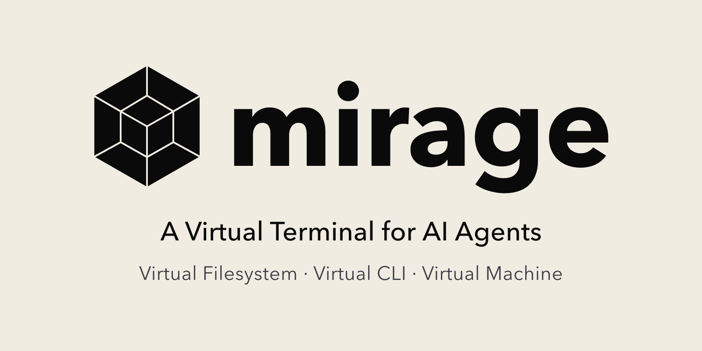
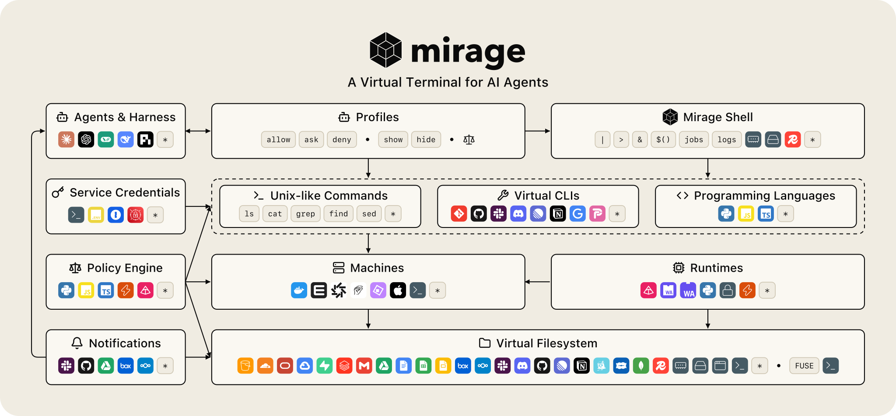

<p align="center">
  <picture>
    <source media="(prefers-color-scheme: dark)" srcset="../assets/mirage-og-dark@2x.png">
    
  </picture>
</p>

<p align="center">
  <a href="https://agentvfs.org">
    <picture>
      <source media="(max-width: 767px) and (prefers-color-scheme: dark)" srcset="../assets/agentvfs-banner-narrow-dark.svg">
      <source media="(max-width: 767px)" srcset="../assets/agentvfs-banner-narrow-light.svg">
      <source media="(prefers-color-scheme: dark)" srcset="../assets/agentvfs-banner-dark.svg">
      
    </picture>
  </a>
</p>

<p align="center">
    <a href="https://docs.mirage.strukto.ai" alt="文档">
        </a>
    <a href="https://www.strukto.ai" alt="官网">
        </a>
    <a href="https://github.com/strukto-ai/mirage/blob/main/LICENSE" alt="许可证">
        </a>
    <a href="https://doi.org/10.5281/zenodo.23504502" alt="DOI">
        </a>
    <a href="https://discord.gg/u8BPQ65KsS" alt="Discord 社区">
        </a>
    <a href="../assets/wechat-qr-code.jpg" aria-label="微信社区">
        </a>
    <br/>
    <a href="https://docs.mirage.strukto.ai/python/quickstart" alt="Python 文档">
        </a>
    <a href="https://pypi.org/project/mirage-ai/" alt="PyPI 版本">
        </a>
    <br/>
    <a href="https://docs.mirage.strukto.ai/typescript/quickstart" alt="TypeScript 文档">
        </a>
    <a href="https://www.npmjs.com/package/@struktoai/mirage-node" alt="NPM 版本">
        </a>
</p>

<p align="center">
  <a href="../README.md"></a>
  <a href="./README.zh-CN.md"></a>
  <a href="./README.zh-TW.md"></a>
  <a href="./README.fr.md"></a>
  <a href="./README.de.md"></a>
  <a href="./README.vi.md"></a>
  <a href="./README.ko.md"></a>
</p>

AI Agent 在终端中工作。Mirage 是一个**虚拟终端**，它把终端接口、数据存储和计算机器彼此分开。Mirage 把每条命令路由到适合它的机器上，覆盖容器、microVM、云沙箱和 SSH 主机等异构机器。文件、CLI 和机器分别加入，因此它保持灵活、基础设施成本低，并让 Agent 以最高效、最安全的方式工作。

<p align="center">
  <picture>
    <source media="(prefers-color-scheme: dark)" srcset="../assets/mirage-terminal-dark.svg">
    
  </picture>
</p>

- **可控。** 决定每个 Agent 能触达什么，包括它能看到哪些文件、它的虚拟文件系统和 CLI 在不向它展示的情况下使用哪些凭据，以及由哪台机器运行它的每个程序。
- **可脚本化。** 整个终端用代码或配置文件定义，从虚拟文件系统、CLI 和机器，到各项规则，例如哪些命令需要审批、Agent 能拿回多少输出。
- **托管式。** Mirage 管理虚拟终端的基础设施，由所选的后端组合而成。虚拟文件系统放在 S3、Drive、数据库或 RAM 上，作业和历史记录放在 RAM、Redis 或磁盘上，整个工作区可以保存为快照。Agent 运行的每条命令都会被记录，并可以作为 trace 发送到 OpenTelemetry 后端。

<p align="center">
  <picture>
    <source media="(prefers-color-scheme: dark)" srcset="../assets/mirage-arch-dark.svg">
    
  </picture>
</p>

下面是在应用中启动 Mirage 的示例：

```python
ws = Workspace(
    {
        "/s3":    (S3VFS(S3Config(bucket="my-bucket")), MountMode.WRITE),
        "/slack": (SlackVFS(SlackConfig(token=slack_bot_token)), MountMode.EXEC),
        "/gmail": (GmailVFS(GmailConfig(**google_credentials)), MountMode.READ),
    },
    # 安装 Slack CLI，按名称运行，并像其他程序一样出现在 `man` 和 `which` 中
    clis={"slack": (SLACK, {"token": slack_bot_token})},
    # analyst Profile 隐藏 /s3/secrets，并禁止向 Slack 发帖和使用 curl
    profiles={
        "analyst": {
            "paths": {"hide": ["/s3/secrets"]},
            "commands": {"deny": ["slack send-message", "curl"]},
        },
    },
    # python 在进程内的 monty 上运行，或在 e2b 沙箱中运行
    machines={
        "py": {"provider": "in_process", "runtime": "monty"},
        "box": {"provider": "e2b", "sandbox_id": sandbox_id, "mount_type": "ssh", "captures": ["python", "python3"]},
    },
    # 路由底层计算：含 numpy 的命令行在机器上运行，其余在 monty 上
    route_policy=lambda ctx: "box" if "numpy" in ctx.line else None,
)

# 添加一个使用 analyst Profile 的 Agent
alice = await ws.session("alice", profile="analyst")

# 一次 grep 扫遍 S3、Slack 和 Gmail，有自带搜索的服务就用它自己的搜索
await alice.shell("grep -rlw invoice /s3 /slack /gmail")

# 在 monty 上运行存放在 Slack 里的脚本，把报告写入 S3
await alice.shell("python3 /slack/channels/general__C0123/2026-10-21/files/report__F0456.py > /s3/report.txt")

# monty 中没有 numpy，所以路由策略把这一行发送到 e2b
await alice.shell("python3 -c 'import numpy; print(numpy.arange(10).sum())'")
```

`alice` 在 Shell 中看到的是：

```console
$ grep -rlw invoice /s3 /slack /gmail
/s3/billing/2026-10.csv
/gmail/INBOX/2026-10-21/Invoice_1042__18f3a9c2b7d1e0f4.gmail.json
$ ls /s3
billing
report.txt
$ cat /s3/secrets/aws.txt
cat: /s3/secrets/aws.txt: No such file or directory
$ slack send-message --channel general --text "report is up"
slack: Permission denied
```

## 关于

- **统一的虚拟终端接口，而不是 N 个 SDK 和 M 个 MCP。** 每个后端都使用同一套文件系统语义，管道可以跨服务组合。
- **覆盖所有数据源的虚拟文件系统。** S3、Google Drive、Slack、Gmail、Redis 等并排挂载在同一个根目录下，Agent 通过统一接口，用它已经会的 unix 工具（如 `ls`、`grep`、`find` 和 `jq`）访问全部数据源。
- **虚拟命令行工具（CLI）。** `git`、`slack` 和 `ntn` 由 Mirage 自己应答，Agent 无需安装任何东西即可驱动这些服务，并可跨不同运行时和机器；同一个工具还能虚拟成两个或更多，各自使用独立的名称和凭据。
- **动态路由的机器。** Python、JavaScript 以及任何其他命令都可以被发送到所配置的机器，进程内、沙箱或远程，从而把计算与存储解耦，任何一方都可以独立更换。
- **虚拟化的 Mirage Shell。** 它把文件系统、CLI 和机器绑定到同一条命令行上，因此管道、重定向、变量、作业和历史记录在三者之间都可用。
- **轻量化设计。** 工作区，也就是虚拟终端本身，约占 100 KB 内存，每个新会话约 10 KB，因此一个进程即可服务许多 Agent，无需为每个 Agent 准备容器或虚拟机。
- **为 Agent 设计的 Profile。** `allow`、`ask` 和 `deny` 管控命令和 CLI，`hide` 和 `show` 管控文件和目录，因此被隐藏的路径不只是不可读，而是在 Agent 看到的文件系统中根本不存在。
- **可脚本化的策略引擎。** 策略脚本可以在任何危险操作执行前将其阻止，同一套策略栈还会拦截每一次 VFS 操作和会话写入，因此文件和环境变量都不会泄露。
- **接入 VFS 与 Agent 的通知。** 外部变更会成为挂载上的事件流，因此一条新的 Slack 回复会表现为虚拟文件系统中聊天文件的变化，Agent 直接据此响应，而不必重新扫描整棵树。

## 虚拟文件系统

[Mirage](https://www.strukto.ai/mirage) 把一切“挂载”为一个面向 AI Agent 的统一虚拟文件系统。每个服务并排位于同一个根目录下，并遵循相同的 POSIX 语义。

|                      | VFS                                                                                                                                                                                                                                                                                                                                                                                                                                                                                                                                                                                                                                                                                                                                                                                                                                                                                                                                                                                                                                                                                                                                                                                                                                                                                                                                                                                                                                                                                                                                                                                                                                                                                                                                                                                                                                                                                                                                                                                                                                                                                                                                                                                                                                                                                                                                                                                                                                                                                                                                                                                                                                                                                                                                                                                                                                                                                                                                                                                                                                                                                                                                                                                                     |
| -------------------- | ------------------------------------------------------------------------------------------------------------------------------------------------------------------------------------------------------------------------------------------------------------------------------------------------------------------------------------------------------------------------------------------------------------------------------------------------------------------------------------------------------------------------------------------------------------------------------------------------------------------------------------------------------------------------------------------------------------------------------------------------------------------------------------------------------------------------------------------------------------------------------------------------------------------------------------------------------------------------------------------------------------------------------------------------------------------------------------------------------------------------------------------------------------------------------------------------------------------------------------------------------------------------------------------------------------------------------------------------------------------------------------------------------------------------------------------------------------------------------------------------------------------------------------------------------------------------------------------------------------------------------------------------------------------------------------------------------------------------------------------------------------------------------------------------------------------------------------------------------------------------------------------------------------------------------------------------------------------------------------------------------------------------------------------------------------------------------------------------------------------------------------------------------------------------------------------------------------------------------------------------------------------------------------------------------------------------------------------------------------------------------------------------------------------------------------------------------------------------------------------------------------------------------------------------------------------------------------------------------------------------------------------------------------------------------------------------------------------------------------------------------------------------------------------------------------------------------------------------------------------------------------------------------------------------------------------------------------------------------------------------------------------------------------------------------------------------------------------------------------------------------------------------------------------------------------------------------- |
| **对象存储**         | <a href="https://docs.mirage.strukto.ai/home/setup/s3"></a>  <a href="https://docs.mirage.strukto.ai/home/setup/r2"></a>  <a href="https://docs.mirage.strukto.ai/home/setup/gcs"></a>  <a href="https://docs.mirage.strukto.ai/home/setup/oci"></a>  <a href="https://docs.mirage.strukto.ai/home/setup/supabase"></a>  <a href="https://docs.mirage.strukto.ai/home/setup/minio"></a>  <a href="https://docs.mirage.strukto.ai/home/setup/ceph"></a>  <a href="https://docs.mirage.strukto.ai/home/setup/seaweedfs"></a>  <a href="https://docs.mirage.strukto.ai/home/setup/wasabi"></a>  <a href="https://docs.mirage.strukto.ai/home/setup/backblaze"></a>  <a href="https://docs.mirage.strukto.ai/home/setup/digitalocean"></a>  <a href="https://docs.mirage.strukto.ai/home/setup/aliyun"></a>  <a href="https://docs.mirage.strukto.ai/home/setup/tencent"></a>  <a href="https://docs.mirage.strukto.ai/home/setup/scaleway"></a>  <a href="https://docs.mirage.strukto.ai/home/setup/qingstor"></a>  <a href="https://docs.mirage.strukto.ai/home/setup/hf_buckets"></a>  <a href="https://docs.mirage.strukto.ai/home/setup/gridfs"></a> |
| **文件与文档**       | <a href="https://docs.mirage.strukto.ai/home/setup/google"></a>  <a href="https://docs.mirage.strukto.ai/home/setup/google"></a>  <a href="https://docs.mirage.strukto.ai/home/setup/google"></a>  <a href="https://docs.mirage.strukto.ai/home/setup/google"></a>  <a href="https://docs.mirage.strukto.ai/home/setup/onedrive"></a>  <a href="https://docs.mirage.strukto.ai/home/setup/sharepoint"></a>  <a href="https://docs.mirage.strukto.ai/home/setup/box"></a>  <a href="https://docs.mirage.strukto.ai/home/setup/dropbox"></a>  <a href="https://docs.mirage.strukto.ai/home/setup/nextcloud"></a> <a href="https://docs.mirage.strukto.ai/home/setup/tidb"></a>                                                                                                                                                                                                                                                                                                                                                                                                                                                                                                                                                                                                                                                                                                                                                                                                                                                                                                                                                                                                                                                     |
| **消息与协作**       | <a href="https://docs.mirage.strukto.ai/home/setup/slack"></a>  <a href="https://docs.mirage.strukto.ai/home/setup/discord"></a>  <a href="https://docs.mirage.strukto.ai/home/setup/google"></a>  <a href="https://docs.mirage.strukto.ai/home/setup/email"></a>  <a href="https://docs.mirage.strukto.ai/home/setup/github"></a>  <a href="https://docs.mirage.strukto.ai/home/setup/linear"></a>  <a href="https://docs.mirage.strukto.ai/home/setup/notion"></a>  <a href="https://docs.mirage.strukto.ai/home/setup/trello"></a>  <a href="https://docs.mirage.strukto.ai/home/setup/gcal"></a>                                                                                                                                                                                                                                                                                                                                                                                                                                                                                                                                                                                                                                                                                                                                                                                                                                                                                                                                                                                                                                                                                                                                                                                                                                                                                                                                                                                                                                                                                                          |
| **数据库与数据平台** | <a href="https://docs.mirage.strukto.ai/home/setup/postgres"></a>  <a href="https://docs.mirage.strukto.ai/home/setup/mongodb"></a>  <a href="https://docs.mirage.strukto.ai/home/setup/redis"></a> <a href="https://docs.mirage.strukto.ai/home/setup/redis"></a> <a href="https://docs.mirage.strukto.ai/home/setup/sql"></a> <a href="https://docs.mirage.strukto.ai/home/setup/airtable"></a>  <a href="https://docs.mirage.strukto.ai/home/setup/lancedb"></a>  <a href="https://docs.mirage.strukto.ai/home/setup/qdrant"></a>  <a href="https://docs.mirage.strukto.ai/home/setup/chroma"></a>  <a href="https://docs.mirage.strukto.ai/home/setup/mem0"></a>  <a href="https://docs.mirage.strukto.ai/home/setup/hf_datasets"></a>  <a href="https://docs.mirage.strukto.ai/home/setup/hf_models"></a>  <a href="https://docs.mirage.strukto.ai/home/setup/hf_spaces"></a>  <a href="https://docs.mirage.strukto.ai/home/setup/databricks"></a>  <a href="https://docs.mirage.strukto.ai/home/setup/dify"></a>                                                                                                                                                                                                                                                                                                                                                                                                                            |
| **可观测性**         | <a href="https://docs.mirage.strukto.ai/home/setup/langfuse"></a>  <a href="https://docs.mirage.strukto.ai/home/setup/jaeger"></a> <a href="https://docs.mirage.strukto.ai/home/setup/wandb"></a>                                                                                                                                                                                                                                                                                                                                                                                                                                                                                                                                                                                                                                                                                                                                                                                                                                                                                                                                                                                                                                                                                                                                                                                                                                                                                                                                                                                                                                                                                                                                                                                                                                                                                                                                                                                                                                                                                                                                                                                                                                                                                                                                                                                                                                                                                                                                                                                                                                                                                                                                                                                                                                                              |
| **本地与远程**       | <a href="https://docs.mirage.strukto.ai/home/setup/ram"></a>  <a href="https://docs.mirage.strukto.ai/home/setup/disk"></a>  <a href="https://docs.mirage.strukto.ai/home/setup/opfs"></a>  <a href="https://docs.mirage.strukto.ai/home/setup/ssh"></a>                                                                                                                                                                                                                                                                                                                                                                                                                                                                                                                                                                                                                                                                                                                                                                                                                                                                                                                                                                                                                                                                                                                                                                                                                                                                                                                                                                                                                                                                                                                                                                                                                                                                                                                                                                                                                                                                                                                                                                                                                                                                                                                                                                                                                                                                                                                                                                                                                                                                  |

Agent 可以通过 Python 和 TypeScript SDK、`mirage` CLI，或基于 FUSE 和 FSKit 的真实挂载点访问它，再用已经熟悉的 unix 工具操作，如 `ls`、`grep`、`find` 和 `jq`。

## 虚拟命令行工具

这些命令行工具是虚拟化的：[Mirage](https://www.strukto.ai/mirage) 自己应答 `git`、`slack` 或 `ntn`，因此 Agent 无需在机器上安装对应程序即可驱动服务。每个工具都模仿真实工具，熟悉该 CLI 的 Agent 无需学习新东西。由于它们是虚拟的，同一个工具可以用不同名称安装多次，各自使用独立的凭据，因此每个 Agent 拿到的恰好是分配给它的账号。

|                | CLI                                                                                                                                                                                                                                                                                                                                                                                                                                                                                                                                                                                                                                                                                                                                                                                                                                                                                                                                                                                                                                                                                                                                                                                                                                                                                                                                                                                                                                                                                                                                                                                                                                                                        |
| -------------- | -------------------------------------------------------------------------------------------------------------------------------------------------------------------------------------------------------------------------------------------------------------------------------------------------------------------------------------------------------------------------------------------------------------------------------------------------------------------------------------------------------------------------------------------------------------------------------------------------------------------------------------------------------------------------------------------------------------------------------------------------------------------------------------------------------------------------------------------------------------------------------------------------------------------------------------------------------------------------------------------------------------------------------------------------------------------------------------------------------------------------------------------------------------------------------------------------------------------------------------------------------------------------------------------------------------------------------------------------------------------------------------------------------------------------------------------------------------------------------------------------------------------------------------------------------------------------------------------------------------------------------------------------------------------------- |
| **代码**       | <a href="https://docs.mirage.strukto.ai/home/setup/cli/git"></a>  <a href="https://docs.mirage.strukto.ai/home/setup/cli/gh"></a>                                                                                                                                                                                                                                                                                                                                                                                                                                                                                                                                                                                                                                                                                                                                                                                                                                                                                                                                                                                                                                                                                                                                                                                                                                                                                                                                       |
| **沟通**       | <a href="https://docs.mirage.strukto.ai/home/setup/cli/slack"></a>  <a href="https://docs.mirage.strukto.ai/home/setup/cli/discord"></a>  <a href="https://docs.mirage.strukto.ai/home/setup/cli/himalaya"></a>                                                                                                                                                                                                                                                                                                                                                                                                                                                                                                                                                                                                                                                                                                                                                                                                                                                                                                                                                                                                                                                                                                                                       |
| **工作与数据** | <a href="https://docs.mirage.strukto.ai/home/setup/cli/linear"></a>  <a href="https://docs.mirage.strukto.ai/home/setup/cli/ntn"></a> <a href="https://docs.mirage.strukto.ai/home/setup/cli/trello"></a> <a href="https://docs.mirage.strukto.ai/home/setup/cli/airtable"></a>  <a href="https://docs.mirage.strukto.ai/home/setup/cli/gws"></a>  <a href="https://docs.mirage.strukto.ai/home/setup/cli/hf"></a> <a href="https://docs.mirage.strukto.ai/home/setup/cli/office"></a> <a href="https://docs.mirage.strukto.ai/home/setup/cli/pdftotext"></a> <a href="https://docs.mirage.strukto.ai/home/setup/cli/pdfinfo"></a> |

## 虚拟机器

机器以同样的方式虚拟化，而且不只针对编程语言。命令行上的任何命令都可以发送到所配置的机器，例如 Python 可以借助 [Monty](https://pydantic.dev/articles/pydantic-monty) 在进程内运行，而另一个命令（比如 `kubectl`）则通过 SSH 在远程机器上运行。某一行由哪台机器处理，可以交给[脚本化的机器路由器](https://docs.mirage.strukto.ai/home/policy/route-machine)决定。

|                | 机器                                                                                                                                                                                                                                                                                                                                                                                                                                                                                                                                                                                                                                                                                                                                                                                                                                                                                                                                                                                                                                                                                                                                                                                                                                                                                                                                                                                                                                                                                                                                                                                                                                                                                                                                                                                                                                                        |
| -------------- | ----------------------------------------------------------------------------------------------------------------------------------------------------------------------------------------------------------------------------------------------------------------------------------------------------------------------------------------------------------------------------------------------------------------------------------------------------------------------------------------------------------------------------------------------------------------------------------------------------------------------------------------------------------------------------------------------------------------------------------------------------------------------------------------------------------------------------------------------------------------------------------------------------------------------------------------------------------------------------------------------------------------------------------------------------------------------------------------------------------------------------------------------------------------------------------------------------------------------------------------------------------------------------------------------------------------------------------------------------------------------------------------------------------------------------------------------------------------------------------------------------------------------------------------------------------------------------------------------------------------------------------------------------------------------------------------------------------------------------------------------------------------------------------------------------------------------------------------------------------- |
| **Python**     | <a href="https://docs.mirage.strukto.ai/home/setup/runtime/monty"></a>  <a href="https://docs.mirage.strukto.ai/home/setup/runtime/wasi"></a>  <a href="https://docs.mirage.strukto.ai/home/setup/runtime/pyodide"></a>  <a href="https://docs.mirage.strukto.ai/home/setup/machine/host"></a>  <a href="https://docs.mirage.strukto.ai/home/setup/machine/host"></a>                                                                                                                                                                                                                                                                                                                                                                                                                                                                                                                                                                                                                                                                                                                                                                                                                                                                                                                      |
| **JavaScript** | <a href="https://docs.mirage.strukto.ai/home/setup/runtime/quickjs"></a> <a href="https://docs.mirage.strukto.ai/home/setup/runtime/quickjs"></a> <a href="https://docs.mirage.strukto.ai/home/setup/runtime/quickjs"></a>                                                                                                                                                                                                                                                                                                                                                                                                                                                                                                                                                                                                                                                                                                                                                                                                                                                                                                                                                                                                                                                                                                                                                                                                                                                            |
| **机器**       | <a href="https://docs.mirage.strukto.ai/home/setup/machine/docker"></a> <a href="https://docs.mirage.strukto.ai/home/setup/machine/kubernetes"></a>  <a href="https://docs.mirage.strukto.ai/home/setup/machine/e2b"></a>  <a href="https://docs.mirage.strukto.ai/home/setup/machine/daytona"></a> <a href="https://docs.mirage.strukto.ai/home/setup/machine/cloudflare_container"></a> <a href="https://docs.mirage.strukto.ai/home/setup/machine/boxd"></a>  <a href="https://docs.mirage.strukto.ai/home/setup/machine/smolvm"></a> <a href="https://docs.mirage.strukto.ai/home/setup/machine/microsandbox"></a> <a href="https://docs.mirage.strukto.ai/home/setup/machine/apple_container"></a>  <a href="https://docs.mirage.strukto.ai/home/setup/machine/ssh"></a> |

## 安全

Profile 决定一个会话可以运行什么、可以看到什么。命令由可自定义的 `allow`、`ask` 和 `deny` 规则管控，路径由 `hide` 和 `show` 管控，因此被隐藏的文件不只是不可读，而是在 Agent 看到的文件系统中根本不存在。对于这些规则无法表达的情况，Profile 可以指定一个策略脚本，它在每条命令的关口运行，自行答复 allow、deny 或 ask；但和所有规则一样，它只能收紧权限，不能授予权限。此外，宿主程序还可以在[策略引擎](https://docs.mirage.strukto.ai/home/policy/policies)上注册自己的策略，这是一个有序的策略栈，工作区会在每条命令、每次 VFS 操作和会话写入时查询它。参见[策略文档](https://docs.mirage.strukto.ai/home/policy/overview)。

## 服务凭据

服务凭据可以对接密钥已经存放的位置，包括 AWS Secrets Manager、1Password 和 dotenv，因此 Mirage 中的环境变量可以直接解析为其中某处保存的凭据。

|            | 来源                                                                                                                                                                                                                                                                                                                                                                                                                                       |
| ---------- | ------------------------------------------------------------------------------------------------------------------------------------------------------------------------------------------------------------------------------------------------------------------------------------------------------------------------------------------------------------------------------------------------------------------------------------------ |
| **内置**   | <a href="https://docs.mirage.strukto.ai/home/service-credentials#sources"></a> <a href="https://docs.mirage.strukto.ai/home/service-credentials#sources"></a>                                                                    |
| **自定义** | <a href="https://docs.mirage.strukto.ai/home/service-credentials/1password"></a> <a href="https://docs.mirage.strukto.ai/home/service-credentials/aws-secrets-manager"></a> |

## 安装

- **Python** ≥ 3.12，用于 `mirage-ai` 包和 `mirage` CLI
- **Node.js** Node 22 需 22.20+，Node 24 需 24.12+，或 25+，用于 TypeScript SDK

### Python

```bash
uv add mirage-ai              # 安装 `mirage` 库和 `mirage` CLI 二进制
uv add 'mirage-ai[openai]'    # OpenAI Agents 适配器；每个 agent 框架是一个 extra
uv add 'mirage-ai[monty]'     # Monty：示例所用的进程内 Python 运行时
```

### TypeScript

```bash
npm install @struktoai/mirage-node      # Node.js 服务器和 CLI
npm install @struktoai/mirage-browser   # 浏览器 / edge 运行时
```

两个运行时包都会自动引入 `@struktoai/mirage-core`。

### CLI

```bash
npm install -g @struktoai/mirage-cli
# 或
uvx --from mirage-ai mirage
# 或
npx @struktoai/mirage-cli
```

快速上手请参阅 [Python](https://docs.mirage.strukto.ai/python/quickstart)、[TypeScript](https://docs.mirage.strukto.ai/typescript/quickstart) 和 [CLI](https://docs.mirage.strukto.ai/home/access/cli) 的快速开始指南。

## 可脚本化的策略

对于规则无法表达的情况，Profile 可以指定策略脚本。脚本的 `pre_command` 接收命令，可以打开命令中指定的文件，并返回 deny、ask 或 `None`。下面这个脚本禁用 `rm`，以及代码会删除文件的 Python 脚本：

```python
def deletes(path):
    try:
        code = open(path).read()
    except OSError:
        return False
    return any(call in code for call in ("os.remove", "os.unlink", "shutil.rmtree"))


def pre_command(ctx):
    if ctx["command"] == "rm" or (
        ctx["command"].startswith("python") and any(deletes(p) for p in ctx["paths"])
    ):
        return {"kind": "deny", "reason": "deleting files is disabled"}
```

在 Profile 中注册它，这里让它在每条命令之前于 Monty 上运行：

```python
ws = Workspace(
    {"/s3": (S3VFS(S3Config(bucket="my-bucket")), MountMode.WRITE)},
    profiles={
        "analyst": {
            "policy": {
                "pre_command": [{"script": ScriptSource(Path("guard.py").read_text()), "runtime": "monty"}],
            },
        },
    },
    profile="analyst",
)
```

```console
$ cat /s3/clean.py
import os
os.remove("/s3/report.txt")
$ rm /s3/report.txt
rm: Permission denied
$ python3 /s3/clean.py
python3: Permission denied
```

脚本还能在哪些其他阶段作答，参见[策略脚本](https://docs.mirage.strukto.ai/home/policy/scripts)。

## 示例

- **[In-Process Terminal](https://docs.mirage.strukto.ai/home/examples/in-process-terminal).** 在你的应用中为 Agent 提供终端，即使在 FastAPI 或 Express 服务器里也行，无需固定的机器或沙箱。
- **[Multi-machine Terminal](https://docs.mirage.strukto.ai/home/examples/multi-machine-terminal).** 跨不同机器的统一虚拟终端，把每个任务放到适合它的机器上运行，让 AI Agent 更高效、更低成本地完成任务。
- **[Secured Terminal](https://docs.mirage.strukto.ai/home/examples/secured-terminal).** 在一份工作区配置中决定 Agent 能看到哪些文件、能运行哪些命令和 CLI，以及它的工具使用哪些凭据。
- **[Infra-agnostic Terminal](https://docs.mirage.strukto.ai/home/examples/infra-agnostic-terminal).** 不绑定任何固定基础设施的虚拟终端，把文件、会话和命令日志放在已有的后端上。

## 贡献者

感谢所有为 Mirage 做出贡献的人。

<a href="https://github.com/strukto-ai/mirage/graphs/contributors">
  
</a>
