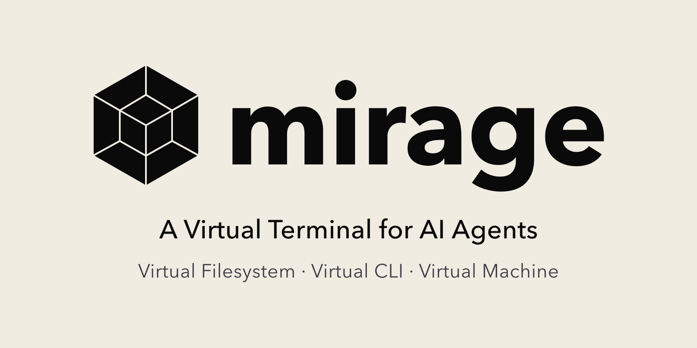
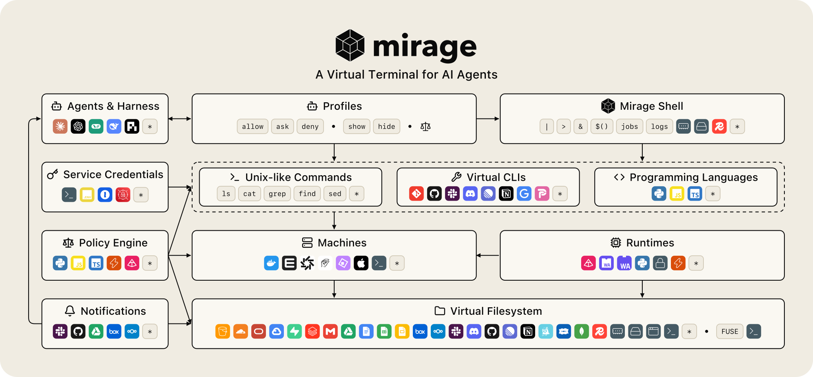

<p align="center">
  <picture>
    <source media="(prefers-color-scheme: dark)" srcset="../assets/mirage-og-dark@2x.png">
    
  </picture>
</p>

<p align="center">
  <a href="https://agentvfs.org">
    <picture>
      <source media="(max-width: 767px) and (prefers-color-scheme: dark)" srcset="../assets/agentvfs-banner-narrow-dark.svg">
      <source media="(max-width: 767px)" srcset="../assets/agentvfs-banner-narrow-light.svg">
      <source media="(prefers-color-scheme: dark)" srcset="../assets/agentvfs-banner-dark.svg">
      
    </picture>
  </a>
</p>

<p align="center">
    <a href="https://docs.mirage.strukto.ai" alt="文件">
        </a>
    <a href="https://www.strukto.ai" alt="官網">
        </a>
    <a href="https://github.com/strukto-ai/mirage/blob/main/LICENSE" alt="授權條款">
        </a>
    <a href="https://doi.org/10.5281/zenodo.23504502" alt="DOI">
        </a>
    <a href="https://discord.gg/u8BPQ65KsS" alt="Discord 社群">
        </a>
    <a href="../assets/wechat-qr-code.jpg" aria-label="微信社群">
        </a>
    <br/>
    <a href="https://docs.mirage.strukto.ai/python/quickstart" alt="Python 文件">
        </a>
    <a href="https://pypi.org/project/mirage-ai/" alt="PyPI 版本">
        </a>
    <br/>
    <a href="https://docs.mirage.strukto.ai/typescript/quickstart" alt="TypeScript 文件">
        </a>
    <a href="https://www.npmjs.com/package/@struktoai/mirage-node" alt="NPM 版本">
        </a>
</p>

<p align="center">
  <a href="../README.md"></a>
  <a href="./README.zh-CN.md"></a>
  <a href="./README.zh-TW.md"></a>
  <a href="./README.fr.md"></a>
  <a href="./README.de.md"></a>
  <a href="./README.vi.md"></a>
  <a href="./README.ko.md"></a>
</p>

AI Agent 在終端機中工作。Mirage 是一個**虛擬終端機**，它把終端機介面、資料儲存和運算機器彼此分開。Mirage 把每條命令路由到適合它的機器上，涵蓋容器、microVM、雲端沙箱和 SSH 主機等異質機器。檔案、CLI 和機器分別加入，因此它保持彈性、基礎設施成本低，並讓 Agent 以最有效率、最安全的方式工作。

<p align="center">
  <picture>
    <source media="(prefers-color-scheme: dark)" srcset="../assets/mirage-terminal-dark.svg">
    
  </picture>
</p>

- **可控。** 決定每個 Agent 能觸及什麼，包括它能看到哪些檔案、它的虛擬檔案系統和 CLI 在不向它展示的情況下使用哪些憑證，以及由哪台機器執行它的每個程式。
- **可腳本化。** 整個終端機以程式碼或設定檔定義，從虛擬檔案系統、CLI 和機器，到各項規則，例如哪些命令需要審核、Agent 能拿回多少輸出。
- **託管式。** Mirage 管理虛擬終端機的基礎設施，由所選的後端組合而成。虛擬檔案系統放在 S3、Drive、資料庫或 RAM 上，工作和歷史記錄放在 RAM、Redis 或磁碟上，整個工作區可以儲存為快照。Agent 執行的每條命令都會被記錄，並可以作為 trace 傳送到 OpenTelemetry 後端。

<p align="center">
  <picture>
    <source media="(prefers-color-scheme: dark)" srcset="../assets/mirage-arch-dark.svg">
    
  </picture>
</p>

以下是在應用程式中啟動 Mirage 的範例：

```python
ws = Workspace(
    {
        "/s3":    (S3VFS(S3Config(bucket="my-bucket")), MountMode.WRITE),
        "/slack": (SlackVFS(SlackConfig(token=slack_bot_token)), MountMode.EXEC),
        "/gmail": (GmailVFS(GmailConfig(**google_credentials)), MountMode.READ),
    },
    # 安裝 Slack CLI，依名稱執行，並像其他程式一樣出現在 `man` 和 `which` 中
    clis={"slack": (SLACK, {"token": slack_bot_token})},
    # analyst Profile 隱藏 /s3/secrets，並禁止向 Slack 發文和使用 curl
    profiles={
        "analyst": {
            "paths": {"hide": ["/s3/secrets"]},
            "commands": {"deny": ["slack send-message", "curl"]},
        },
    },
    # python 在行程內的 monty 上執行，或在 e2b 沙箱中執行
    machines={
        "py": {"provider": "in_process", "runtime": "monty"},
        "box": {"provider": "e2b", "sandbox_id": sandbox_id, "mount_type": "ssh", "captures": ["python", "python3"]},
    },
    # 路由底層運算：含 numpy 的命令列在機器上執行，其餘在 monty 上
    route_policy=lambda ctx: "box" if "numpy" in ctx.line else None,
)

# 新增一個使用 analyst Profile 的 Agent
alice = await ws.session("alice", profile="analyst")

# 一次 grep 掃遍 S3、Slack 和 Gmail，有內建搜尋的服務就用它自己的搜尋
await alice.shell("grep -rlw invoice /s3 /slack /gmail")

# 在 monty 上執行放在 Slack 裡的腳本，把報告寫入 S3
await alice.shell("python3 /slack/channels/general__C0123/2026-10-21/files/report__F0456.py > /s3/report.txt")

# monty 中沒有 numpy，所以路由策略把這一行送到 e2b
await alice.shell("python3 -c 'import numpy; print(numpy.arange(10).sum())'")
```

`alice` 在 Shell 中看到的是：

```console
$ grep -rlw invoice /s3 /slack /gmail
/s3/billing/2026-10.csv
/gmail/INBOX/2026-10-21/Invoice_1042__18f3a9c2b7d1e0f4.gmail.json
$ ls /s3
billing
report.txt
$ cat /s3/secrets/aws.txt
cat: /s3/secrets/aws.txt: No such file or directory
$ slack send-message --channel general --text "report is up"
slack: Permission denied
```

## 關於

- **統一的虛擬終端機介面，而不是 N 個 SDK 和 M 個 MCP。** 每個後端都使用同一套檔案系統語意，管線可以跨服務組合。
- **涵蓋所有資料來源的虛擬檔案系統。** S3、Google Drive、Slack、Gmail、Redis 等並排掛載在同一個根目錄下，Agent 透過統一介面，用它已經會的 unix 工具（如 `ls`、`grep`、`find` 和 `jq`）存取全部資料來源。
- **虛擬命令列工具（CLI）。** `git`、`slack` 和 `ntn` 由 Mirage 自己回應，Agent 無需安裝任何東西即可驅動這些服務，並可跨不同執行環境和機器；同一個工具還能虛擬成兩個或更多，各自使用獨立的名稱和憑證。
- **動態路由的機器。** Python、JavaScript 以及任何其他命令都可以被送到所設定的機器，行程內、沙箱或遠端，從而把運算與儲存解耦，任何一方都可以獨立更換。
- **虛擬化的 Mirage Shell。** 它把檔案系統、CLI 和機器綁定到同一條命令列上，因此管線、重新導向、變數、工作和歷史記錄在三者之間都可用。
- **輕量化設計。** 工作區，也就是虛擬終端機本身，約占 100 KB 記憶體，每個新工作階段約 10 KB，因此一個行程即可服務許多 Agent，無需為每個 Agent 準備容器或虛擬機。
- **為 Agent 設計的 Profile。** `allow`、`ask` 和 `deny` 管控命令和 CLI，`hide` 和 `show` 管控檔案和目錄，因此被隱藏的路徑不只是不可讀，而是在 Agent 看到的檔案系統中根本不存在。
- **可腳本化的策略引擎。** 策略腳本可以在任何危險操作執行前將其阻擋，同一套策略堆疊還會攔截每一次 VFS 操作和工作階段寫入，因此檔案和環境變數都不會外洩。
- **接入 VFS 與 Agent 的通知。** 外部變更會成為掛載上的事件串流，因此一則新的 Slack 回覆會表現為虛擬檔案系統中聊天檔案的變化，Agent 直接據此回應，而不必重新掃描整棵樹。

## 虛擬檔案系統

[Mirage](https://www.strukto.ai/mirage) 把一切「掛載」為一個面向 AI Agent 的統一虛擬檔案系統。每個服務並排位於同一個根目錄下，並遵循相同的 POSIX 語意。

|                      | VFS                                                                                                                                                                                                                                                                                                                                                                                                                                                                                                                                                                                                                                                                                                                                                                                                                                                                                                                                                                                                                                                                                                                                                                                                                                                                                                                                                                                                                                                                                                                                                                                                                                                                                                                                                                                                                                                                                                                                                                                                                                                                                                                                                                                                                                                                                                                                                                                                                                                                                                                                                                                                                                                                                                                                                                                                                                                                                                                                                                                                                                                                                                                                                                                          |
| -------------------- | -------------------------------------------------------------------------------------------------------------------------------------------------------------------------------------------------------------------------------------------------------------------------------------------------------------------------------------------------------------------------------------------------------------------------------------------------------------------------------------------------------------------------------------------------------------------------------------------------------------------------------------------------------------------------------------------------------------------------------------------------------------------------------------------------------------------------------------------------------------------------------------------------------------------------------------------------------------------------------------------------------------------------------------------------------------------------------------------------------------------------------------------------------------------------------------------------------------------------------------------------------------------------------------------------------------------------------------------------------------------------------------------------------------------------------------------------------------------------------------------------------------------------------------------------------------------------------------------------------------------------------------------------------------------------------------------------------------------------------------------------------------------------------------------------------------------------------------------------------------------------------------------------------------------------------------------------------------------------------------------------------------------------------------------------------------------------------------------------------------------------------------------------------------------------------------------------------------------------------------------------------------------------------------------------------------------------------------------------------------------------------------------------------------------------------------------------------------------------------------------------------------------------------------------------------------------------------------------------------------------------------------------------------------------------------------------------------------------------------------------------------------------------------------------------------------------------------------------------------------------------------------------------------------------------------------------------------------------------------------------------------------------------------------------------------------------------------------------------------------------------------------------------------------------------------------------- |
| **物件儲存**         | <a href="https://docs.mirage.strukto.ai/home/setup/s3"></a>  <a href="https://docs.mirage.strukto.ai/home/setup/r2"></a>  <a href="https://docs.mirage.strukto.ai/home/setup/gcs"></a>  <a href="https://docs.mirage.strukto.ai/home/setup/oci"></a>  <a href="https://docs.mirage.strukto.ai/home/setup/supabase"></a>  <a href="https://docs.mirage.strukto.ai/home/setup/minio"></a>  <a href="https://docs.mirage.strukto.ai/home/setup/ceph"></a>  <a href="https://docs.mirage.strukto.ai/home/setup/seaweedfs"></a>  <a href="https://docs.mirage.strukto.ai/home/setup/wasabi"></a>  <a href="https://docs.mirage.strukto.ai/home/setup/backblaze"></a>  <a href="https://docs.mirage.strukto.ai/home/setup/digitalocean"></a>  <a href="https://docs.mirage.strukto.ai/home/setup/aliyun"></a>  <a href="https://docs.mirage.strukto.ai/home/setup/tencent"></a>  <a href="https://docs.mirage.strukto.ai/home/setup/scaleway"></a>  <a href="https://docs.mirage.strukto.ai/home/setup/qingstor"></a>  <a href="https://docs.mirage.strukto.ai/home/setup/hf_buckets"></a>  <a href="https://docs.mirage.strukto.ai/home/setup/gridfs"></a> |
| **檔案與文件**       | <a href="https://docs.mirage.strukto.ai/home/setup/google"></a>  <a href="https://docs.mirage.strukto.ai/home/setup/google"></a>  <a href="https://docs.mirage.strukto.ai/home/setup/google"></a>  <a href="https://docs.mirage.strukto.ai/home/setup/google"></a>  <a href="https://docs.mirage.strukto.ai/home/setup/onedrive"></a>  <a href="https://docs.mirage.strukto.ai/home/setup/sharepoint"></a>  <a href="https://docs.mirage.strukto.ai/home/setup/box"></a>  <a href="https://docs.mirage.strukto.ai/home/setup/dropbox"></a>  <a href="https://docs.mirage.strukto.ai/home/setup/nextcloud"></a> <a href="https://docs.mirage.strukto.ai/home/setup/tidb"></a>                                                                                                                                                                                                                                                                                                                                                                                                                                                                                                                                                                                                                                                                                                                                                                                                                                                                                                                                                                                                                                                                                                            |
| **訊息與協作**       | <a href="https://docs.mirage.strukto.ai/home/setup/slack"></a>  <a href="https://docs.mirage.strukto.ai/home/setup/discord"></a>  <a href="https://docs.mirage.strukto.ai/home/setup/google"></a>  <a href="https://docs.mirage.strukto.ai/home/setup/email"></a>  <a href="https://docs.mirage.strukto.ai/home/setup/github"></a>  <a href="https://docs.mirage.strukto.ai/home/setup/linear"></a>  <a href="https://docs.mirage.strukto.ai/home/setup/notion"></a>  <a href="https://docs.mirage.strukto.ai/home/setup/trello"></a>  <a href="https://docs.mirage.strukto.ai/home/setup/gcal"></a>                                                                                                                                                                                                                                                                                                                                                                                                                                                                                                                                                                                                                                                                                                                                                                                                                                                                                                                                                                                                                                                                                                                                                                                                                                                                                                                                                                                                                                                                                                          |
| **資料庫與資料平台** | <a href="https://docs.mirage.strukto.ai/home/setup/postgres"></a>  <a href="https://docs.mirage.strukto.ai/home/setup/mongodb"></a>  <a href="https://docs.mirage.strukto.ai/home/setup/redis"></a> <a href="https://docs.mirage.strukto.ai/home/setup/redis"></a> <a href="https://docs.mirage.strukto.ai/home/setup/sql"></a> <a href="https://docs.mirage.strukto.ai/home/setup/airtable"></a>  <a href="https://docs.mirage.strukto.ai/home/setup/lancedb"></a>  <a href="https://docs.mirage.strukto.ai/home/setup/qdrant"></a>  <a href="https://docs.mirage.strukto.ai/home/setup/chroma"></a>  <a href="https://docs.mirage.strukto.ai/home/setup/mem0"></a>  <a href="https://docs.mirage.strukto.ai/home/setup/hf_datasets"></a>  <a href="https://docs.mirage.strukto.ai/home/setup/hf_models"></a>  <a href="https://docs.mirage.strukto.ai/home/setup/hf_spaces"></a>  <a href="https://docs.mirage.strukto.ai/home/setup/databricks"></a>  <a href="https://docs.mirage.strukto.ai/home/setup/dify"></a>                                                                                                                                                                                                                                                                                                                                                                                                                            |
| **可觀測性**         | <a href="https://docs.mirage.strukto.ai/home/setup/langfuse"></a>  <a href="https://docs.mirage.strukto.ai/home/setup/jaeger"></a> <a href="https://docs.mirage.strukto.ai/home/setup/wandb"></a>                                                                                                                                                                                                                                                                                                                                                                                                                                                                                                                                                                                                                                                                                                                                                                                                                                                                                                                                                                                                                                                                                                                                                                                                                                                                                                                                                                                                                                                                                                                                                                                                                                                                                                                                                                                                                                                                                                                                                                                                                                                                                                                                                                                                                                                                                                                                                                                                                                                                                                                                                                                                                                                   |
| **本機與遠端**       | <a href="https://docs.mirage.strukto.ai/home/setup/ram"></a>  <a href="https://docs.mirage.strukto.ai/home/setup/disk"></a>  <a href="https://docs.mirage.strukto.ai/home/setup/opfs"></a>  <a href="https://docs.mirage.strukto.ai/home/setup/ssh"></a>                                                                                                                                                                                                                                                                                                                                                                                                                                                                                                                                                                                                                                                                                                                                                                                                                                                                                                                                                                                                                                                                                                                                                                                                                                                                                                                                                                                                                                                                                                                                                                                                                                                                                                                                                                                                                                                                                                                                                                                                                                                                                                                                                                                                                                                                                                                                                                                                                                                       |

Agent 可以透過 Python 和 TypeScript SDK、`mirage` CLI，或基於 FUSE 和 FSKit 的真實掛載點存取它，再用已經熟悉的 unix 工具操作，如 `ls`、`grep`、`find` 和 `jq`。

## 虛擬命令列工具

這些命令列工具是虛擬化的：[Mirage](https://www.strukto.ai/mirage) 自己回應 `git`、`slack` 或 `ntn`，因此 Agent 無需在機器上安裝對應程式即可驅動服務。每個工具都模仿真實工具，熟悉該 CLI 的 Agent 無需學習新東西。由於它們是虛擬的，同一個工具可以用不同名稱安裝多次，各自使用獨立的憑證，因此每個 Agent 拿到的恰好是分配給它的帳號。

|                | CLI                                                                                                                                                                                                                                                                                                                                                                                                                                                                                                                                                                                                                                                                                                                                                                                                                                                                                                                                                                                                                                                                                                                                                                                                                                                                                                                                                                                                                                                                                                                                                                                                                                                                        |
| -------------- | -------------------------------------------------------------------------------------------------------------------------------------------------------------------------------------------------------------------------------------------------------------------------------------------------------------------------------------------------------------------------------------------------------------------------------------------------------------------------------------------------------------------------------------------------------------------------------------------------------------------------------------------------------------------------------------------------------------------------------------------------------------------------------------------------------------------------------------------------------------------------------------------------------------------------------------------------------------------------------------------------------------------------------------------------------------------------------------------------------------------------------------------------------------------------------------------------------------------------------------------------------------------------------------------------------------------------------------------------------------------------------------------------------------------------------------------------------------------------------------------------------------------------------------------------------------------------------------------------------------------------------------------------------------------------- |
| **程式碼**     | <a href="https://docs.mirage.strukto.ai/home/setup/cli/git"></a>  <a href="https://docs.mirage.strukto.ai/home/setup/cli/gh"></a>                                                                                                                                                                                                                                                                                                                                                                                                                                                                                                                                                                                                                                                                                                                                                                                                                                                                                                                                                                                                                                                                                                                                                                                                                                                                                                                                       |
| **溝通**       | <a href="https://docs.mirage.strukto.ai/home/setup/cli/slack"></a>  <a href="https://docs.mirage.strukto.ai/home/setup/cli/discord"></a>  <a href="https://docs.mirage.strukto.ai/home/setup/cli/himalaya"></a>                                                                                                                                                                                                                                                                                                                                                                                                                                                                                                                                                                                                                                                                                                                                                                                                                                                                                                                                                                                                                                                                                                                                       |
| **工作與資料** | <a href="https://docs.mirage.strukto.ai/home/setup/cli/linear"></a>  <a href="https://docs.mirage.strukto.ai/home/setup/cli/ntn"></a> <a href="https://docs.mirage.strukto.ai/home/setup/cli/trello"></a> <a href="https://docs.mirage.strukto.ai/home/setup/cli/airtable"></a>  <a href="https://docs.mirage.strukto.ai/home/setup/cli/gws"></a>  <a href="https://docs.mirage.strukto.ai/home/setup/cli/hf"></a> <a href="https://docs.mirage.strukto.ai/home/setup/cli/office"></a> <a href="https://docs.mirage.strukto.ai/home/setup/cli/pdftotext"></a> <a href="https://docs.mirage.strukto.ai/home/setup/cli/pdfinfo"></a> |

## 虛擬機器

機器以同樣的方式虛擬化，而且不只針對程式語言。命令列上的任何命令都可以送到所設定的機器，例如 Python 可以藉助 [Monty](https://pydantic.dev/articles/pydantic-monty) 在行程內執行，而另一個命令（比如 `kubectl`）則透過 SSH 在遠端機器上執行。某一行由哪台機器處理，可以交給[腳本化的機器路由器](https://docs.mirage.strukto.ai/home/policy/route-machine)決定。

|                | 機器                                                                                                                                                                                                                                                                                                                                                                                                                                                                                                                                                                                                                                                                                                                                                                                                                                                                                                                                                                                                                                                                                                                                                                                                                                                                                                                                                                                                                                                                                                                                                                                                                                                                                                                                                                                                                                                        |
| -------------- | ----------------------------------------------------------------------------------------------------------------------------------------------------------------------------------------------------------------------------------------------------------------------------------------------------------------------------------------------------------------------------------------------------------------------------------------------------------------------------------------------------------------------------------------------------------------------------------------------------------------------------------------------------------------------------------------------------------------------------------------------------------------------------------------------------------------------------------------------------------------------------------------------------------------------------------------------------------------------------------------------------------------------------------------------------------------------------------------------------------------------------------------------------------------------------------------------------------------------------------------------------------------------------------------------------------------------------------------------------------------------------------------------------------------------------------------------------------------------------------------------------------------------------------------------------------------------------------------------------------------------------------------------------------------------------------------------------------------------------------------------------------------------------------------------------------------------------------------------------------- |
| **Python**     | <a href="https://docs.mirage.strukto.ai/home/setup/runtime/monty"></a>  <a href="https://docs.mirage.strukto.ai/home/setup/runtime/wasi"></a>  <a href="https://docs.mirage.strukto.ai/home/setup/runtime/pyodide"></a>  <a href="https://docs.mirage.strukto.ai/home/setup/machine/host"></a>  <a href="https://docs.mirage.strukto.ai/home/setup/machine/host"></a>                                                                                                                                                                                                                                                                                                                                                                                                                                                                                                                                                                                                                                                                                                                                                                                                                                                                                                                      |
| **JavaScript** | <a href="https://docs.mirage.strukto.ai/home/setup/runtime/quickjs"></a> <a href="https://docs.mirage.strukto.ai/home/setup/runtime/quickjs"></a> <a href="https://docs.mirage.strukto.ai/home/setup/runtime/quickjs"></a>                                                                                                                                                                                                                                                                                                                                                                                                                                                                                                                                                                                                                                                                                                                                                                                                                                                                                                                                                                                                                                                                                                                                                                                                                                                            |
| **機器**       | <a href="https://docs.mirage.strukto.ai/home/setup/machine/docker"></a> <a href="https://docs.mirage.strukto.ai/home/setup/machine/kubernetes"></a>  <a href="https://docs.mirage.strukto.ai/home/setup/machine/e2b"></a>  <a href="https://docs.mirage.strukto.ai/home/setup/machine/daytona"></a> <a href="https://docs.mirage.strukto.ai/home/setup/machine/cloudflare_container"></a> <a href="https://docs.mirage.strukto.ai/home/setup/machine/boxd"></a>  <a href="https://docs.mirage.strukto.ai/home/setup/machine/smolvm"></a> <a href="https://docs.mirage.strukto.ai/home/setup/machine/microsandbox"></a> <a href="https://docs.mirage.strukto.ai/home/setup/machine/apple_container"></a>  <a href="https://docs.mirage.strukto.ai/home/setup/machine/ssh"></a> |

## 安全

Profile 決定一個工作階段可以執行什麼、可以看到什麼。命令由可自訂的 `allow`、`ask` 和 `deny` 規則管控，路徑由 `hide` 和 `show` 管控，因此被隱藏的檔案不只是不可讀，而是在 Agent 看到的檔案系統中根本不存在。對於這些規則無法表達的情況，Profile 可以指定一個策略腳本，它在每條命令的關口執行，自行答覆 allow、deny 或 ask；但和所有規則一樣，它只能收緊權限，不能授予權限。此外，宿主程式還可以在[策略引擎](https://docs.mirage.strukto.ai/home/policy/policies)上註冊自己的策略，這是一個有序的策略堆疊，工作區會在每條命令、每次 VFS 操作和工作階段寫入時查詢它。參見[策略文件](https://docs.mirage.strukto.ai/home/policy/overview)。

## 服務憑證

服務憑證可以對接密鑰已經存放的位置，包括 AWS Secrets Manager、1Password 和 dotenv，因此 Mirage 中的環境變數可以直接解析為其中某處保存的憑證。

|          | 來源                                                                                                                                                                                                                                                                                                                                                                                                                                       |
| -------- | ------------------------------------------------------------------------------------------------------------------------------------------------------------------------------------------------------------------------------------------------------------------------------------------------------------------------------------------------------------------------------------------------------------------------------------------ |
| **內建** | <a href="https://docs.mirage.strukto.ai/home/service-credentials#sources"></a> <a href="https://docs.mirage.strukto.ai/home/service-credentials#sources"></a>                                                                    |
| **自訂** | <a href="https://docs.mirage.strukto.ai/home/service-credentials/1password"></a> <a href="https://docs.mirage.strukto.ai/home/service-credentials/aws-secrets-manager"></a> |

## 安裝

- **Python** ≥ 3.12，用於 `mirage-ai` 套件和 `mirage` CLI
- **Node.js** Node 22 需 22.20+，Node 24 需 24.12+，或 25+，用於 TypeScript SDK

### Python

```bash
uv add mirage-ai              # 安裝 `mirage` 函式庫和 `mirage` CLI 執行檔
uv add 'mirage-ai[openai]'    # OpenAI Agents 介接器；每個 agent 框架是一個 extra
uv add 'mirage-ai[monty]'     # Monty：範例所用的行程內 Python 執行環境
```

### TypeScript

```bash
npm install @struktoai/mirage-node      # Node.js 伺服器和 CLI
npm install @struktoai/mirage-browser   # 瀏覽器 / edge 執行環境
```

兩個執行環境套件都會自動引入 `@struktoai/mirage-core`。

### CLI

```bash
npm install -g @struktoai/mirage-cli
# 或
uvx --from mirage-ai mirage
# 或
npx @struktoai/mirage-cli
```

快速上手請參閱 [Python](https://docs.mirage.strukto.ai/python/quickstart)、[TypeScript](https://docs.mirage.strukto.ai/typescript/quickstart) 和 [CLI](https://docs.mirage.strukto.ai/home/access/cli) 的快速入門指南。

## 可腳本化的策略

對於規則無法表達的情況，Profile 可以指定策略腳本。腳本的 `pre_command` 接收命令，可以開啟命令中指定的檔案，並回傳 deny、ask 或 `None`。下面這個腳本停用 `rm`，以及程式碼會刪除檔案的 Python 腳本：

```python
def deletes(path):
    try:
        code = open(path).read()
    except OSError:
        return False
    return any(call in code for call in ("os.remove", "os.unlink", "shutil.rmtree"))


def pre_command(ctx):
    if ctx["command"] == "rm" or (
        ctx["command"].startswith("python") and any(deletes(p) for p in ctx["paths"])
    ):
        return {"kind": "deny", "reason": "deleting files is disabled"}
```

在 Profile 中註冊它，這裡讓它在每條命令之前於 Monty 上執行：

```python
ws = Workspace(
    {"/s3": (S3VFS(S3Config(bucket="my-bucket")), MountMode.WRITE)},
    profiles={
        "analyst": {
            "policy": {
                "pre_command": [{"script": ScriptSource(Path("guard.py").read_text()), "runtime": "monty"}],
            },
        },
    },
    profile="analyst",
)
```

```console
$ cat /s3/clean.py
import os
os.remove("/s3/report.txt")
$ rm /s3/report.txt
rm: Permission denied
$ python3 /s3/clean.py
python3: Permission denied
```

腳本還能在哪些其他階段作答，參見[策略腳本](https://docs.mirage.strukto.ai/home/policy/scripts)。

## 範例

- **[In-Process Terminal](https://docs.mirage.strukto.ai/home/examples/in-process-terminal).** 在你的應用程式中為 Agent 提供終端機，即使在 FastAPI 或 Express 伺服器裡也行，無需固定的機器或沙箱。
- **[Multi-machine Terminal](https://docs.mirage.strukto.ai/home/examples/multi-machine-terminal).** 橫跨不同機器的統一虛擬終端機，把每個任務放到適合它的機器上執行，讓 AI Agent 更有效率、更低成本地完成任務。
- **[Secured Terminal](https://docs.mirage.strukto.ai/home/examples/secured-terminal).** 在一份工作區設定中決定 Agent 能看到哪些檔案、能執行哪些命令和 CLI，以及它的工具使用哪些憑證。
- **[Infra-agnostic Terminal](https://docs.mirage.strukto.ai/home/examples/infra-agnostic-terminal).** 不綁定任何固定基礎設施的虛擬終端機，把檔案、工作階段和命令日誌放在既有的後端上。

## 貢獻者

感謝所有為 Mirage 做出貢獻的人。

<a href="https://github.com/strukto-ai/mirage/graphs/contributors">
  
</a>
